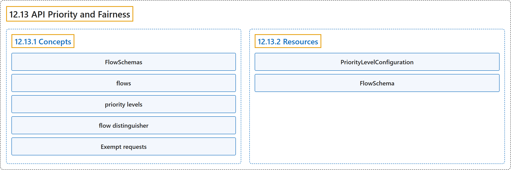

# 12.13 API Priority and Fairness

## Classification

## Glossary

| Term | Definition | 中文翻译 | Source |
|---|---|---|---|
| **12.13 API Priority and Fairness** API 优先级与公平性 | "**The API Priority and Fairness feature** (APF) is **an alternative** that **improves upon aforementioned max-inflight limitations**." | **API 优先级与公平性功能**（APF）是**一种替代方案**，**改进了前面提到的最大并发请求限制**。 | [The Kubernetes Authors, n.d., "API Priority and Fairness", para. 2](https://kubernetes.io/docs/concepts/cluster-administration/flow-control/#:~:text=The%20API%20Priority%20and%20Fairness%20feature%20%28APF%29) |
| **12.13.1 Concepts** 概念 | "There are **several distinct features** involved in **the API Priority and Fairness feature**." | 有**几个不同的特性**参与到 **API 优先级与公平性功能**中。 | [The Kubernetes Authors, n.d., "Concepts", para. 1](https://kubernetes.io/docs/concepts/cluster-administration/flow-control/#:~:text=There%20are%20several%20distinct%20features%20involved%20in) |
| **FlowSchemas** FlowSchema | "Incoming requests are **classified by attributes of the request** using ***FlowSchemas***, and **assigned to priority levels**." | 传入的请求**按请求属性分类**，用的是 **FlowSchema**，并**分配到优先级**。 | [The Kubernetes Authors, n.d., "Concepts", para. 1](https://kubernetes.io/docs/concepts/cluster-administration/flow-control/#:~:text=Incoming%20requests%20are%20classified%20by%20attributes%20of) |
| **flows** 流 | (context) "Within a priority level, **a fair-queuing algorithm** prevents requests from **different *flows*** from **starving each other**" | （语境）在一个优先级内，**公平排队算法**防止来自**不同的流**的请求**相互饿死** | [The Kubernetes Authors, n.d., "Concepts", para. 1](https://kubernetes.io/docs/concepts/cluster-administration/flow-control/#:~:text=Within%20a%20priority%20level%2C%20a%20fair-queuing%20algorithm) |
| **priority levels** 优先级 | (context) "**the sum** is **divided up** among **a configurable set of *priority levels***." | （语境）**总和**被**分配**到**一组可配置的优先级**之间。 | [The Kubernetes Authors, n.d., "Priority Levels", para. 1](https://kubernetes.io/docs/concepts/cluster-administration/flow-control/#:~:text=the%20sum%20is%20divided%20up%20among%20a) |
| **flow distinguisher** 流区分符 | "Each request is **assigned to a *flow***, identified by the name of the matching FlowSchema plus a ***flow distinguisher*** — which is **either the requesting user, the target resource's namespace, or nothing**" | 每个请求被**分配到一个流**，由匹配的 FlowSchema 名称加上一个**流区分符**来标识，流区分符**要么是请求用户，要么是目标资源的命名空间，要么什么都没有** | [The Kubernetes Authors, n.d., "Queuing", para. 1](https://kubernetes.io/docs/concepts/cluster-administration/flow-control/#:~:text=Each%20request%20is%20assigned%20to%20a%20%2Aflow%2A%2C) |
| **Exempt requests** 豁免请求 | "Some requests are considered **sufficiently important** that they are **not subject to any of the limitations imposed by this feature**." | 有些请求被视为**足够重要**，**不受这项功能施加的任何限制**。 | [The Kubernetes Authors, n.d., "Exempt requests", para. 1](https://kubernetes.io/docs/concepts/cluster-administration/flow-control/#:~:text=Some%20requests%20are%20considered%20sufficiently%20important%20that) |
| **12.13.2 Resources** 资源 | "**The flow control API** involves **two kinds of resources**." | **流控 API** 涉及**两种资源**。 | [The Kubernetes Authors, n.d., "Resources", para. 1](https://kubernetes.io/docs/concepts/cluster-administration/flow-control/#:~:text=The%20flow%20control%20API%20involves%20two%20kinds) |
| **PriorityLevelConfiguration** PriorityLevelConfiguration | "**A PriorityLevelConfiguration** represents **a single priority level**." | **PriorityLevelConfiguration** 代表**单个优先级**。 | [The Kubernetes Authors, n.d., "PriorityLevelConfiguration", para. 1](https://kubernetes.io/docs/concepts/cluster-administration/flow-control/#:~:text=A%20PriorityLevelConfiguration%20represents%20a%20single%20priority%20level.) |
| **FlowSchema** FlowSchema | "A FlowSchema **matches some inbound requests** and **assigns them to a priority level**." | FlowSchema **匹配部分入站请求**，并**把它们分配到某个优先级**。 | [The Kubernetes Authors, n.d., "FlowSchema", para. 1](https://kubernetes.io/docs/concepts/cluster-administration/flow-control/#:~:text=A%20FlowSchema%20matches%20some%20inbound%20requests%20and) |

## References

The Kubernetes Authors. (n.d.). *API Priority and Fairness*. Kubernetes Documentation. Retrieved October 31, 2026, from <https://kubernetes.io/docs/concepts/cluster-administration/flow-control/>
