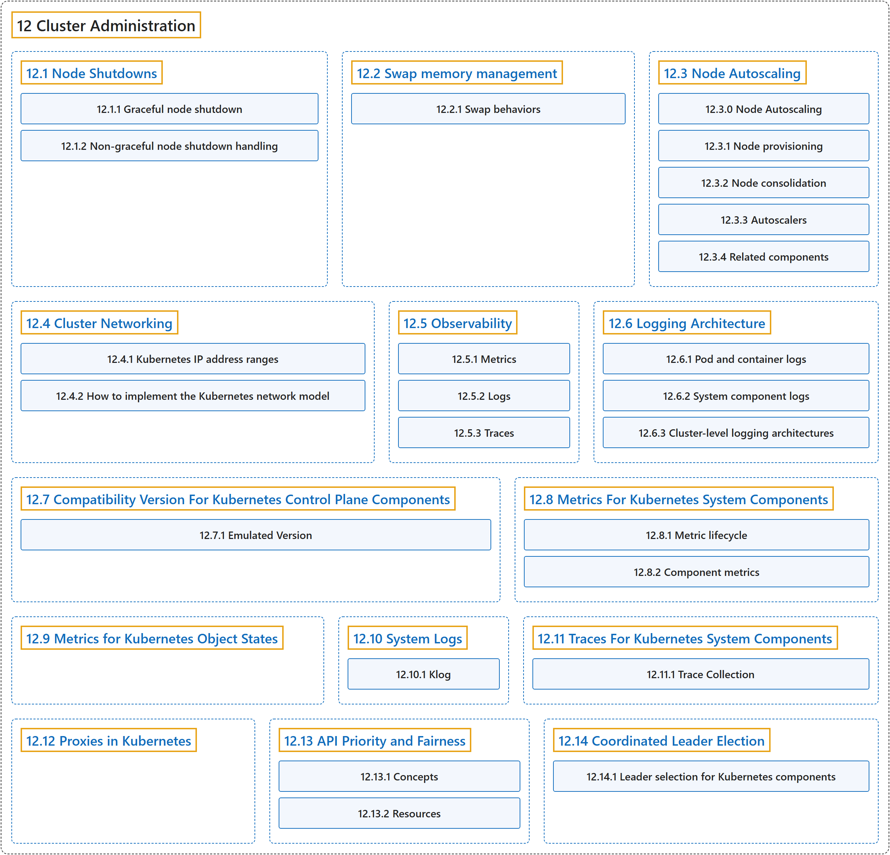

# 12 Cluster Administration

## Classification

## Glossary

| Term | Definition | 中文翻译 | Source |
|---|---|---|---|
| **12 Cluster Administration** 集群管理 | "**Lower-level detail** relevant to **creating or administering a Kubernetes cluster**." | **底层细节**，关于**创建或管理 Kubernetes 集群**。 | [The Kubernetes Authors, n.d.-b, "Cluster Administration", para. 1](https://kubernetes.io/docs/concepts/cluster-administration/#:~:text=Lower-level%20detail%20relevant%20to%20creating%20or%20administering) |
| **[12.1 Node Shutdowns](node-shutdown.md)** 节点关闭 | (context) "In a Kubernetes cluster, **a node** can be **shut down in a planned graceful way** or **unexpectedly** because of reasons such as a power outage or something else external." | （语境）在 Kubernetes 集群中，**节点**可能**按计划体面地关闭**，也可能**意外关闭**，原因可能是断电或其他外部事件。 | [The Kubernetes Authors, n.d.-j, "Node Shutdowns", para. 1](https://kubernetes.io/docs/concepts/cluster-administration/node-shutdown/#:~:text=In%20a%20Kubernetes%20cluster%2C%20a%20%5Bnode%5D%28https%3A%2F%2Fkubernetes.io%2Fdocs%2Fconcepts%2Farchitecture%2Fnodes%2F%29%20can) |
| **[12.2 Swap memory management](swap-memory-management.md)** 交换内存管理 | (context) "Kubernetes can be configured to **use swap memory on a node**, allowing the kernel to **free up physical memory** by **swapping out pages to backing storage**." | （语境）Kubernetes 可以配置为**在节点上使用交换内存**，让内核**释放物理内存**，方法是**把内存页换出到后备存储**。 | [The Kubernetes Authors, n.d.-m, "Swap memory management", para. 1](https://kubernetes.io/docs/concepts/cluster-administration/swap-memory-management/#:~:text=Kubernetes%20can%20be%20configured%20to%20use%20swap) |
| **[12.3 Node Autoscaling](node-autoscaling.md)** 节点自动扩缩 | "**Automatically provision and consolidate the Nodes** in your cluster to **adapt to demand** and **optimize cost**." | **自动供应和合并集群中的节点**，以**适应需求**并**优化成本**。 | [The Kubernetes Authors, n.d.-i, "Node Autoscaling", para. 1](https://kubernetes.io/docs/concepts/cluster-administration/node-autoscaling/#:~:text=Automatically%20provision%20and%20consolidate%20the%20Nodes%20in) |
| **[12.4 Cluster Networking](networking.md)** 集群网络 | (context) "**Networking** is **a central part of Kubernetes**, but it can be **challenging to understand** exactly how it is expected to work." | （语境）**网络**是 **Kubernetes 的核心部分**，但它究竟应当如何工作却可能**难以准确理解**。 | [The Kubernetes Authors, n.d.-c, "Cluster Networking", para. 1](https://kubernetes.io/docs/concepts/cluster-administration/networking/#:~:text=Networking%20is%20a%20central%20part%20of%20Kubernetes%2C) |
| **[12.5 Observability](observability.md)** 可观测性 | "In Kubernetes, **observability** is the process of **collecting and analyzing metrics, logs, and traces**—often referred to as **the three pillars of observability**—in order to obtain a better understanding of **the internal state, performance, and health of the cluster**." | 在 Kubernetes 中，**可观测性**是**收集和分析指标、日志和追踪**的过程（这三者常被称为**可观测性的三大支柱**），以便更好地了解**集群的内部状态、性能和健康状况**。 | [The Kubernetes Authors, n.d.-k, "Observability", para. 2](https://kubernetes.io/docs/concepts/cluster-administration/observability/#:~:text=In%20Kubernetes%2C%20observability%20is%20the%20process%20of) |
| **[12.6 Logging Architecture](logging.md)** 日志架构 | (context) "**Application logs** can help you **understand what is happening inside your application**." | （语境）**应用日志**可以帮助你**了解应用内部正在发生什么**。 | [The Kubernetes Authors, n.d.-f, "Logging Architecture", para. 1](https://kubernetes.io/docs/concepts/cluster-administration/logging/#:~:text=Application%20logs%20can%20help%20you%20understand%20what) |
| **[12.7 Compatibility Version For Kubernetes Control Plane Components](compatibility-version.md)** Kubernetes 控制平面组件的兼容版本 | (context) "Since release v1.32, we introduced **configurable version compatibility and emulation options** to **Kubernetes control plane components** to **make upgrades safer** by providing more control and increasing the granularity of steps available to cluster administrators." | （语境）自 v1.32 版本起，我们引入了**可配置的版本兼容和模拟选项**，用于 **Kubernetes 控制平面组件**，以**让升级更安全**：提供更多控制，细化集群管理员可用的步骤。 | [The Kubernetes Authors, n.d.-d, "Compatibility Version For Kubernetes Control Plane Components", para. 1](https://kubernetes.io/docs/concepts/cluster-administration/compatibility-version/#:~:text=Since%20release%20v1.32%2C%20we%20introduced%20configurable%20version) |
| **[12.8 Metrics For Kubernetes System Components](system-metrics.md)** Kubernetes 系统组件的指标 | "**System component metrics** can give **a better look into what is happening inside them**." | **系统组件指标**可以让你**更好地了解组件内部正在发生什么**。 | [The Kubernetes Authors, n.d.-h, "Metrics For Kubernetes System Components", para. 1](https://kubernetes.io/docs/concepts/cluster-administration/system-metrics/#:~:text=System%20component%20metrics%20can%20give%20a%20better) |
| **[12.9 Metrics for Kubernetes Object States](kube-state-metrics.md)** Kubernetes 对象状态的指标 | (context) "kube-state-metrics, **an add-on agent** to **generate and expose cluster-level metrics**." | （语境）kube-state-metrics，**一个附加代理**，用来**生成并暴露集群级指标**。 | [The Kubernetes Authors, n.d.-g, "Metrics for Kubernetes Object States", para. 1](https://kubernetes.io/docs/concepts/cluster-administration/kube-state-metrics/#:~:text=kube-state-metrics%2C%20an%20add-on%20agent%20to%20generate%20and) |
| **[12.10 System Logs](system-logs.md)** 系统日志 | "System component logs **record events happening in cluster**, which can be **very useful for debugging**." | 系统组件日志**记录集群中发生的事件**，对**调试非常有用**。 | [The Kubernetes Authors, n.d.-n, "System Logs", para. 1](https://kubernetes.io/docs/concepts/cluster-administration/system-logs/#:~:text=System%20component%20logs%20record%20events%20happening%20in) |
| **[12.11 Traces For Kubernetes System Components](system-traces.md)** Kubernetes 系统组件的追踪 | "**System component traces** record **the latency of and relationships between operations** in the cluster." | **系统组件追踪**记录**集群中各操作的延迟及其相互关系**。 | [The Kubernetes Authors, n.d.-o, "Traces For Kubernetes System Components", para. 1](https://kubernetes.io/docs/concepts/cluster-administration/system-traces/#:~:text=System%20component%20traces%20record%20the%20latency%20of) |
| **[12.12 Proxies in Kubernetes](proxies.md)** Kubernetes 中的代理 | (context) "There are **several different proxies** you may encounter **when using Kubernetes**:" | （语境）有**几种不同的代理**，你可能在**使用 Kubernetes 时**遇到： | [The Kubernetes Authors, n.d.-l, "Proxies", para. 1](https://kubernetes.io/docs/concepts/cluster-administration/proxies/#:~:text=There%20are%20several%20different%20proxies%20you%20may) |
| **[12.13 API Priority and Fairness](flow-control.md)** API 优先级与公平性 | "**The API Priority and Fairness feature** (APF) is **an alternative** that **improves upon aforementioned max-inflight limitations**." | **API 优先级与公平性功能**（APF）是**一种替代方案**，**改进了前面提到的最大并发请求限制**。 | [The Kubernetes Authors, n.d.-a, "API Priority and Fairness", para. 2](https://kubernetes.io/docs/concepts/cluster-administration/flow-control/#:~:text=The%20API%20Priority%20and%20Fairness%20feature%20%28APF%29) |
| **[12.14 Coordinated Leader Election](coordinated-leader-election.md)** 协调式领导者选举 | "Kubernetes 1.37 includes a beta feature that **allows control plane components** to **deterministically select a leader** via ***coordinated leader election***." | Kubernetes 1.37 包含一项 beta 功能，**允许控制平面组件**以**确定性方式选出领导者**，方法是**协调式领导者选举**。 | [The Kubernetes Authors, n.d.-e, "Coordinated Leader Election", para. 3](https://kubernetes.io/docs/concepts/cluster-administration/coordinated-leader-election/#:~:text=Kubernetes%201.37%20includes%20a%20beta%20feature%20that) |

## References

The Kubernetes Authors. (n.d.-a). *API Priority and Fairness*. Kubernetes Documentation. Retrieved October 31, 2026, from <https://kubernetes.io/docs/concepts/cluster-administration/flow-control/>

The Kubernetes Authors. (n.d.-b). *Cluster Administration*. Kubernetes Documentation. Retrieved October 31, 2026, from <https://kubernetes.io/docs/concepts/cluster-administration/>

The Kubernetes Authors. (n.d.-c). *Cluster Networking*. Kubernetes Documentation. Retrieved October 31, 2026, from <https://kubernetes.io/docs/concepts/cluster-administration/networking/>

The Kubernetes Authors. (n.d.-d). *Compatibility Version For Kubernetes Control Plane Components*. Kubernetes Documentation. Retrieved October 31, 2026, from <https://kubernetes.io/docs/concepts/cluster-administration/compatibility-version/>

The Kubernetes Authors. (n.d.-e). *Coordinated Leader Election*. Kubernetes Documentation. Retrieved October 31, 2026, from <https://kubernetes.io/docs/concepts/cluster-administration/coordinated-leader-election/>

The Kubernetes Authors. (n.d.-f). *Logging Architecture*. Kubernetes Documentation. Retrieved October 31, 2026, from <https://kubernetes.io/docs/concepts/cluster-administration/logging/>

The Kubernetes Authors. (n.d.-g). *Metrics for Kubernetes Object States*. Kubernetes Documentation. Retrieved October 31, 2026, from <https://kubernetes.io/docs/concepts/cluster-administration/kube-state-metrics/>

The Kubernetes Authors. (n.d.-h). *Metrics For Kubernetes System Components*. Kubernetes Documentation. Retrieved October 31, 2026, from <https://kubernetes.io/docs/concepts/cluster-administration/system-metrics/>

The Kubernetes Authors. (n.d.-i). *Node Autoscaling*. Kubernetes Documentation. Retrieved October 31, 2026, from <https://kubernetes.io/docs/concepts/cluster-administration/node-autoscaling/>

The Kubernetes Authors. (n.d.-j). *Node Shutdowns*. Kubernetes Documentation. Retrieved October 31, 2026, from <https://kubernetes.io/docs/concepts/cluster-administration/node-shutdown/>

The Kubernetes Authors. (n.d.-k). *Observability*. Kubernetes Documentation. Retrieved October 31, 2026, from <https://kubernetes.io/docs/concepts/cluster-administration/observability/>

The Kubernetes Authors. (n.d.-l). *Proxies in Kubernetes*. Kubernetes Documentation. Retrieved October 31, 2026, from <https://kubernetes.io/docs/concepts/cluster-administration/proxies/>

The Kubernetes Authors. (n.d.-m). *Swap memory management*. Kubernetes Documentation. Retrieved October 31, 2026, from <https://kubernetes.io/docs/concepts/cluster-administration/swap-memory-management/>

The Kubernetes Authors. (n.d.-n). *System Logs*. Kubernetes Documentation. Retrieved October 31, 2026, from <https://kubernetes.io/docs/concepts/cluster-administration/system-logs/>

The Kubernetes Authors. (n.d.-o). *Traces For Kubernetes System Components*. Kubernetes Documentation. Retrieved October 31, 2026, from <https://kubernetes.io/docs/concepts/cluster-administration/system-traces/>
