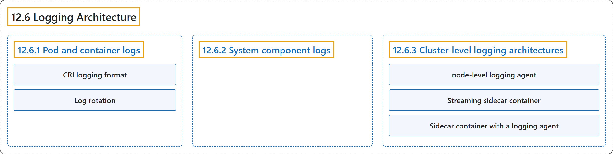

# 12.6 Logging Architecture

## Classification

## Glossary

| Term | Definition | 中文翻译 | Source |
|---|---|---|---|
| **12.6 Logging Architecture** 日志架构 | (context) "Application logs can help you **understand what is happening inside your application**." | （语境）应用日志可以帮助你**了解应用内部正在发生什么**。 | [The Kubernetes Authors, n.d., "Logging Architecture", para. 1](https://kubernetes.io/docs/concepts/cluster-administration/logging/#:~:text=Application%20logs%20can%20help%20you%20understand%20what) |
| **12.6.1 Pod and container logs** Pod 与容器日志 | "Kubernetes **captures logs from each container in a running Pod**." | Kubernetes **捕获运行中 Pod 里每个容器的日志**。 | [The Kubernetes Authors, n.d., "Pod and container logs", para. 1](https://kubernetes.io/docs/concepts/cluster-administration/logging/#:~:text=Kubernetes%20captures%20logs%20from%20each%20container%20in) |
| **CRI logging format** CRI 日志格式 | (context) "Different container runtimes implement this in different ways; however, **the integration with the kubelet is standardized as the *CRI logging format***." | （语境）不同的容器运行时以不同方式实现这一点；不过，**与 kubelet 的集成都被标准化为 *CRI 日志格式***。 | [The Kubernetes Authors, n.d., "How nodes handle container logs", para. 1](https://kubernetes.io/docs/concepts/cluster-administration/logging/#:~:text=Different%20container%20runtimes%20implement%20this%20in%20different) |
| **Log rotation** 日志轮转 | "The kubelet is **responsible for rotating container logs and managing the logging directory structure**." | kubelet **负责轮转容器日志并管理日志目录结构**。 | [The Kubernetes Authors, n.d., "Log rotation", para. 1](https://kubernetes.io/docs/concepts/cluster-administration/logging/#:~:text=The%20kubelet%20is%20responsible%20for%20rotating%20container) |
| **12.6.2 System component logs** 系统组件日志 | "There are **two types of system components: those that typically run in a container, and those components directly involved in running containers**." | 系统组件**有两类：通常运行在容器中的组件，以及直接参与运行容器的组件**。 | [The Kubernetes Authors, n.d., "System component logs", para. 1](https://kubernetes.io/docs/concepts/cluster-administration/logging/#:~:text=There%20are%20two%20types%20of%20system%20components%3A) |
| **12.6.3 Cluster-level logging architectures** 集群级日志架构 | "While Kubernetes does not provide a native solution for cluster-level logging, **there are several common approaches you can consider**." | 虽然 Kubernetes 没有为集群级日志提供原生方案，**但有几种常见做法可供考虑**。 | [The Kubernetes Authors, n.d., "Cluster-level logging architectures", para. 1](https://kubernetes.io/docs/concepts/cluster-administration/logging/#:~:text=While%20Kubernetes%20does%20not%20provide%20a%20native) |
| **node-level logging agent** 节点级日志代理 | "You can implement cluster-level logging by **including a *node-level logging agent* on each node**." | 你可以**在每个节点上部署一个*节点级日志代理***来实现集群级日志。 | [The Kubernetes Authors, n.d., "Using a node logging agent", para. 1](https://kubernetes.io/docs/concepts/cluster-administration/logging/#:~:text=You%20can%20implement%20cluster-level%20logging%20by%20including) |
| **Streaming sidecar container** 流式边车容器 | (context) "By having your sidecar containers write to their own `stdout` and `stderr` streams, **you can take advantage of the kubelet and the logging agent that already run on each node**." | （语境）让边车容器写入它们自己的 `stdout` 和 `stderr` 流，**你就可以利用每个节点上已在运行的 kubelet 和日志代理**。 | [The Kubernetes Authors, n.d., "Streaming sidecar container", para. 1](https://kubernetes.io/docs/concepts/cluster-administration/logging/#:~:text=By%20having%20your%20sidecar%20containers%20write%20to) |
| **Sidecar container with a logging agent** 带日志代理的边车容器 | (context) "you can **create a sidecar container with a separate logging agent that you have configured specifically to run with your application**." | （语境）你可以**创建一个带有独立日志代理的边车容器，并专门配置它与你的应用一起运行**。 | [The Kubernetes Authors, n.d., "Sidecar container with a logging agent", para. 1](https://kubernetes.io/docs/concepts/cluster-administration/logging/#:~:text=you%20can%20create%20a%20sidecar%20container%20with) |

## References

The Kubernetes Authors. (n.d.). *Logging Architecture*. Kubernetes Documentation. Retrieved October 31, 2026, from <https://kubernetes.io/docs/concepts/cluster-administration/logging/>
