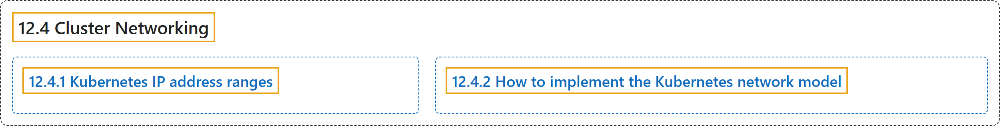

# 12.4 Cluster Networking

## Classification

## Glossary

| Term | Definition | 中文翻译 | Source |
|---|---|---|---|
| **12.4 Cluster Networking** 集群网络 | (context) "Networking is **a central part of Kubernetes**, but it can be challenging to understand exactly how it is expected to work." | （语境）网络是 **Kubernetes 的核心部分**，但要准确理解它应当如何工作可能并不容易。 | [The Kubernetes Authors, n.d., "Cluster Networking", para. 1](https://kubernetes.io/docs/concepts/cluster-administration/networking/#:~:text=Networking%20is%20a%20central%20part%20of%20Kubernetes%2C) |
| **12.4.1 Kubernetes IP address ranges** Kubernetes IP 地址范围 | "Kubernetes clusters require to **allocate non-overlapping IP addresses for Pods, Services and Nodes**" | Kubernetes 集群需要**为 Pod、Service 和节点分配互不重叠的 IP 地址** | [The Kubernetes Authors, n.d., "Kubernetes IP address ranges", para. 1](https://kubernetes.io/docs/concepts/cluster-administration/networking/#:~:text=Kubernetes%20clusters%20require%20to%20allocate%20non-overlapping%20IP) |
| **12.4.2 How to implement the Kubernetes network model** 如何实现 Kubernetes 网络模型 | "The network model is **implemented by the container runtime on each node**." | 网络模型**由每个节点上的容器运行时实现**。 | [The Kubernetes Authors, n.d., "How to implement the Kubernetes network model", para. 1](https://kubernetes.io/docs/concepts/cluster-administration/networking/#:~:text=The%20network%20model%20is%20implemented%20by%20the) |

## References

The Kubernetes Authors. (n.d.). *Cluster Networking*. Kubernetes Documentation. Retrieved October 31, 2026, from <https://kubernetes.io/docs/concepts/cluster-administration/networking/>
