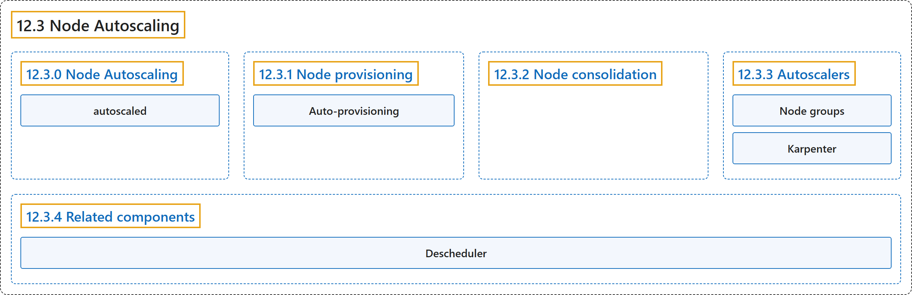

# 12.3 Node Autoscaling

## Classification

## Glossary

| Term | Definition | 中文翻译 | Source |
|---|---|---|---|
| **12.3 Node Autoscaling** 节点自动扩缩 | "**Automatically provision and consolidate the Nodes in your cluster to adapt to demand and optimize cost.**" | **自动供应和合并集群中的节点，以适应需求并优化成本。** | [The Kubernetes Authors, n.d., "Node Autoscaling", para. 1](https://kubernetes.io/docs/concepts/cluster-administration/node-autoscaling/#:~:text=Automatically%20provision%20and%20consolidate%20the%20Nodes%20in) |
| **12.3.0 Node Autoscaling** 节点自动扩缩 | (No definition) | （无定义） | [The Kubernetes Authors, n.d., "Node Autoscaling"](https://kubernetes.io/docs/concepts/cluster-administration/node-autoscaling/#node-autoscaling) |
| **autoscaled** 自动扩缩 | "Nodes in your cluster can be ***autoscaled* - dynamically [provisioned](#provisioning), or [consolidated](#consolidation) to provide needed capacity while optimizing cost**." | 集群中的节点可以被***自动扩缩*：动态[供应](#provisioning)或[合并](#consolidation)，在提供所需容量的同时优化成本**。 | [The Kubernetes Authors, n.d., "Node Autoscaling", para. 2](https://kubernetes.io/docs/concepts/cluster-administration/node-autoscaling/#:~:text=Nodes%20in%20your%20cluster%20can%20be%20%2Aautoscaled%2A) |
| **12.3.1 Node provisioning** 节点供应 | "If there are Pods in a cluster that can't be scheduled on existing Nodes, **new Nodes can be automatically added to the cluster—*provisioned*—to accommodate the Pods**." | 如果集群中有 Pod 无法调度到现有节点上，**可以自动向集群添加新节点（即*供应*）来容纳这些 Pod**。 | [The Kubernetes Authors, n.d., "Node provisioning", para. 1](https://kubernetes.io/docs/concepts/cluster-administration/node-autoscaling/#:~:text=If%20there%20are%20Pods%20in%20a%20cluster) |
| **Auto-provisioning** 自动供应 | "Node auto-provisioning is **a mode of provisioning in which a user doesn't have to fully configure the specifics of the Nodes that can be provisioned**." | 节点自动供应是**一种供应模式，用户不必完整配置可供应节点的各项细节**。 | [The Kubernetes Authors, n.d., "Auto-provisioning", para. 1](https://kubernetes.io/docs/concepts/cluster-administration/node-autoscaling/#:~:text=Node%20auto-provisioning%20is%20a%20mode%20of%20provisioning) |
| **12.3.2 Node consolidation** 节点合并 | (context) "The main consideration when running a cluster is **ensuring that all schedulable pods are running, whilst keeping the cost of the cluster as low as possible**." | （语境）运行集群时的主要考虑是**确保所有可调度的 Pod 都在运行，同时让集群成本尽可能低**。 | [The Kubernetes Authors, n.d., "Node consolidation", para. 1](https://kubernetes.io/docs/concepts/cluster-administration/node-autoscaling/#:~:text=The%20main%20consideration%20when%20running%20a%20cluster) |
| **12.3.3 Autoscalers** 自动扩缩器 | "The functionalities described in previous sections are **provided by Node *autoscalers***." | 前面各节所述的功能**由节点*自动扩缩器*提供**。 | [The Kubernetes Authors, n.d., "Autoscalers", para. 1](https://kubernetes.io/docs/concepts/cluster-administration/node-autoscaling/#:~:text=The%20functionalities%20described%20in%20previous%20sections%20are) |
| **Node groups** 节点组 | "Cluster Autoscaler **adds or removes Nodes to pre-configured *Node groups***." | Cluster Autoscaler **向预先配置的*节点组*添加或移除节点**。 | [The Kubernetes Authors, n.d., "Cluster Autoscaler", para. 1](https://kubernetes.io/docs/concepts/cluster-administration/node-autoscaling/#:~:text=Cluster%20Autoscaler%20adds%20or%20removes%20Nodes%20to) |
| **Karpenter** Karpenter | "Karpenter **auto-provisions Nodes based on [NodePool](https://karpenter.sh/docs/concepts/nodepools/) configurations provided by the cluster operator**." | Karpenter **根据集群运维人员提供的 [NodePool](https://karpenter.sh/docs/concepts/nodepools/) 配置自动供应节点**。 | [The Kubernetes Authors, n.d., "Karpenter", para. 1](https://kubernetes.io/docs/concepts/cluster-administration/node-autoscaling/#:~:text=Karpenter%20auto-provisions%20Nodes%20based%20on%20%5BNodePool%5D%28https%3A%2F%2Fkarpenter.sh%2Fdocs%2Fconcepts%2Fnodepools%2F%29%20configurations) |
| **12.3.4 Related components** 相关组件 | (No definition) | （无定义） | [The Kubernetes Authors, n.d., "Related components"](https://kubernetes.io/docs/concepts/cluster-administration/node-autoscaling/#related-components) |
| **Descheduler** Descheduler | "The [descheduler](https://github.com/kubernetes-sigs/descheduler) is **a component providing Node consolidation functionality based on custom policies**" | [descheduler](https://github.com/kubernetes-sigs/descheduler) 是**一个基于自定义策略提供节点合并功能的组件** | [The Kubernetes Authors, n.d., "Descheduler", para. 1](https://kubernetes.io/docs/concepts/cluster-administration/node-autoscaling/#:~:text=The%20%5Bdescheduler%5D%28https%3A%2F%2Fgithub.com%2Fkubernetes-sigs%2Fdescheduler%29%20is%20a%20component%20providing%20Node) |

## References

The Kubernetes Authors. (n.d.). *Node Autoscaling*. Kubernetes Documentation. Retrieved October 31, 2026, from <https://kubernetes.io/docs/concepts/cluster-administration/node-autoscaling/>
