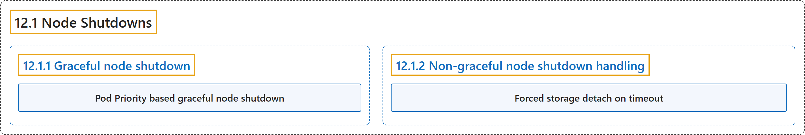

# 12.1 Node Shutdowns

## Classification

## Glossary

| Term | Definition | 中文翻译 | Source |
|---|---|---|---|
| **12.1 Node Shutdowns** 节点关闭 | (context) "In a Kubernetes cluster, **a node** can be **shut down in a planned graceful way** or **unexpectedly** because of reasons such as a power outage or something else external." | （语境）在 Kubernetes 集群中，**节点**可能**按计划体面地关闭**，也可能**意外关闭**，原因可能是断电或其他外部事件。 | [The Kubernetes Authors, n.d., "Node Shutdowns", para. 1](https://kubernetes.io/docs/concepts/cluster-administration/node-shutdown/#:~:text=In%20a%20Kubernetes%20cluster%2C%20a%20%5Bnode%5D%28https%3A%2F%2Fkubernetes.io%2Fdocs%2Fconcepts%2Farchitecture%2Fnodes%2F%29%20can) |
| **12.1.1 Graceful node shutdown** 节点体面关闭 | "The kubelet attempts to **detect node system shutdown** and **terminates pods running on the node**." | kubelet 会尝试**检测节点系统关闭**，并**终止节点上运行的 Pod**。 | [The Kubernetes Authors, n.d., "Graceful node shutdown", para. 1](https://kubernetes.io/docs/concepts/cluster-administration/node-shutdown/#:~:text=The%20kubelet%20attempts%20to%20detect%20node%20system) |
| **Pod Priority based graceful node shutdown** 基于 Pod 优先级的节点体面关闭 | (context) "graceful node shutdown **honors the PriorityClass for Pods**, provided that you **enabled this feature in your cluster**." | （语境）节点体面关闭**会遵循 Pod 的 PriorityClass**，前提是你**在集群中启用了这项功能**。 | [The Kubernetes Authors, n.d., "Pod Priority based graceful node shutdown", para. 1](https://kubernetes.io/docs/concepts/cluster-administration/node-shutdown/#:~:text=graceful%20node%20shutdown%20honors%20the%20PriorityClass%20for) |
| **12.1.2 Non-graceful node shutdown handling** 非体面节点关闭的处理 | (No definition) | （无定义） | [The Kubernetes Authors, n.d., "Non-graceful node shutdown handling"](https://kubernetes.io/docs/concepts/cluster-administration/node-shutdown/#non-graceful-node-shutdown-handling) |
| **Forced storage detach on timeout** 超时强制分离存储 | "In any situation where **a pod deletion has not succeeded for 6 minutes**, kubernetes will **force detach volumes being unmounted** if **the node is unhealthy** at that instant." | 任何情况下，只要 **Pod 删除 6 分钟仍未成功**，Kubernetes 就会**强制分离正在卸载的卷**，前提是**节点当时不健康**。 | [The Kubernetes Authors, n.d., "Forced storage detach on timeout", para. 1](https://kubernetes.io/docs/concepts/cluster-administration/node-shutdown/#:~:text=In%20any%20situation%20where%20a%20pod%20deletion) |

## References

The Kubernetes Authors. (n.d.). *Node Shutdowns*. Kubernetes Documentation. Retrieved October 31, 2026, from <https://kubernetes.io/docs/concepts/cluster-administration/node-shutdown/>
