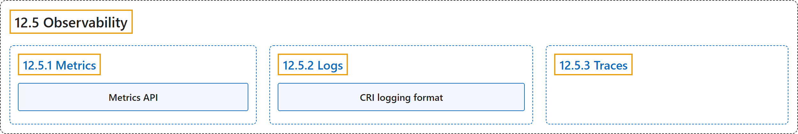

# 12.5 Observability

## Classification

## Glossary

| Term | Definition | 中文翻译 | Source |
|---|---|---|---|
| **12.5 Observability** 可观测性 | "In Kubernetes, **observability** is the process of **collecting and analyzing metrics, logs, and traces**—often referred to as **the three pillars of observability**—in order to obtain a better understanding of **the internal state, performance, and health of the cluster**." | 在 Kubernetes 中，**可观测性**是**收集和分析指标、日志和追踪**的过程（这三者常被称为**可观测性的三大支柱**），以便更好地了解**集群的内部状态、性能和健康状况**。 | [The Kubernetes Authors, n.d., "Observability", para. 2](https://kubernetes.io/docs/concepts/cluster-administration/observability/#:~:text=In%20Kubernetes%2C%20observability%20is%20the%20process%20of) |
| **12.5.1 Metrics** 指标 | "Kubernetes components **emit metrics in Prometheus format** from **their `/metrics` endpoints**" | Kubernetes 组件**以 Prometheus 格式输出指标**，来源是**其 `/metrics` 端点** | [The Kubernetes Authors, n.d., "Metrics", para. 1](https://kubernetes.io/docs/concepts/cluster-administration/observability/#:~:text=Kubernetes%20components%20emit%20metrics%20in%20%5BPrometheus%20format%5D%28https%3A%2F%2Fprometheus.io%2Fdocs%2Finstrumenting%2Fexposition_formats%2F%29) |
| **Metrics API** 指标 API | "**The Kubernetes Metrics API** provides **CPU and memory resource usage** for **nodes and Pods**." | **Kubernetes 指标 API** 提供 **CPU 与内存资源用量**，针对**节点和 Pod**。 | [The Kubernetes Authors, n.d., "Metrics API", para. 1](https://kubernetes.io/docs/concepts/cluster-administration/observability/#:~:text=The%20Kubernetes%20Metrics%20API%20provides%20CPU%20and) |
| **12.5.2 Logs** 日志 | "Logs provide **a chronological record of events** inside **applications, Kubernetes system components, and security-related activities** such as audit logging." | 日志提供**事件的时间顺序记录**，涵盖**应用、Kubernetes 系统组件以及审计日志等安全相关活动**。 | [The Kubernetes Authors, n.d., "Logs", para. 1](https://kubernetes.io/docs/concepts/cluster-administration/observability/#:~:text=Logs%20provide%20a%20chronological%20record%20of%20events) |
| **CRI logging format** CRI 日志格式 | (context) "While runtimes implement this differently, **the integration with the kubelet** is **standardized through the *CRI logging format***" | （语境）虽然各运行时实现方式不同，**与 kubelet 的集成**都**通过 CRI 日志格式实现标准化** | [The Kubernetes Authors, n.d., "Logs", para. 2](https://kubernetes.io/docs/concepts/cluster-administration/observability/#:~:text=While%20runtimes%20implement%20this%20differently%2C%20the%20integration) |
| **12.5.3 Traces** 追踪 | "Traces **capture how requests moves** across **Kubernetes components and applications**, linking **latency, timing and relationships between operations**." | 追踪**捕获请求如何流转**于 **Kubernetes 组件和应用**之间，并联系起**各操作的延迟、时序和相互关系**。 | [The Kubernetes Authors, n.d., "Traces", para. 1](https://kubernetes.io/docs/concepts/cluster-administration/observability/#:~:text=Traces%20capture%20how%20requests%20moves%20across%20Kubernetes) |

## References

The Kubernetes Authors. (n.d.). *Observability*. Kubernetes Documentation. Retrieved October 31, 2026, from <https://kubernetes.io/docs/concepts/cluster-administration/observability/>
