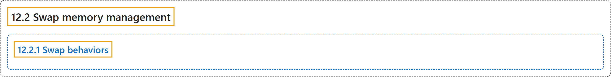

# 12.2 Swap memory management

## Classification

## Glossary

| Term | Definition | 中文翻译 | Source |
|---|---|---|---|
| **12.2 Swap memory management** 交换内存管理 | (context) "Kubernetes can be configured to **use swap memory on a node**, allowing the kernel to **free up physical memory** by **swapping out pages to backing storage**." | （语境）Kubernetes 可以配置为**在节点上使用交换内存**，让内核**释放物理内存**，方法是**把内存页换出到后备存储**。 | [The Kubernetes Authors, n.d., "Swap memory management", para. 1](https://kubernetes.io/docs/concepts/cluster-administration/swap-memory-management/#:~:text=Kubernetes%20can%20be%20configured%20to%20use%20swap) |
| **12.2.1 Swap behaviors** 交换行为 | (context) "You need to **pick a swap behavior to use**." | （语境）你需要**选择一种要使用的交换行为**。 | [The Kubernetes Authors, n.d., "Swap behaviors", para. 1](https://kubernetes.io/docs/concepts/cluster-administration/swap-memory-management/#:~:text=You%20need%20to%20pick%20a%20%5Bswap%20behavior%5D%28https%3A%2F%2Fkubernetes.io%2Fdocs%2Freference%2Fnode%2Fswap-behavior%2F%29) |

## References

The Kubernetes Authors. (n.d.). *Swap memory management*. Kubernetes Documentation. Retrieved October 31, 2026, from <https://kubernetes.io/docs/concepts/cluster-administration/swap-memory-management/>
