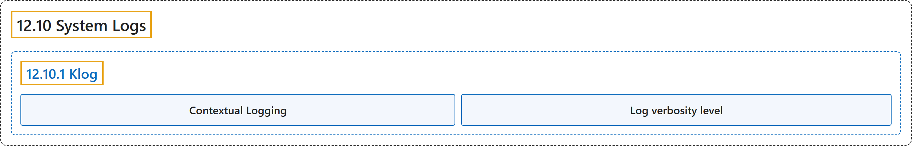

# 12.10 System Logs

## Classification

## Glossary

| Term | Definition | 中文翻译 | Source |
|---|---|---|---|
| **12.10 System Logs** 系统日志 | "System component logs **record events happening in cluster**, which can be **very useful for debugging**." | 系统组件日志**记录集群中发生的事件**，对**调试非常有用**。 | [The Kubernetes Authors, n.d., "System Logs", para. 1](https://kubernetes.io/docs/concepts/cluster-administration/system-logs/#:~:text=System%20component%20logs%20record%20events%20happening%20in) |
| **12.10.1 Klog** klog | "**klog** is **the Kubernetes logging library**." | **klog** 是 **Kubernetes 的日志库**。 | [The Kubernetes Authors, n.d., "Klog", para. 1](https://kubernetes.io/docs/concepts/cluster-administration/system-logs/#:~:text=klog%20is%20the%20Kubernetes%20logging%20library.) |
| **Contextual Logging** 上下文日志 | "**Contextual logging** builds on top of **structured logging**." | **上下文日志**建立在**结构化日志**之上。 | [The Kubernetes Authors, n.d., "Contextual Logging", para. 1](https://kubernetes.io/docs/concepts/cluster-administration/system-logs/#:~:text=Contextual%20logging%20builds%20on%20top%20of%20structured) |
| **Log verbosity level** 日志详细级别 | "**The `-v` flag** controls **log verbosity**." | **`-v` 标志**控制**日志的详细程度**。 | [The Kubernetes Authors, n.d., "Log verbosity level", para. 1](https://kubernetes.io/docs/concepts/cluster-administration/system-logs/#:~:text=The%20%60-v%60%20flag%20controls%20log%20verbosity.) |

## References

The Kubernetes Authors. (n.d.). *System Logs*. Kubernetes Documentation. Retrieved October 31, 2026, from <https://kubernetes.io/docs/concepts/cluster-administration/system-logs/>
