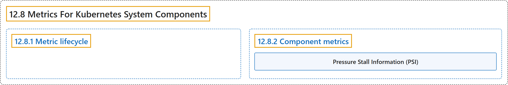

# 12.8 Metrics For Kubernetes System Components

## Classification

## Glossary

| Term | Definition | 中文翻译 | Source |
|---|---|---|---|
| **12.8 Metrics For Kubernetes System Components** Kubernetes 系统组件的指标 | "**System component metrics** can give **a better look into what is happening inside them**." | **系统组件指标**可以让你**更好地了解组件内部正在发生什么**。 | [The Kubernetes Authors, n.d., "Metrics For Kubernetes System Components", para. 1](https://kubernetes.io/docs/concepts/cluster-administration/system-metrics/#:~:text=System%20component%20metrics%20can%20give%20a%20better) |
| **12.8.1 Metric lifecycle** 指标生命周期 | "**Alpha metric → Beta metric → Stable metric → Deprecated metric → Hidden metric → Deleted metric**" | **Alpha 指标 → Beta 指标 → Stable 指标 → 已弃用指标 → 隐藏指标 → 已删除指标** | [The Kubernetes Authors, n.d., "Metric lifecycle", para. 1](https://kubernetes.io/docs/concepts/cluster-administration/system-metrics/#:~:text=Alpha%20metric%20%E2%86%92%20Beta%20metric%20%E2%86%92%20Stable) |
| **12.8.2 Component metrics** 组件指标 | (No definition) | （无定义） | [The Kubernetes Authors, n.d., "Component metrics"](https://kubernetes.io/docs/concepts/cluster-administration/system-metrics/#component-metrics) |
| **Pressure Stall Information (PSI)** 压力阻塞信息（PSI） | (context) "Pressure Stall Information requires:" | （语境）压力阻塞信息需要： | [The Kubernetes Authors, n.d., "Requirements", para. 1](https://kubernetes.io/docs/concepts/cluster-administration/system-metrics/#:~:text=Pressure%20Stall%20Information%20requires%3A) |

## References

The Kubernetes Authors. (n.d.). *Metrics For Kubernetes System Components*. Kubernetes Documentation. Retrieved October 31, 2026, from <https://kubernetes.io/docs/concepts/cluster-administration/system-metrics/>
