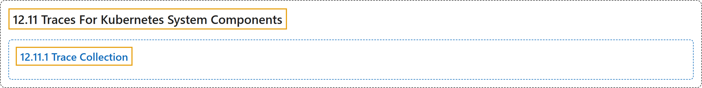

# 12.11 Traces For Kubernetes System Components

## Classification

## Glossary

| Term | Definition | 中文翻译 | Source |
|---|---|---|---|
| **12.11 Traces For Kubernetes System Components** Kubernetes 系统组件的追踪 | "System component traces **record the latency of and relationships between operations in the cluster**." | 系统组件追踪**记录集群中各操作的延迟及其相互关系**。 | [The Kubernetes Authors, n.d., "Traces For Kubernetes System Components", para. 1](https://kubernetes.io/docs/concepts/cluster-administration/system-traces/#:~:text=System%20component%20traces%20record%20the%20latency%20of) |
| **12.11.1 Trace Collection** 追踪收集 | "Kubernetes components have **built-in gRPC exporters for OTLP to export traces**, either with an OpenTelemetry Collector, or without an OpenTelemetry Collector." | Kubernetes 组件**内置了用于 OTLP 的 gRPC 导出器来导出追踪**，可以搭配 OpenTelemetry Collector，也可以不搭配。 | [The Kubernetes Authors, n.d., "Trace Collection", para. 1](https://kubernetes.io/docs/concepts/cluster-administration/system-traces/#:~:text=Kubernetes%20components%20have%20built-in%20gRPC%20exporters%20for) |

## References

The Kubernetes Authors. (n.d.). *Traces For Kubernetes System Components*. Kubernetes Documentation. Retrieved October 31, 2026, from <https://kubernetes.io/docs/concepts/cluster-administration/system-traces/>
