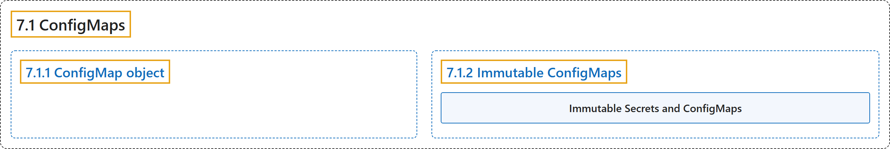

# 7.1 ConfigMaps

## Classification

## Glossary

| Term | Definition | 中文翻译 | Source |
|---|---|---|---|
| **7.1 ConfigMaps** ConfigMap | "A ConfigMap is **an API object used to store non-confidential data in key-value pairs**." | ConfigMap 是**一个用键值对存储非机密数据的 API 对象**。 | [The Kubernetes Authors, n.d., "ConfigMaps", para. 1](https://kubernetes.io/docs/concepts/configuration/configmap/#:~:text=A%20ConfigMap%20is%20an%20API%20object%20used) |
| **7.1.1 ConfigMap object** ConfigMap 对象 | "A ConfigMap is **an [API object](https://kubernetes.io/docs/concepts/overview/working-with-objects/#kubernetes-objects) that lets you store configuration for other objects to use**." | ConfigMap 是**一个 [API 对象](https://kubernetes.io/docs/concepts/overview/working-with-objects/#kubernetes-objects)，让你存储供其他对象使用的配置**。 | [The Kubernetes Authors, n.d., "ConfigMap object", para. 1](https://kubernetes.io/docs/concepts/configuration/configmap/#:~:text=A%20ConfigMap%20is%20an%20%5BAPI%20object%5D%28https%3A%2F%2Fkubernetes.io%2Fdocs%2Fconcepts%2Foverview%2Fworking-with-objects%2F%23kubernetes-objects%29%20that) |
| **7.1.2 Immutable ConfigMaps** 不可变 ConfigMap | (No definition) | （无定义） | [The Kubernetes Authors, n.d., "Immutable ConfigMaps"](https://kubernetes.io/docs/concepts/configuration/configmap/#immutable-configmaps) |
| **Immutable Secrets and ConfigMaps** 不可变的 Secret 和 ConfigMap | "The Kubernetes feature *Immutable Secrets and ConfigMaps* **provides an option to set individual Secrets and ConfigMaps as immutable**." | Kubernetes 的*不可变 Secret 和 ConfigMap* 功能**提供一个选项，把单个 Secret 和 ConfigMap 设为不可变**。 | [The Kubernetes Authors, n.d., "Immutable ConfigMaps", para. 1](https://kubernetes.io/docs/concepts/configuration/configmap/#:~:text=The%20Kubernetes%20feature%20%2AImmutable%20Secrets%20and%20ConfigMaps%2A) |

## References

The Kubernetes Authors. (n.d.). *ConfigMaps*. Kubernetes Documentation. Retrieved October 31, 2026, from <https://kubernetes.io/docs/concepts/configuration/configmap/>
