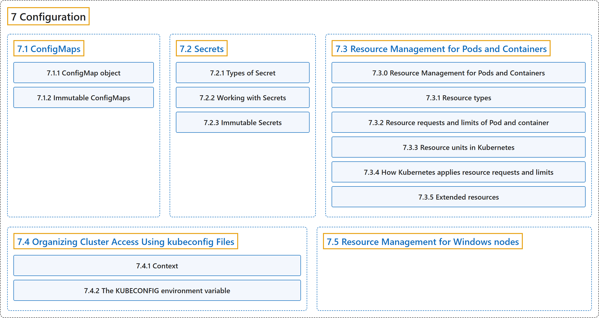

# 7 Configuration

## Classification

## Glossary

| Term | Definition | 中文翻译 | Source |
|---|---|---|---|
| **7 Configuration** 配置 | "**Configuration mechanisms within Kubernetes.**" | **Kubernetes 内部的配置机制。** | [The Kubernetes Authors, n.d.-b, "Configuration", para. 1](https://kubernetes.io/docs/concepts/configuration/#:~:text=Configuration%20mechanisms%20within%20Kubernetes.) |
| **[7.1 ConfigMaps](configmap.md)** ConfigMap | "**A ConfigMap** is **an API object** used to **store non-confidential data in key-value pairs**." | **ConfigMap** 是**一个 API 对象**，用于**以键值对存储非机密数据**。 | [The Kubernetes Authors, n.d.-a, "ConfigMaps", para. 1](https://kubernetes.io/docs/concepts/configuration/configmap/#:~:text=A%20ConfigMap%20is%20an%20API%20object%20used) |
| **[7.2 Secrets](secret.md)** Secret | "**A Secret** is an object that contains **a small amount of sensitive data** such as **a password, a token, or a key**." | **Secret** 是一个对象，包含**少量敏感数据**，例如**密码、令牌或密钥**。 | [The Kubernetes Authors, n.d.-f, "Secrets", para. 1](https://kubernetes.io/docs/concepts/configuration/secret/#:~:text=A%20Secret%20is%20an%20object%20that%20contains) |
| **[7.3 Resource Management for Pods and Containers](manage-resources-containers.md)** Pod 和容器的资源管理 | (context) "When you **specify a Pod**, you can optionally specify **how much of each resource a container needs**." | （语境）当你**定义 Pod** 时，可以选择指定**一个容器需要多少各类资源**。 | [The Kubernetes Authors, n.d.-d, "Resource Management for Pods and Containers", para. 1](https://kubernetes.io/docs/concepts/configuration/manage-resources-containers/#:~:text=When%20you%20specify%20a%20%5BPod%5D%28https%3A%2F%2Fkubernetes.io%2Fdocs%2Fconcepts%2Fworkloads%2Fpods%2F%29%2C%20you%20can) |
| **[7.4 Organizing Cluster Access Using kubeconfig Files](organize-cluster-access-kubeconfig.md)** 使用 kubeconfig 文件组织集群访问 | (context) "A file that is used to **configure access to clusters** is called **a *kubeconfig file***." | （语境）用来**配置集群访问**的文件称为 **kubeconfig 文件**。 | [The Kubernetes Authors, n.d.-c, "Note:", para. 1](https://kubernetes.io/docs/concepts/configuration/organize-cluster-access-kubeconfig/#:~:text=A%20file%20that%20is%20used%20to%20configure) |
| **[7.5 Resource Management for Windows nodes](windows-resource-management.md)** Windows 节点的资源管理 | (context) "This page outlines **the differences in how resources are managed** between **Linux and Windows**." | （语境）本页概述**资源管理方式上的差异**，对比 **Linux 和 Windows**。 | [The Kubernetes Authors, n.d.-e, "Resource Management for Windows nodes", para. 1](https://kubernetes.io/docs/concepts/configuration/windows-resource-management/#:~:text=This%20page%20outlines%20the%20differences%20in%20how) |

## References

The Kubernetes Authors. (n.d.-a). *ConfigMaps*. Kubernetes Documentation. Retrieved October 31, 2026, from <https://kubernetes.io/docs/concepts/configuration/configmap/>

The Kubernetes Authors. (n.d.-b). *Configuration*. Kubernetes Documentation. Retrieved October 31, 2026, from <https://kubernetes.io/docs/concepts/configuration/>

The Kubernetes Authors. (n.d.-c). *Organizing Cluster Access Using kubeconfig Files*. Kubernetes Documentation. Retrieved October 31, 2026, from <https://kubernetes.io/docs/concepts/configuration/organize-cluster-access-kubeconfig/>

The Kubernetes Authors. (n.d.-d). *Resource Management for Pods and Containers*. Kubernetes Documentation. Retrieved October 31, 2026, from <https://kubernetes.io/docs/concepts/configuration/manage-resources-containers/>

The Kubernetes Authors. (n.d.-e). *Resource Management for Windows nodes*. Kubernetes Documentation. Retrieved October 31, 2026, from <https://kubernetes.io/docs/concepts/configuration/windows-resource-management/>

The Kubernetes Authors. (n.d.-f). *Secrets*. Kubernetes Documentation. Retrieved October 31, 2026, from <https://kubernetes.io/docs/concepts/configuration/secret/>
