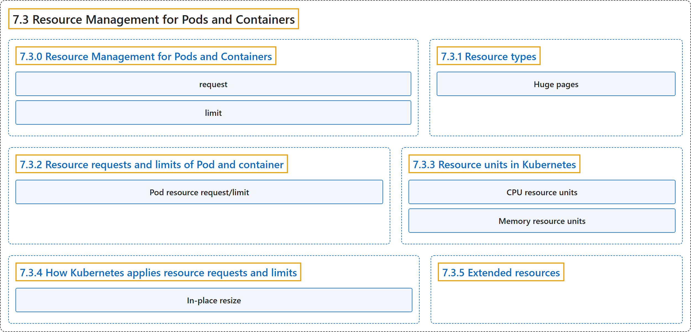

# 7.3 Resource Management for Pods and Containers

## Classification

## Glossary

| Term | Definition | 中文翻译 | Source |
|---|---|---|---|
| **7.3 Resource Management for Pods and Containers** Pod 和容器的资源管理 | (context) "When you specify a [Pod](https://kubernetes.io/docs/concepts/workloads/pods/), you can optionally **specify how much of each resource a [container](https://kubernetes.io/docs/concepts/containers/) needs**." | （语境）定义 [Pod](https://kubernetes.io/docs/concepts/workloads/pods/) 时，你可以选择**指定一个[容器](https://kubernetes.io/docs/concepts/containers/)需要多少各类资源**。 | [The Kubernetes Authors, n.d., "Resource Management for Pods and Containers", para. 1](https://kubernetes.io/docs/concepts/configuration/manage-resources-containers/#:~:text=When%20you%20specify%20a%20%5BPod%5D%28https%3A%2F%2Fkubernetes.io%2Fdocs%2Fconcepts%2Fworkloads%2Fpods%2F%29%2C%20you%20can) |
| **7.3.0 Resource Management for Pods and Containers** Pod 和容器的资源管理 | (No definition) | （无定义） | [The Kubernetes Authors, n.d., "Resource Management for Pods and Containers"](https://kubernetes.io/docs/concepts/configuration/manage-resources-containers/#resource-management-for-pods-and-containers) |
| **request** 请求 | (context) "When you specify the resource *request* for containers in a Pod, **the [kube-scheduler](https://kubernetes.io/docs/reference/command-line-tools-reference/kube-scheduler/) uses this information to decide which node to place the Pod on**." | （语境）当你为 Pod 中的容器指定资源*请求*时，**[kube-scheduler](https://kubernetes.io/docs/reference/command-line-tools-reference/kube-scheduler/) 用这一信息决定把 Pod 放到哪个节点上**。 | [The Kubernetes Authors, n.d., "Resource Management for Pods and Containers", para. 2](https://kubernetes.io/docs/concepts/configuration/manage-resources-containers/#:~:text=When%20you%20specify%20the%20resource%20%2Arequest%2A%20for) |
| **limit** 限制 | (context) "When you specify a resource *limit* for a container, **the [kubelet](https://kubernetes.io/docs/reference/command-line-tools-reference/kubelet) enforces those limits**" | （语境）当你为容器指定资源*限制*时，**[kubelet](https://kubernetes.io/docs/reference/command-line-tools-reference/kubelet) 会强制执行这些限制** | [The Kubernetes Authors, n.d., "Resource Management for Pods and Containers", para. 2](https://kubernetes.io/docs/concepts/configuration/manage-resources-containers/#:~:text=When%20you%20specify%20a%20resource%20%2Alimit%2A%20for) |
| **7.3.1 Resource types** 资源类型 | "A *resource type* has **a base unit and can be requested, limited, or both**." | *资源类型*有**一个基本单位，可以被请求、被限制，或两者兼有**。 | [The Kubernetes Authors, n.d., "Resource types", para. 1](https://kubernetes.io/docs/concepts/configuration/manage-resources-containers/#:~:text=A%20%2Aresource%20type%2A%20has%20a%20base%20unit) |
| **Huge pages** 巨页 | (context) "For Linux workloads, **you can specify *huge page* resources**." | （语境）对于 Linux 工作负载，**你可以指定*巨页*资源**。 | [The Kubernetes Authors, n.d., "Huge pages", para. 1](https://kubernetes.io/docs/concepts/configuration/manage-resources-containers/#:~:text=For%20Linux%20workloads%2C%20you%20can%20specify%20%2Ahuge) |
| **7.3.2 Resource requests and limits of Pod and container** Pod 和容器的资源请求与限制 | (No definition) | （无定义） | [The Kubernetes Authors, n.d., "Resource requests and limits of Pod and container"](https://kubernetes.io/docs/concepts/configuration/manage-resources-containers/#resource-requests-and-limits-of-pod-and-container) |
| **Pod resource request/limit** Pod 资源请求/限制 | "For a particular resource, a *Pod resource request/limit* is **the sum of the resource requests/limits of that type for each container in the Pod**." | 对某种资源而言，*Pod 资源请求/限制*是 **Pod 中每个容器该类资源请求/限制的总和**。 | [The Kubernetes Authors, n.d., "Resource requests and limits of Pod and container", para. 10](https://kubernetes.io/docs/concepts/configuration/manage-resources-containers/#:~:text=For%20a%20particular%20resource%2C%20a%20%2APod%20resource) |
| **7.3.3 Resource units in Kubernetes** Kubernetes 中的资源单位 | (No definition) | （无定义） | [The Kubernetes Authors, n.d., "Resource units in Kubernetes"](https://kubernetes.io/docs/concepts/configuration/manage-resources-containers/#resource-units-in-kubernetes) |
| **CPU resource units** CPU 资源单位 | "Limits and requests for CPU resources are **measured in *cpu* units**." | CPU 资源的限制和请求**以 *cpu* 单位度量**。 | [The Kubernetes Authors, n.d., "CPU resource units", para. 1](https://kubernetes.io/docs/concepts/configuration/manage-resources-containers/#:~:text=Limits%20and%20requests%20for%20CPU%20resources%20are) |
| **Memory resource units** 内存资源单位 | "Limits and requests for `memory` are **measured in bytes**." | `memory` 的限制和请求**以字节度量**。 | [The Kubernetes Authors, n.d., "Memory resource units", para. 1](https://kubernetes.io/docs/concepts/configuration/manage-resources-containers/#:~:text=Limits%20and%20requests%20for%20%60memory%60%20are%20measured) |
| **7.3.4 How Kubernetes applies resource requests and limits** Kubernetes 如何应用资源请求和限制 | (No definition) | （无定义） | [The Kubernetes Authors, n.d., "How Kubernetes applies resource requests and limits"](https://kubernetes.io/docs/concepts/configuration/manage-resources-containers/#how-kubernetes-applies-resource-requests-and-limits) |
| **In-place resize** 原地调整 | (context) "This is called ***in-place Pod vertical scaling* or *in-place Pod resize***." | （语境）这称为***原地 Pod 垂直扩缩*或*原地 Pod 调整***。 | [The Kubernetes Authors, n.d., "In-place resize", para. 2](https://kubernetes.io/docs/concepts/configuration/manage-resources-containers/#:~:text=This%20is%20called%20%2Ain-place%20Pod%20vertical%20scaling%2A) |
| **7.3.5 Extended resources** 扩展资源 | "Extended resources are **fully-qualified resource names outside the `kubernetes.io` domain**." | 扩展资源是 **`kubernetes.io` 域之外的完全限定资源名称**。 | [The Kubernetes Authors, n.d., "Extended resources", para. 1](https://kubernetes.io/docs/concepts/configuration/manage-resources-containers/#:~:text=Extended%20resources%20are%20fully-qualified%20resource%20names%20outside) |

## References

The Kubernetes Authors. (n.d.). *Resource Management for Pods and Containers*. Kubernetes Documentation. Retrieved October 31, 2026, from <https://kubernetes.io/docs/concepts/configuration/manage-resources-containers/>
