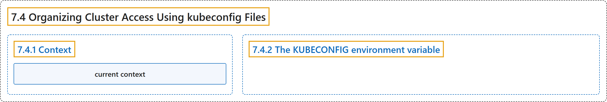

# 7.4 Organizing Cluster Access Using kubeconfig Files

## Classification

## Glossary

| Term | Definition | 中文翻译 | Source |
|---|---|---|---|
| **7.4 Organizing Cluster Access Using kubeconfig Files** 使用 kubeconfig 文件组织集群访问 | (context) "A file that is used to configure access to clusters is called **a *kubeconfig file***." | （语境）用来配置集群访问的文件称为 **kubeconfig 文件**。 | [The Kubernetes Authors, n.d., "Note:", para. 1](https://kubernetes.io/docs/concepts/configuration/organize-cluster-access-kubeconfig/#:~:text=A%20file%20that%20is%20used%20to%20configure) |
| **7.4.1 Context** 上下文 | "A *context* element in a kubeconfig file is used to **group access parameters under a convenient name**." | kubeconfig 文件中的*上下文*元素用于**把访问参数归到一个便于使用的名称下**。 | [The Kubernetes Authors, n.d., "Context", para. 1](https://kubernetes.io/docs/concepts/configuration/organize-cluster-access-kubeconfig/#:~:text=A%20%2Acontext%2A%20element%20in%20a%20kubeconfig%20file) |
| **current context** 当前上下文 | "By default, the `kubectl` command-line tool **uses parameters from the *current context* to communicate with the cluster**." | 默认情况下，`kubectl` 命令行工具**使用*当前上下文*中的参数与集群通信**。 | [The Kubernetes Authors, n.d., "Context", para. 1](https://kubernetes.io/docs/concepts/configuration/organize-cluster-access-kubeconfig/#:~:text=By%20default%2C%20the%20%60kubectl%60%20command-line%20tool%20uses) |
| **7.4.2 The KUBECONFIG environment variable** KUBECONFIG 环境变量 | "The `KUBECONFIG` environment variable **holds a list of kubeconfig files**." | `KUBECONFIG` 环境变量**保存一组 kubeconfig 文件**。 | [The Kubernetes Authors, n.d., "The KUBECONFIG environment variable", para. 1](https://kubernetes.io/docs/concepts/configuration/organize-cluster-access-kubeconfig/#:~:text=The%20%60KUBECONFIG%60%20environment%20variable%20holds%20a%20list) |

## References

The Kubernetes Authors. (n.d.). *Organizing Cluster Access Using kubeconfig Files*. Kubernetes Documentation. Retrieved October 31, 2026, from <https://kubernetes.io/docs/concepts/configuration/organize-cluster-access-kubeconfig/>
