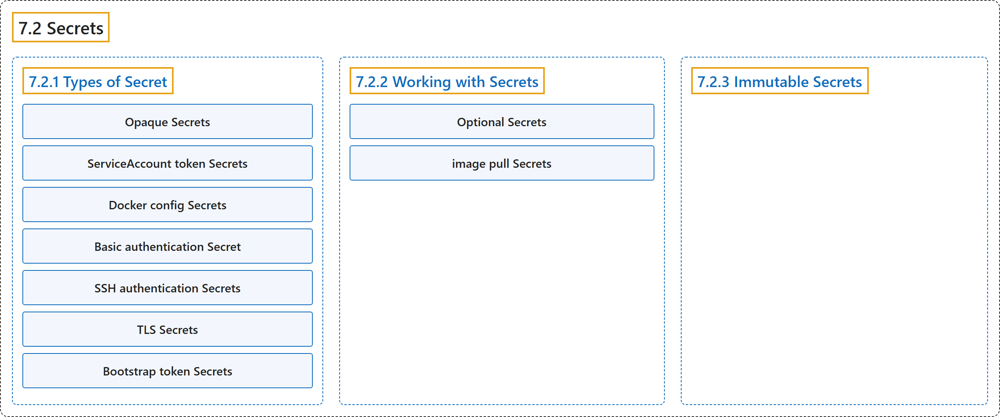

# 7.2 Secrets

## Classification

## Glossary

| Term | Definition | 中文翻译 | Source |
|---|---|---|---|
| **7.2 Secrets** Secret | "A Secret is **an object that contains a small amount of sensitive data such as a password, a token, or a key**." | Secret 是**一个包含少量敏感数据（例如密码、令牌或密钥）的对象**。 | [The Kubernetes Authors, n.d., "Secrets", para. 1](https://kubernetes.io/docs/concepts/configuration/secret/#:~:text=A%20Secret%20is%20an%20object%20that%20contains) |
| **7.2.1 Types of Secret** Secret 的类型 | (No definition) | （无定义） | [The Kubernetes Authors, n.d., "Types of Secret"](https://kubernetes.io/docs/concepts/configuration/secret/#types-of-secret) |
| **Opaque Secrets** Opaque Secret | "`Opaque` is **the default Secret type if you don't explicitly specify a type in a Secret manifest**." | `Opaque` 是**在 Secret 清单中未显式指定类型时的默认 Secret 类型**。 | [The Kubernetes Authors, n.d., "Opaque Secrets", para. 1](https://kubernetes.io/docs/concepts/configuration/secret/#:~:text=%60Opaque%60%20is%20the%20default%20Secret%20type%20if) |
| **ServiceAccount token Secrets** ServiceAccount 令牌 Secret | "A `kubernetes.io/service-account-token` type of Secret is **used to store a token credential that identifies a [ServiceAccount](https://kubernetes.io/docs/tasks/configure-pod-container/configure-service-account/)**." | `kubernetes.io/service-account-token` 类型的 Secret **用于存储标识某个 [ServiceAccount](https://kubernetes.io/docs/tasks/configure-pod-container/configure-service-account/) 的令牌凭据**。 | [The Kubernetes Authors, n.d., "ServiceAccount token Secrets", para. 1](https://kubernetes.io/docs/concepts/configuration/secret/#:~:text=A%20%60kubernetes.io%2Fservice-account-token%60%20type%20of%20Secret%20is%20used) |
| **Docker config Secrets** Docker 配置 Secret | (context) "If you are creating a Secret to **store credentials for accessing a container image registry**, you must use one of the following `type` values for that Secret:" | （语境）如果你创建 Secret 来**存储访问容器镜像仓库的凭据**，必须为该 Secret 使用以下 `type` 值之一： | [The Kubernetes Authors, n.d., "Docker config Secrets", para. 1](https://kubernetes.io/docs/concepts/configuration/secret/#:~:text=If%20you%20are%20creating%20a%20Secret%20to) |
| **Basic authentication Secret** 基本认证 Secret | "The `kubernetes.io/basic-auth` type is **provided for storing credentials needed for basic authentication**." | `kubernetes.io/basic-auth` 类型**用于存储基本认证所需的凭据**。 | [The Kubernetes Authors, n.d., "Basic authentication Secret", para. 1](https://kubernetes.io/docs/concepts/configuration/secret/#:~:text=The%20%60kubernetes.io%2Fbasic-auth%60%20type%20is%20provided%20for%20storing) |
| **SSH authentication Secrets** SSH 认证 Secret | "The builtin type `kubernetes.io/ssh-auth` is **provided for storing data used in SSH authentication**." | 内置类型 `kubernetes.io/ssh-auth` **用于存储 SSH 认证所用的数据**。 | [The Kubernetes Authors, n.d., "SSH authentication Secrets", para. 1](https://kubernetes.io/docs/concepts/configuration/secret/#:~:text=The%20builtin%20type%20%60kubernetes.io%2Fssh-auth%60%20is%20provided%20for) |
| **TLS Secrets** TLS Secret | "The `kubernetes.io/tls` Secret type is **for storing a certificate and its associated key that are typically used for TLS**." | `kubernetes.io/tls` Secret 类型**用于存储通常用于 TLS 的证书及其关联的密钥**。 | [The Kubernetes Authors, n.d., "TLS Secrets", para. 1](https://kubernetes.io/docs/concepts/configuration/secret/#:~:text=The%20%60kubernetes.io%2Ftls%60%20Secret%20type%20is%20for%20storing) |
| **Bootstrap token Secrets** 启动引导令牌 Secret | "The `bootstrap.kubernetes.io/token` Secret type is **for tokens used during the node bootstrap process**." | `bootstrap.kubernetes.io/token` Secret 类型**用于节点启动引导过程中使用的令牌**。 | [The Kubernetes Authors, n.d., "Bootstrap token Secrets", para. 1](https://kubernetes.io/docs/concepts/configuration/secret/#:~:text=The%20%60bootstrap.kubernetes.io%2Ftoken%60%20Secret%20type%20is%20for%20tokens) |
| **7.2.2 Working with Secrets** 使用 Secret | (No definition) | （无定义） | [The Kubernetes Authors, n.d., "Working with Secrets"](https://kubernetes.io/docs/concepts/configuration/secret/#working-with-secrets) |
| **Optional Secrets** 可选 Secret | "When you reference a Secret in a Pod, **you can mark the Secret as *optional***, such as in the following example." | 在 Pod 中引用 Secret 时，**你可以把它标记为*可选***，如下例所示。 | [The Kubernetes Authors, n.d., "Optional Secrets", para. 1](https://kubernetes.io/docs/concepts/configuration/secret/#:~:text=When%20you%20reference%20a%20Secret%20in%20a) |
| **image pull Secrets** 镜像拉取 Secret | (context) "You can configure *image pull Secrets* to make this possible." | （语境）你可以配置*镜像拉取 Secret* 来实现这一点。 | [The Kubernetes Authors, n.d., "Container image pull Secrets", para. 1](https://kubernetes.io/docs/concepts/configuration/secret/#:~:text=You%20can%20configure%20%2Aimage%20pull%20Secrets%2A%20to) |
| **7.2.3 Immutable Secrets** 不可变 Secret | "Kubernetes lets you **mark specific Secrets (and ConfigMaps) as *immutable***." | Kubernetes 允许你**把特定的 Secret（和 ConfigMap）标记为*不可变***。 | [The Kubernetes Authors, n.d., "Immutable Secrets", para. 1](https://kubernetes.io/docs/concepts/configuration/secret/#:~:text=Kubernetes%20lets%20you%20mark%20specific%20Secrets%20%28and) |

## References

The Kubernetes Authors. (n.d.). *Secrets*. Kubernetes Documentation. Retrieved October 31, 2026, from <https://kubernetes.io/docs/concepts/configuration/secret/>
