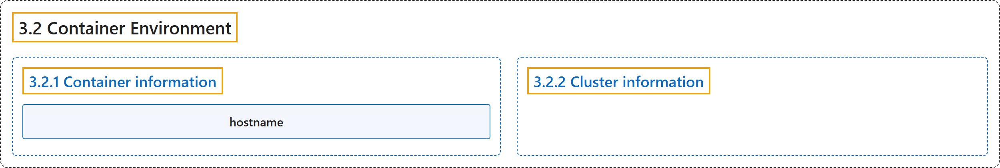

# 3.2 Container Environment

## Classification

## Glossary

| Term | Definition | 中文翻译 | Source |
|---|---|---|---|
| **3.2 Container Environment** 容器环境 | "**The Kubernetes Container environment** provides **several important resources to Containers**:" | **Kubernetes 容器环境**提供**若干面向容器的重要资源**： | [The Kubernetes Authors, n.d., "Container environment", para. 1](https://kubernetes.io/docs/concepts/containers/container-environment/#:~:text=The%20Kubernetes%20Container%20environment%20provides%20several%20important) |
| **3.2.1 Container information** 容器信息 | (No definition) | （无定义） | [The Kubernetes Authors, n.d., "Container information"](https://kubernetes.io/docs/concepts/containers/container-environment/#container-information) |
| **hostname** 主机名 | "**The *hostname* of a Container** is **the name of the Pod** in which the Container is running." | **容器的*主机名*** 是**该容器所在 Pod 的名称**。 | [The Kubernetes Authors, n.d., "Container information", para. 1](https://kubernetes.io/docs/concepts/containers/container-environment/#:~:text=The%20%2Ahostname%2A%20of%20a%20Container%20is%20the) |
| **3.2.2 Cluster information** 集群信息 | (context) "**A list of all services** that were running when a Container was created is **available to that Container as environment variables**." | （语境）**所有服务的列表**（容器创建时正在运行的），**以环境变量的形式提供给该容器**。 | [The Kubernetes Authors, n.d., "Cluster information", para. 1](https://kubernetes.io/docs/concepts/containers/container-environment/#:~:text=A%20list%20of%20all%20services%20that%20were) |

## References

The Kubernetes Authors. (n.d.). *Container Environment*. Kubernetes Documentation. Retrieved October 31, 2026, from <https://kubernetes.io/docs/concepts/containers/container-environment/>
