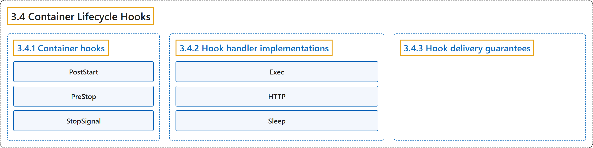

# 3.4 Container Lifecycle Hooks

## Classification

## Glossary

| Term | Definition | 中文翻译 | Source |
|---|---|---|---|
| **3.4 Container Lifecycle Hooks** 容器生命周期钩子 | "Analogous to many programming language frameworks that have component lifecycle hooks, such as Angular, **Kubernetes provides Containers with lifecycle hooks**." | 类似于许多带有组件生命周期钩子的编程语言框架（例如 Angular），**Kubernetes 为容器提供生命周期钩子**。 | [The Kubernetes Authors, n.d., "Overview", para. 1](https://kubernetes.io/docs/concepts/containers/container-lifecycle-hooks/#:~:text=Analogous%20to%20many%20programming%20language%20frameworks%20that) |
| **3.4.1 Container hooks** 容器钩子 | "There are **two hooks that are exposed to Containers**:" | **有两个钩子暴露给容器**： | [The Kubernetes Authors, n.d., "Container hooks", para. 1](https://kubernetes.io/docs/concepts/containers/container-lifecycle-hooks/#:~:text=There%20are%20two%20hooks%20that%20are%20exposed) |
| **PostStart** PostStart | "This hook is **executed immediately after a container is created**." | 这个钩子**在容器创建后立即执行**。 | [The Kubernetes Authors, n.d., "Container hooks", para. 3](https://kubernetes.io/docs/concepts/containers/container-lifecycle-hooks/#:~:text=This%20hook%20is%20executed%20immediately%20after%20a) |
| **PreStop** PreStop | "This hook is **called immediately before a container is terminated** due to an API request or management event such as a liveness/startup probe failure, preemption, resource contention and others." | 这个钩子**在容器被终止之前立即调用**，起因可能是 API 请求或管理事件，例如存活/启动探针失败、抢占、资源争用等。 | [The Kubernetes Authors, n.d., "Note:", para. 3](https://kubernetes.io/docs/concepts/containers/container-lifecycle-hooks/#:~:text=This%20hook%20is%20called%20immediately%20before%20a) |
| **StopSignal** StopSignal | "The StopSignal lifecycle can be used to **define a stop signal which would be sent to the container when it is stopped**." | StopSignal 生命周期可用来**定义容器停止时发送给它的停止信号**。 | [The Kubernetes Authors, n.d., "Note:", para. 6](https://kubernetes.io/docs/concepts/containers/container-lifecycle-hooks/#:~:text=The%20StopSignal%20lifecycle%20can%20be%20used%20to) |
| **3.4.2 Hook handler implementations** 钩子处理程序的实现 | "Containers can access a hook by **implementing and registering a handler for that hook**." | 容器可以通过**为钩子实现并注册一个处理程序**来使用该钩子。 | [The Kubernetes Authors, n.d., "Hook handler implementations", para. 1](https://kubernetes.io/docs/concepts/containers/container-lifecycle-hooks/#:~:text=Containers%20can%20access%20a%20hook%20by%20implementing) |
| **Exec** Exec | "Exec - **Executes a specific command**, such as `pre-stop.sh`, inside the cgroups and namespaces of the Container." | Exec：**执行特定命令**，例如 `pre-stop.sh`，在容器的 cgroup 和命名空间内运行。 | [The Kubernetes Authors, n.d., "Hook handler implementations", para. 2](https://kubernetes.io/docs/concepts/containers/container-lifecycle-hooks/#:~:text=Exec%20-%20Executes%20a%20specific%20command%2C%20such) |
| **HTTP** HTTP | "HTTP - **Executes an HTTP request against a specific endpoint on the Container.**" | HTTP：**对容器上的特定端点执行 HTTP 请求。** | [The Kubernetes Authors, n.d., "Hook handler implementations", para. 3](https://kubernetes.io/docs/concepts/containers/container-lifecycle-hooks/#:~:text=HTTP%20-%20Executes%20an%20HTTP%20request%20against) |
| **Sleep** Sleep | "Sleep - **Pauses the container for a specified duration.**" | Sleep：**让容器暂停指定的时长。** | [The Kubernetes Authors, n.d., "Hook handler implementations", para. 4](https://kubernetes.io/docs/concepts/containers/container-lifecycle-hooks/#:~:text=Sleep%20-%20Pauses%20the%20container%20for%20a) |
| **3.4.3 Hook delivery guarantees** 钩子交付保证 | "Hook delivery is intended to be ***at least once***, which means that a hook may be called multiple times for any given event, such as for `PostStart` or `PreStop`." | 钩子交付的设计目标是***至少一次***，即对于任一事件（例如 `PostStart` 或 `PreStop`），钩子可能被调用多次。 | [The Kubernetes Authors, n.d., "Hook delivery guarantees", para. 1](https://kubernetes.io/docs/concepts/containers/container-lifecycle-hooks/#:~:text=Hook%20delivery%20is%20intended%20to%20be%20%2Aat) |

## References

The Kubernetes Authors. (n.d.). *Container Lifecycle Hooks*. Kubernetes Documentation. Retrieved October 31, 2026, from <https://kubernetes.io/docs/concepts/containers/container-lifecycle-hooks/>
