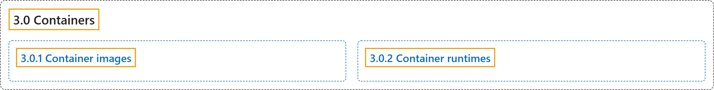

# 3.0 Containers

## Classification

## Glossary

| Term | Definition | 中文翻译 | Source |
|---|---|---|---|
| **3.0 Containers** 容器 | "**Technology for packaging an application** along with **its runtime dependencies**." | **打包应用程序的技术**，连同**它的运行时依赖**。 | [The Kubernetes Authors, n.d., "Containers", para. 1](https://kubernetes.io/docs/concepts/containers/#:~:text=Technology%20for%20packaging%20an%20application%20along%20with) |
| **3.0.1 Container images** 容器镜像 | "**A container image** is **a ready-to-run software package** containing **everything needed to run an application**: the code and any runtime it requires, application and system libraries, and default values for any essential settings." | **容器镜像**是**一个即可运行的软件包**，包含**运行应用所需的一切**：代码及其所需的运行时、应用和系统库，以及各项必要设置的默认值。 | [The Kubernetes Authors, n.d., "Container images", para. 1](https://kubernetes.io/docs/concepts/containers/#:~:text=A%20%5Bcontainer%20image%5D%28https%3A%2F%2Fkubernetes.io%2Fdocs%2Fconcepts%2Fcontainers%2Fimages%2F%29%20is%20a%20ready-to-run%20software) |
| **3.0.2 Container runtimes** 容器运行时 | "**A fundamental component** that empowers Kubernetes to **run containers effectively**." | **一个基础组件**，让 Kubernetes 能够**高效运行容器**。 | [The Kubernetes Authors, n.d., "Container runtimes", para. 1](https://kubernetes.io/docs/concepts/containers/#:~:text=A%20fundamental%20component%20that%20empowers%20Kubernetes%20to) |

## References

The Kubernetes Authors. (n.d.). *Containers*. Kubernetes Documentation. Retrieved October 31, 2026, from <https://kubernetes.io/docs/concepts/containers/>
