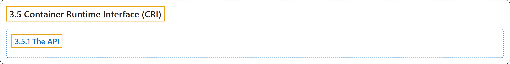

# 3.5 Container Runtime Interface (CRI)

## Classification

## Glossary

| Term | Definition | 中文翻译 | Source |
|---|---|---|---|
| **3.5 Container Runtime Interface (CRI)** 容器运行时接口（CRI） | "The CRI is **a plugin interface which enables the kubelet to use a wide variety of container runtimes**, without having a need to recompile the cluster components." | CRI 是**一个插件接口，使 kubelet 能够使用各种容器运行时**，而无需重新编译集群组件。 | [The Kubernetes Authors, n.d., "Container Runtime Interface (CRI)", para. 1](https://kubernetes.io/docs/concepts/containers/cri/#:~:text=The%20CRI%20is%20a%20plugin%20interface%20which) |
| **3.5.1 The API** API | "The kubelet acts as **a client when connecting to the container runtime via gRPC**." | kubelet 在**通过 gRPC 连接容器运行时时充当客户端**。 | [The Kubernetes Authors, n.d., "The API", para. 1](https://kubernetes.io/docs/concepts/containers/cri/#:~:text=The%20kubelet%20acts%20as%20a%20client%20when) |

## References

The Kubernetes Authors. (n.d.). *Container Runtime Interface (CRI)*. Kubernetes Documentation. Retrieved October 31, 2026, from <https://kubernetes.io/docs/concepts/containers/cri/>
