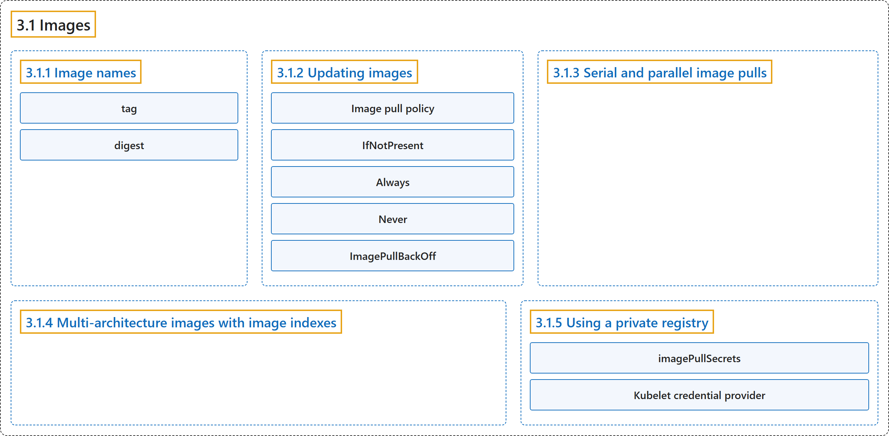

# 3.1 Images

## Classification

## Glossary

| Term | Definition | 中文翻译 | Source |
|---|---|---|---|
| **3.1 Images** 镜像 | "A container image **represents binary data that encapsulates an application and all its software dependencies**." | 容器镜像**代表封装了应用程序及其全部软件依赖的二进制数据**。 | [The Kubernetes Authors, n.d., "Images", para. 1](https://kubernetes.io/docs/concepts/containers/images/#:~:text=A%20container%20image%20represents%20binary%20data%20that) |
| **3.1.1 Image names** 镜像名称 | (context) "Container images are usually given **a name such as `pause`, `example/mycontainer`, or `kube-apiserver`**." | （语境）容器镜像通常会被赋予**一个名称，例如 `pause`、`example/mycontainer` 或 `kube-apiserver`**。 | [The Kubernetes Authors, n.d., "Image names", para. 1](https://kubernetes.io/docs/concepts/containers/images/#:~:text=Container%20images%20are%20usually%20given%20a%20name) |
| **tag** 标签 | (context) "After the image name part **you can add a *tag* or *digest*** (in the same way you would when using with commands like `docker` or `podman`)." | （语境）在镜像名称之后，**你可以加上一个*标签*或*摘要***（与使用 `docker` 或 `podman` 等命令时的方式相同）。 | [The Kubernetes Authors, n.d., "Image names", para. 3](https://kubernetes.io/docs/concepts/containers/images/#:~:text=After%20the%20image%20name%20part%20you%20can) |
| **digest** 摘要 | (context) "After the image name part **you can add a *tag* or *digest*** (in the same way you would when using with commands like `docker` or `podman`)." | （语境）在镜像名称之后，**你可以加上一个*标签*或*摘要***（与使用 `docker` 或 `podman` 等命令时的方式相同）。 | [The Kubernetes Authors, n.d., "Image names", para. 3](https://kubernetes.io/docs/concepts/containers/images/#:~:text=After%20the%20image%20name%20part%20you%20can) |
| **3.1.2 Updating images** 更新镜像 | (No definition) | （无定义） | [The Kubernetes Authors, n.d., "Updating images"](https://kubernetes.io/docs/concepts/containers/images/#updating-images) |
| **Image pull policy** 镜像拉取策略 | "The `imagePullPolicy` for a container and the tag of the image both **affect *when* the [kubelet](https://kubernetes.io/docs/reference/command-line-tools-reference/kubelet/) attempts to pull (download) the specified image**." | 容器的 `imagePullPolicy` 和镜像的标签都会**影响 [kubelet](https://kubernetes.io/docs/reference/command-line-tools-reference/kubelet/) *何时*尝试拉取（下载）指定的镜像**。 | [The Kubernetes Authors, n.d., "Image pull policy", para. 1](https://kubernetes.io/docs/concepts/containers/images/#:~:text=The%20%60imagePullPolicy%60%20for%20a%20container%20and%20the) |
| **IfNotPresent** IfNotPresent | "**the image is pulled only if it is not already present locally.**" | **只有当镜像在本地还不存在时才拉取。** | [The Kubernetes Authors, n.d., "Image pull policy", para. 4](https://kubernetes.io/docs/concepts/containers/images/#:~:text=the%20image%20is%20pulled%20only%20if%20it) |
| **Always** Always | "every time the kubelet launches a container, **the kubelet requests the [container runtime](https://kubernetes.io/docs/setup/production-environment/container-runtimes) to pull the image**." | 每次 kubelet 启动容器时，**kubelet 都会请求[容器运行时](https://kubernetes.io/docs/setup/production-environment/container-runtimes)拉取镜像**。 | [The Kubernetes Authors, n.d., "Image pull policy", para. 6](https://kubernetes.io/docs/concepts/containers/images/#:~:text=every%20time%20the%20kubelet%20launches%20a%20container%2C) |
| **Never** Never | "**the kubelet does not try fetching the image.**" | **kubelet 不会尝试获取镜像。** | [The Kubernetes Authors, n.d., "Image pull policy", para. 8](https://kubernetes.io/docs/concepts/containers/images/#:~:text=the%20kubelet%20does%20not%20try%20fetching%20the) |
| **ImagePullBackOff** ImagePullBackOff | "The status `ImagePullBackOff` means that **a container could not start because Kubernetes could not pull a container image**" | 状态 `ImagePullBackOff` 表示**容器无法启动，因为 Kubernetes 无法拉取容器镜像** | [The Kubernetes Authors, n.d., "ImagePullBackOff", para. 2](https://kubernetes.io/docs/concepts/containers/images/#:~:text=The%20status%20%60ImagePullBackOff%60%20means%20that%20a%20container) |
| **3.1.3 Serial and parallel image pulls** 串行与并行镜像拉取 | "By default, **the kubelet pulls images serially**." | 默认情况下，**kubelet 串行拉取镜像**。 | [The Kubernetes Authors, n.d., "Serial and parallel image pulls", para. 1](https://kubernetes.io/docs/concepts/containers/images/#:~:text=By%20default%2C%20the%20kubelet%20pulls%20images%20serially.) |
| **3.1.4 Multi-architecture images with image indexes** 使用镜像索引的多架构镜像 | (context) "As well as providing binary images, a container registry can also serve **a [container image index](https://github.com/opencontainers/image-spec/blob/master/image-index.md)**." | （语境）除了提供二进制镜像，容器镜像仓库还可以提供**[容器镜像索引](https://github.com/opencontainers/image-spec/blob/master/image-index.md)**。 | [The Kubernetes Authors, n.d., "Multi-architecture images with image indexes", para. 1](https://kubernetes.io/docs/concepts/containers/images/#:~:text=As%20well%20as%20providing%20binary%20images%2C%20a) |
| **3.1.5 Using a private registry** 使用私有镜像仓库 | "Private registries **may require authentication to be able to discover and/or pull images from them**." | 私有镜像仓库**可能需要认证，才能从中发现和/或拉取镜像**。 | [The Kubernetes Authors, n.d., "Using a private registry", para. 1](https://kubernetes.io/docs/concepts/containers/images/#:~:text=Private%20registries%20may%20require%20authentication%20to%20be) |
| **imagePullSecrets** imagePullSecrets | (context) "Kubernetes supports **specifying container image registry keys on a Pod**." | （语境）Kubernetes 支持**在 Pod 上指定容器镜像仓库的密钥**。 | [The Kubernetes Authors, n.d., "Note:", para. 2](https://kubernetes.io/docs/concepts/containers/images/#:~:text=Kubernetes%20supports%20specifying%20container%20image%20registry%20keys) |
| **Kubelet credential provider** kubelet 凭据提供程序 | "You can configure the kubelet to **invoke a plugin binary to dynamically fetch registry credentials for a container image**." | 你可以配置 kubelet **调用一个插件二进制程序，为容器镜像动态获取镜像仓库凭据**。 | [The Kubernetes Authors, n.d., "Kubelet credential provider for authenticated image pulls", para. 1](https://kubernetes.io/docs/concepts/containers/images/#:~:text=You%20can%20configure%20the%20kubelet%20to%20invoke) |

## References

The Kubernetes Authors. (n.d.). *Images*. Kubernetes Documentation. Retrieved October 31, 2026, from <https://kubernetes.io/docs/concepts/containers/images/>
