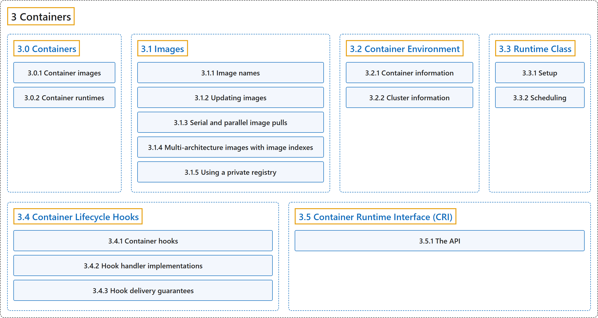

# 3 Containers

## Classification

## Glossary

| Term | Definition | 中文翻译 | Source |
|---|---|---|---|
| **3 Containers** 容器 | "**Technology for packaging an application along with its runtime dependencies.**" | **把应用程序连同其运行时依赖一起打包的技术。** | [The Kubernetes Authors, n.d.-d, "Containers", para. 1](https://kubernetes.io/docs/concepts/containers/#:~:text=Technology%20for%20packaging%20an%20application%20along%20with) |
| **[3.0 Containers](containers.md)** 容器 | "**Technology for packaging an application along with its runtime dependencies.**" | **把应用程序连同其运行时依赖一起打包的技术。** | [The Kubernetes Authors, n.d.-d, "Containers", para. 1](https://kubernetes.io/docs/concepts/containers/#:~:text=Technology%20for%20packaging%20an%20application%20along%20with) |
| **[3.1 Images](images.md)** 镜像 | "A container image **represents binary data that encapsulates an application and all its software dependencies**." | 容器镜像**代表封装了应用程序及其全部软件依赖的二进制数据**。 | [The Kubernetes Authors, n.d.-e, "Images", para. 1](https://kubernetes.io/docs/concepts/containers/images/#:~:text=A%20container%20image%20represents%20binary%20data%20that) |
| **[3.2 Container Environment](container-environment.md)** 容器环境 | "The Kubernetes Container environment **provides several important resources to Containers**:" | Kubernetes 容器环境**为容器提供若干重要资源**： | [The Kubernetes Authors, n.d.-a, "Container environment", para. 1](https://kubernetes.io/docs/concepts/containers/container-environment/#:~:text=The%20Kubernetes%20Container%20environment%20provides%20several%20important) |
| **[3.3 Runtime Class](runtime-class.md)** 运行时类 | "RuntimeClass is **a feature for selecting the container runtime configuration**." | RuntimeClass 是**一项用于选择容器运行时配置的功能**。 | [The Kubernetes Authors, n.d.-f, "Runtime Class", para. 2](https://kubernetes.io/docs/concepts/containers/runtime-class/#:~:text=RuntimeClass%20is%20a%20feature%20for%20selecting%20the) |
| **[3.4 Container Lifecycle Hooks](container-lifecycle-hooks.md)** 容器生命周期钩子 | "Analogous to many programming language frameworks that have component lifecycle hooks, such as Angular, **Kubernetes provides Containers with lifecycle hooks**." | 类似于许多带有组件生命周期钩子的编程语言框架（例如 Angular），**Kubernetes 为容器提供生命周期钩子**。 | [The Kubernetes Authors, n.d.-b, "Overview", para. 1](https://kubernetes.io/docs/concepts/containers/container-lifecycle-hooks/#:~:text=Analogous%20to%20many%20programming%20language%20frameworks%20that) |
| **[3.5 Container Runtime Interface (CRI)](cri.md)** 容器运行时接口（CRI） | "The CRI is **a plugin interface which enables the kubelet to use a wide variety of container runtimes**, without having a need to recompile the cluster components." | CRI 是**一个插件接口，使 kubelet 能够使用各种容器运行时**，而无需重新编译集群组件。 | [The Kubernetes Authors, n.d.-c, "Container Runtime Interface (CRI)", para. 1](https://kubernetes.io/docs/concepts/containers/cri/#:~:text=The%20CRI%20is%20a%20plugin%20interface%20which) |

## References

The Kubernetes Authors. (n.d.-a). *Container Environment*. Kubernetes Documentation. Retrieved October 31, 2026, from <https://kubernetes.io/docs/concepts/containers/container-environment/>

The Kubernetes Authors. (n.d.-b). *Container Lifecycle Hooks*. Kubernetes Documentation. Retrieved October 31, 2026, from <https://kubernetes.io/docs/concepts/containers/container-lifecycle-hooks/>

The Kubernetes Authors. (n.d.-c). *Container Runtime Interface (CRI)*. Kubernetes Documentation. Retrieved October 31, 2026, from <https://kubernetes.io/docs/concepts/containers/cri/>

The Kubernetes Authors. (n.d.-d). *Containers*. Kubernetes Documentation. Retrieved October 31, 2026, from <https://kubernetes.io/docs/concepts/containers/>

The Kubernetes Authors. (n.d.-e). *Images*. Kubernetes Documentation. Retrieved October 31, 2026, from <https://kubernetes.io/docs/concepts/containers/images/>

The Kubernetes Authors. (n.d.-f). *Runtime Class*. Kubernetes Documentation. Retrieved October 31, 2026, from <https://kubernetes.io/docs/concepts/containers/runtime-class/>
