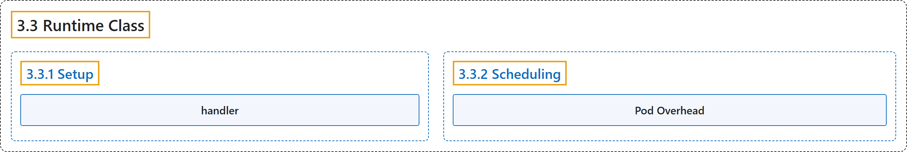

# 3.3 Runtime Class

## Classification

## Glossary

| Term | Definition | 中文翻译 | Source |
|---|---|---|---|
| **3.3 Runtime Class** 运行时类 | "**RuntimeClass** is a feature for **selecting the container runtime configuration**." | **RuntimeClass** 是一项用于**选择容器运行时配置**的功能。 | [The Kubernetes Authors, n.d., "Runtime Class", para. 2](https://kubernetes.io/docs/concepts/containers/runtime-class/#:~:text=RuntimeClass%20is%20a%20feature%20for%20selecting%20the) |
| **3.3.1 Setup** 设置 | (No definition) | （无定义） | [The Kubernetes Authors, n.d., "Setup"](https://kubernetes.io/docs/concepts/containers/runtime-class/#setup) |
| **handler** 处理程序 | "**The configurations** have **a corresponding `handler`** name, **referenced by the RuntimeClass**." | **这些配置**都有**一个对应的 `handler`** 名称，**由 RuntimeClass 引用**。 | [The Kubernetes Authors, n.d., "Note:", para. 2](https://kubernetes.io/docs/concepts/containers/runtime-class/#:~:text=The%20configurations%20have%20a%20corresponding%20%60handler%60%20name%2C) |
| **3.3.2 Scheduling** 调度 | "By specifying **the `scheduling` field for a RuntimeClass**, you can **set constraints** to ensure that Pods running with this RuntimeClass are **scheduled to nodes that support it**." | 为 RuntimeClass 指定 **`scheduling` 字段**，你可以**设置约束**，确保使用该 RuntimeClass 运行的 Pod **被调度到支持它的节点上**。 | [The Kubernetes Authors, n.d., "Scheduling", para. 1](https://kubernetes.io/docs/concepts/containers/runtime-class/#:~:text=By%20specifying%20the%20%60scheduling%60%20field%20for%20a) |
| **Pod Overhead** Pod 开销 | "You can specify ***overhead* resources** that are associated with **running a Pod**." | 你可以指定 ***开销*资源**，它们与**运行 Pod** 相关。 | [The Kubernetes Authors, n.d., "Pod Overhead", para. 1](https://kubernetes.io/docs/concepts/containers/runtime-class/#:~:text=You%20can%20specify%20%2Aoverhead%2A%20resources%20that%20are) |

## References

The Kubernetes Authors. (n.d.). *Runtime Class*. Kubernetes Documentation. Retrieved October 31, 2026, from <https://kubernetes.io/docs/concepts/containers/runtime-class/>
