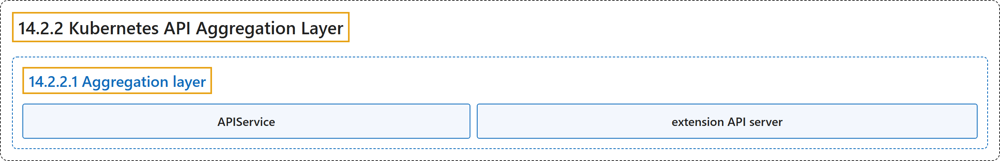

# 14.2.2 Kubernetes API Aggregation Layer

## Classification

## Glossary

| Term | Definition | 中文翻译 | Source |
|---|---|---|---|
| **14.2.2 Kubernetes API Aggregation Layer** Kubernetes API 聚合层 | "**The aggregation layer** allows Kubernetes to be **extended with additional APIs**, beyond what is offered by **the core Kubernetes APIs**." | **聚合层**允许 Kubernetes **用额外的 API 来扩展**，超出**核心 Kubernetes API** 所提供的范围。 | [The Kubernetes Authors, n.d., "Kubernetes API Aggregation Layer", para. 1](https://kubernetes.io/docs/concepts/extend-kubernetes/api-extension/apiserver-aggregation/#:~:text=The%20aggregation%20layer%20allows%20Kubernetes%20to%20be) |
| **14.2.2.1 Aggregation layer** 聚合层 | "**The aggregation layer** runs **in-process with the kube-apiserver**." | **聚合层**运行在**与 kube-apiserver 相同的进程中**。 | [The Kubernetes Authors, n.d., "Aggregation layer", para. 1](https://kubernetes.io/docs/concepts/extend-kubernetes/api-extension/apiserver-aggregation/#:~:text=The%20aggregation%20layer%20runs%20in-process%20with%20the) |
| **APIService** APIService | "To **register an API**, you **add an *APIService* object**, which "claims" **the URL path in the Kubernetes API**." | 要**注册一个 API**，你需要**添加一个 *APIService* 对象**，由它“认领” **Kubernetes API 中的 URL 路径**。 | [The Kubernetes Authors, n.d., "Aggregation layer", para. 1](https://kubernetes.io/docs/concepts/extend-kubernetes/api-extension/apiserver-aggregation/#:~:text=To%20register%20an%20API%2C%20you%20add%20an) |
| **extension API server** 扩展 API 服务器 | "The most common way to **implement the APIService** is to **run an *extension API server*** in **Pod(s) that run in your cluster**." | **实现 APIService** 最常见的方式，是**运行一个*扩展 API 服务器***，位于**集群中运行的 Pod** 里。 | [The Kubernetes Authors, n.d., "Aggregation layer", para. 2](https://kubernetes.io/docs/concepts/extend-kubernetes/api-extension/apiserver-aggregation/#:~:text=The%20most%20common%20way%20to%20implement%20the) |

## References

The Kubernetes Authors. (n.d.). *Kubernetes API Aggregation Layer*. Kubernetes Documentation. Retrieved October 31, 2026, from <https://kubernetes.io/docs/concepts/extend-kubernetes/api-extension/apiserver-aggregation/>
