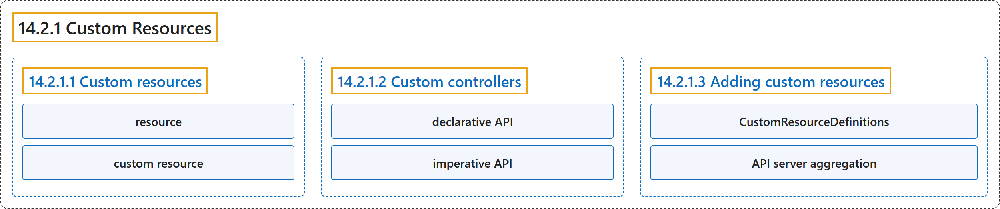

# 14.2.1 Custom Resources

## Classification

## Glossary

| Term | Definition | 中文翻译 | Source |
|---|---|---|---|
| **14.2.1 Custom Resources** 自定义资源 | "***Custom resources*** are **instances of resource types** added to Kubernetes **through API extensions**." | ***自定义资源*** 是**资源类型的实例**，这些类型**通过 API 扩展**添加到 Kubernetes。 | [The Kubernetes Authors, n.d., "Custom Resources", para. 1](https://kubernetes.io/docs/concepts/extend-kubernetes/api-extension/custom-resources/#:~:text=%2ACustom%20resources%2A%20are%20instances%20of%20resource%20types) |
| **14.2.1.1 Custom resources** 自定义资源 | (No definition) | （无定义） | [The Kubernetes Authors, n.d., "Custom resources"](https://kubernetes.io/docs/concepts/extend-kubernetes/api-extension/custom-resources/#custom-resources) |
| **resource** 资源 | "**A *resource*** is **an endpoint in the Kubernetes API** that stores **a collection of API objects of a certain kind**" | ***资源*** 是 **Kubernetes API 中的一个端点**，它存储**某种类型的一组 API 对象** | [The Kubernetes Authors, n.d., "Custom resources", para. 1](https://kubernetes.io/docs/concepts/extend-kubernetes/api-extension/custom-resources/#:~:text=A%20%2Aresource%2A%20is%20an%20endpoint%20in%20the) |
| **custom resource** 自定义资源 | "**A *custom resource*** is **an extension of the Kubernetes API** that is **not necessarily available in a default Kubernetes installation**." | ***自定义资源*** 是 **Kubernetes API 的一种扩展**，在**默认安装的 Kubernetes 中不一定可用**。 | [The Kubernetes Authors, n.d., "Custom resources", para. 2](https://kubernetes.io/docs/concepts/extend-kubernetes/api-extension/custom-resources/#:~:text=A%20%2Acustom%20resource%2A%20is%20an%20extension%20of) |
| **14.2.1.2 Custom controllers** 自定义控制器 | "On their own, **custom resources** let you **store and retrieve structured data**." | 单独使用时，**自定义资源**让你**存储和检索结构化数据**。 | [The Kubernetes Authors, n.d., "Custom controllers", para. 1](https://kubernetes.io/docs/concepts/extend-kubernetes/api-extension/custom-resources/#:~:text=On%20their%20own%2C%20custom%20resources%20let%20you) |
| **declarative API** 声明式 API | "When you combine **a custom resource with a *custom controller***, custom resources provide **a true *declarative API***." | 把**自定义资源与*自定义控制器*** 结合起来，自定义资源就提供了**真正的*声明式 API***。 | [The Kubernetes Authors, n.d., "Custom controllers", para. 1](https://kubernetes.io/docs/concepts/extend-kubernetes/api-extension/custom-resources/#:~:text=When%20you%20combine%20a%20custom%20resource%20with) |
| **imperative API** 命令式 API | (context) "This is in contrast to **an imperative API**, where you ***instruct* a server what to do**." | （语境）这与**命令式 API** 相反，后者由你 ***指示*服务器做什么**。 | [The Kubernetes Authors, n.d., "Custom controllers", para. 2](https://kubernetes.io/docs/concepts/extend-kubernetes/api-extension/custom-resources/#:~:text=This%20is%20in%20contrast%20to%20an%20imperative) |
| **14.2.1.3 Adding custom resources** 添加自定义资源 | "Kubernetes provides **two ways** to **add custom resources to your cluster**:" | Kubernetes 提供**两种方式**来**向集群添加自定义资源**： | [The Kubernetes Authors, n.d., "Adding custom resources", para. 1](https://kubernetes.io/docs/concepts/extend-kubernetes/api-extension/custom-resources/#:~:text=Kubernetes%20provides%20two%20ways%20to%20add%20custom) |
| **CustomResourceDefinitions** CustomResourceDefinition | "**The CustomResourceDefinition API resource** allows you to **define custom resources**." | **CustomResourceDefinition API 资源**让你**定义自定义资源**。 | [The Kubernetes Authors, n.d., "CustomResourceDefinitions", para. 1](https://kubernetes.io/docs/concepts/extend-kubernetes/api-extension/custom-resources/#:~:text=The%20%5BCustomResourceDefinition%5D%28https%3A%2F%2Fkubernetes.io%2Fdocs%2Ftasks%2Fextend-kubernetes%2Fcustom-resources%2Fcustom-resource-definitions%2F%29%20API%20resource%20allows%20you%20to) |
| **API server aggregation** API 服务器聚合 | (context) "Usually, **each resource in the Kubernetes API** requires code that **handles REST requests** and **manages persistent storage of objects**." | （语境）通常，**Kubernetes API 中的每种资源**都需要能**处理 REST 请求**并**管理对象持久存储**的代码。 | [The Kubernetes Authors, n.d., "API server aggregation", para. 1](https://kubernetes.io/docs/concepts/extend-kubernetes/api-extension/custom-resources/#:~:text=Usually%2C%20each%20resource%20in%20the%20Kubernetes%20API) |

## References

The Kubernetes Authors. (n.d.). *Custom Resources*. Kubernetes Documentation. Retrieved October 31, 2026, from <https://kubernetes.io/docs/concepts/extend-kubernetes/api-extension/custom-resources/>
