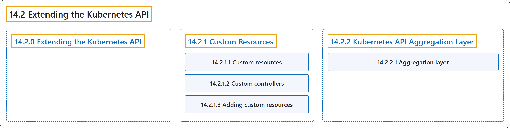

# 14.2 Extending the Kubernetes API

## Classification

## Glossary

| Term | Definition | 中文翻译 | Source |
|---|---|---|---|
| **14.2 Extending the Kubernetes API** 扩展 Kubernetes API | (context) "**Custom resources** are **extensions of the Kubernetes API**." | （语境）**自定义资源**是 **Kubernetes API 的扩展**。 | [The Kubernetes Authors, n.d.-b, "Extending the Kubernetes API", para. 1](https://kubernetes.io/docs/concepts/extend-kubernetes/api-extension/#:~:text=Custom%20resources%20are%20extensions%20of%20the%20Kubernetes) |
| **[14.2.0 Extending the Kubernetes API](extending-the-kubernetes-api.md)** 扩展 Kubernetes API | (context) "**Custom resources** are **extensions of the Kubernetes API**." | （语境）**自定义资源**是 **Kubernetes API 的扩展**。 | [The Kubernetes Authors, n.d.-b, "Extending the Kubernetes API", para. 1](https://kubernetes.io/docs/concepts/extend-kubernetes/api-extension/#:~:text=Custom%20resources%20are%20extensions%20of%20the%20Kubernetes) |
| **[14.2.1 Custom Resources](custom-resources.md)** 自定义资源 | "***Custom resources*** are **instances of resource types** added to Kubernetes **through API extensions**." | ***自定义资源*** 是**资源类型的实例**，这些类型**通过 API 扩展**添加到 Kubernetes。 | [The Kubernetes Authors, n.d.-a, "Custom Resources", para. 1](https://kubernetes.io/docs/concepts/extend-kubernetes/api-extension/custom-resources/#:~:text=%2ACustom%20resources%2A%20are%20instances%20of%20resource%20types) |
| **[14.2.2 Kubernetes API Aggregation Layer](apiserver-aggregation.md)** Kubernetes API 聚合层 | "**The aggregation layer** allows Kubernetes to be **extended with additional APIs**, beyond what is offered by **the core Kubernetes APIs**." | **聚合层**允许 Kubernetes **用额外的 API 来扩展**，超出**核心 Kubernetes API** 所提供的范围。 | [The Kubernetes Authors, n.d.-c, "Kubernetes API Aggregation Layer", para. 1](https://kubernetes.io/docs/concepts/extend-kubernetes/api-extension/apiserver-aggregation/#:~:text=The%20aggregation%20layer%20allows%20Kubernetes%20to%20be) |

## References

The Kubernetes Authors. (n.d.-a). *Custom Resources*. Kubernetes Documentation. Retrieved October 31, 2026, from <https://kubernetes.io/docs/concepts/extend-kubernetes/api-extension/custom-resources/>

The Kubernetes Authors. (n.d.-b). *Extending the Kubernetes API*. Kubernetes Documentation. Retrieved October 31, 2026, from <https://kubernetes.io/docs/concepts/extend-kubernetes/api-extension/>

The Kubernetes Authors. (n.d.-c). *Kubernetes API Aggregation Layer*. Kubernetes Documentation. Retrieved October 31, 2026, from <https://kubernetes.io/docs/concepts/extend-kubernetes/api-extension/apiserver-aggregation/>
