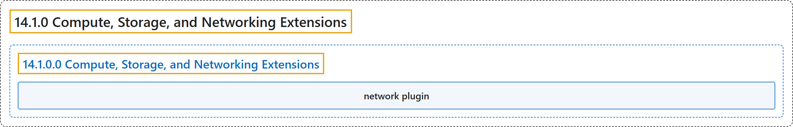

# 14.1.0 Compute, Storage, and Networking Extensions

## Classification

## Glossary

| Term | Definition | 中文翻译 | Source |
|---|---|---|---|
| **14.1.0 Compute, Storage, and Networking Extensions** 计算、存储与网络扩展 | "This section covers **extensions to your cluster that do not come as part as Kubernetes itself**." | 本节介绍**不属于 Kubernetes 本身的集群扩展**。 | [The Kubernetes Authors, n.d., "Compute, Storage, and Networking Extensions", para. 1](https://kubernetes.io/docs/concepts/extend-kubernetes/compute-storage-net/#:~:text=This%20section%20covers%20extensions%20to%20your%20cluster) |
| **14.1.0.0 Compute, Storage, and Networking Extensions** 计算、存储与网络扩展 | (No definition) | （无定义） | [The Kubernetes Authors, n.d., "Compute, Storage, and Networking Extensions"](https://kubernetes.io/docs/concepts/extend-kubernetes/compute-storage-net/#compute-storage-and-networking-extensions) |
| **network plugin** 网络插件 | "Your Kubernetes cluster needs a *network plugin* in order to **have a working Pod network and to support other aspects of the Kubernetes network model**." | 你的 Kubernetes 集群需要一个*网络插件*，**才能拥有可用的 Pod 网络并支持 Kubernetes 网络模型的其他方面**。 | [The Kubernetes Authors, n.d., "Compute, Storage, and Networking Extensions", para. 4](https://kubernetes.io/docs/concepts/extend-kubernetes/compute-storage-net/#:~:text=Your%20Kubernetes%20cluster%20needs%20a%20%2Anetwork%20plugin%2A) |

## References

The Kubernetes Authors. (n.d.). *Compute, Storage, and Networking Extensions*. Kubernetes Documentation. Retrieved October 31, 2026, from <https://kubernetes.io/docs/concepts/extend-kubernetes/compute-storage-net/>
