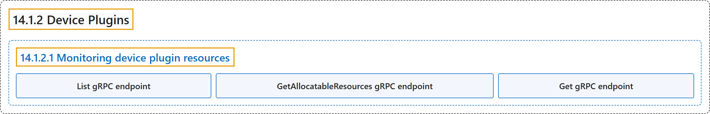

# 14.1.2 Device Plugins

## Classification

## Glossary

| Term | Definition | 中文翻译 | Source |
|---|---|---|---|
| **14.1.2 Device Plugins** 设备插件 | "**Device plugins** let you **configure your cluster** with support for **devices or resources that require vendor-specific setup**, such as GPUs, NICs, FPGAs, or non-volatile main memory." | **设备插件**让你**配置集群**，以支持**需要厂商特定设置的设备或资源**，例如 GPU、网卡、FPGA 或非易失性主存。 | [The Kubernetes Authors, n.d., "Device Plugins", para. 1](https://kubernetes.io/docs/concepts/extend-kubernetes/compute-storage-net/device-plugins/#:~:text=Device%20plugins%20let%20you%20configure%20your%20cluster) |
| **14.1.2.1 Monitoring device plugin resources** 监控设备插件资源 | (No definition) | （无定义） | [The Kubernetes Authors, n.d., "Monitoring device plugin resources"](https://kubernetes.io/docs/concepts/extend-kubernetes/compute-storage-net/device-plugins/#monitoring-device-plugin-resources) |
| **List gRPC endpoint** List gRPC 端点 | "**The `List` endpoint** provides information on **resources of running pods**" | **`List` 端点**提供**运行中 Pod 的资源**信息 | [The Kubernetes Authors, n.d., "List gRPC endpoint", para. 1](https://kubernetes.io/docs/concepts/extend-kubernetes/compute-storage-net/device-plugins/#:~:text=The%20%60List%60%20endpoint%20provides%20information%20on%20resources) |
| **GetAllocatableResources gRPC endpoint** GetAllocatableResources gRPC 端点 | "**GetAllocatableResources** provides information on **resources initially available on the worker node**." | **GetAllocatableResources** 提供**工作节点上最初可用的资源**信息。 | [The Kubernetes Authors, n.d., "GetAllocatableResources gRPC endpoint", para. 1](https://kubernetes.io/docs/concepts/extend-kubernetes/compute-storage-net/device-plugins/#:~:text=GetAllocatableResources%20provides%20information%20on%20resources%20initially%20available) |
| **Get gRPC endpoint** Get gRPC 端点 | "**The `Get` endpoint** provides information on **resources of a running Pod**." | **`Get` 端点**提供**某个运行中 Pod 的资源**信息。 | [The Kubernetes Authors, n.d., "Get gRPC endpoint", para. 1](https://kubernetes.io/docs/concepts/extend-kubernetes/compute-storage-net/device-plugins/#:~:text=The%20%60Get%60%20endpoint%20provides%20information%20on%20resources) |

## References

The Kubernetes Authors. (n.d.). *Device Plugins*. Kubernetes Documentation. Retrieved October 31, 2026, from <https://kubernetes.io/docs/concepts/extend-kubernetes/compute-storage-net/device-plugins/>
