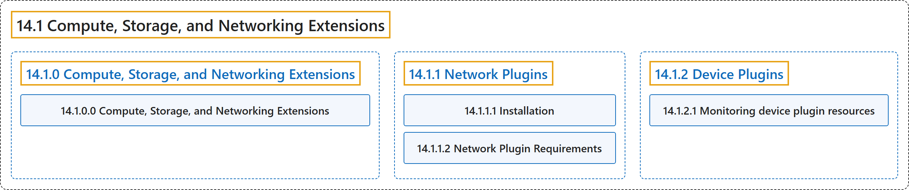

# 14.1 Compute, Storage, and Networking Extensions

## Classification

## Glossary

| Term | Definition | 中文翻译 | Source |
|---|---|---|---|
| **14.1 Compute, Storage, and Networking Extensions** 计算、存储与网络扩展 | "This section covers **extensions to your cluster that do not come as part as Kubernetes itself**." | 本节介绍**不属于 Kubernetes 本身的集群扩展**。 | [The Kubernetes Authors, n.d.-a, "Compute, Storage, and Networking Extensions", para. 1](https://kubernetes.io/docs/concepts/extend-kubernetes/compute-storage-net/#:~:text=This%20section%20covers%20extensions%20to%20your%20cluster) |
| **[14.1.0 Compute, Storage, and Networking Extensions](compute-storage-and-networking-extensions.md)** 计算、存储与网络扩展 | "This section covers **extensions to your cluster that do not come as part as Kubernetes itself**." | 本节介绍**不属于 Kubernetes 本身的集群扩展**。 | [The Kubernetes Authors, n.d.-a, "Compute, Storage, and Networking Extensions", para. 1](https://kubernetes.io/docs/concepts/extend-kubernetes/compute-storage-net/#:~:text=This%20section%20covers%20extensions%20to%20your%20cluster) |
| **[14.1.1 Network Plugins](network-plugins.md)** 网络插件 | "Kubernetes (version 1.3 through to the latest 1.37, and likely onwards) **lets you use [Container Network Interface](https://github.com/containernetworking/cni) (CNI) plugins for cluster networking**." | Kubernetes（从 1.3 版到最新的 1.37，并可能延续下去）**让你使用[容器网络接口](https://github.com/containernetworking/cni)（CNI）插件实现集群网络**。 | [The Kubernetes Authors, n.d.-c, "Network Plugins", para. 1](https://kubernetes.io/docs/concepts/extend-kubernetes/compute-storage-net/network-plugins/#:~:text=Kubernetes%20%28version%201.3%20through%20to%20the%20latest) |
| **[14.1.2 Device Plugins](device-plugins.md)** 设备插件 | "Device plugins let you **configure your cluster with support for devices or resources that require vendor-specific setup**, such as GPUs, NICs, FPGAs, or non-volatile main memory." | 设备插件让你**为集群配置对需要厂商特定设置的设备或资源的支持**，例如 GPU、网卡、FPGA 或非易失性主存。 | [The Kubernetes Authors, n.d.-b, "Device Plugins", para. 1](https://kubernetes.io/docs/concepts/extend-kubernetes/compute-storage-net/device-plugins/#:~:text=Device%20plugins%20let%20you%20configure%20your%20cluster) |

## References

The Kubernetes Authors. (n.d.-a). *Compute, Storage, and Networking Extensions*. Kubernetes Documentation. Retrieved October 31, 2026, from <https://kubernetes.io/docs/concepts/extend-kubernetes/compute-storage-net/>

The Kubernetes Authors. (n.d.-b). *Device Plugins*. Kubernetes Documentation. Retrieved October 31, 2026, from <https://kubernetes.io/docs/concepts/extend-kubernetes/compute-storage-net/device-plugins/>

The Kubernetes Authors. (n.d.-c). *Network Plugins*. Kubernetes Documentation. Retrieved October 31, 2026, from <https://kubernetes.io/docs/concepts/extend-kubernetes/compute-storage-net/network-plugins/>
