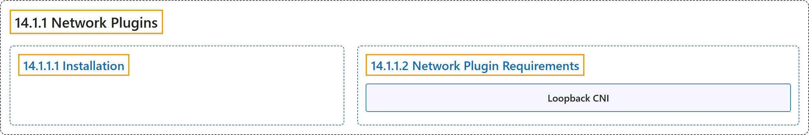

# 14.1.1 Network Plugins

## Classification

## Glossary

| Term | Definition | 中文翻译 | Source |
|---|---|---|---|
| **14.1.1 Network Plugins** 网络插件 | "Kubernetes (version 1.3 through to the latest 1.37, and likely onwards) **lets you use [Container Network Interface](https://github.com/containernetworking/cni) (CNI) plugins for cluster networking**." | Kubernetes（从 1.3 版到最新的 1.37，并可能延续下去）**让你使用[容器网络接口](https://github.com/containernetworking/cni)（CNI）插件实现集群网络**。 | [The Kubernetes Authors, n.d., "Network Plugins", para. 1](https://kubernetes.io/docs/concepts/extend-kubernetes/compute-storage-net/network-plugins/#:~:text=Kubernetes%20%28version%201.3%20through%20to%20the%20latest) |
| **14.1.1.1 Installation** 安装 | "A Container Runtime, in the networking context, is **a daemon on a node configured to provide CRI Services for kubelet**." | 在网络语境下，容器运行时是**节点上一个配置为向 kubelet 提供 CRI 服务的守护进程**。 | [The Kubernetes Authors, n.d., "Installation", para. 1](https://kubernetes.io/docs/concepts/extend-kubernetes/compute-storage-net/network-plugins/#:~:text=A%20Container%20Runtime%2C%20in%20the%20networking%20context%2C) |
| **14.1.1.2 Network Plugin Requirements** 网络插件要求 | (No definition) | （无定义） | [The Kubernetes Authors, n.d., "Network Plugin Requirements"](https://kubernetes.io/docs/concepts/extend-kubernetes/compute-storage-net/network-plugins/#network-plugin-requirements) |
| **Loopback CNI** 回环 CNI | (context) "Kubernetes also **requires the container runtimes to provide a loopback interface `lo`**" | （语境）Kubernetes 还**要求容器运行时提供一个回环接口 `lo`** | [The Kubernetes Authors, n.d., "Loopback CNI", para. 1](https://kubernetes.io/docs/concepts/extend-kubernetes/compute-storage-net/network-plugins/#:~:text=Kubernetes%20also%20requires%20the%20container%20runtimes%20to) |

## References

The Kubernetes Authors. (n.d.). *Network Plugins*. Kubernetes Documentation. Retrieved October 31, 2026, from <https://kubernetes.io/docs/concepts/extend-kubernetes/compute-storage-net/network-plugins/>
