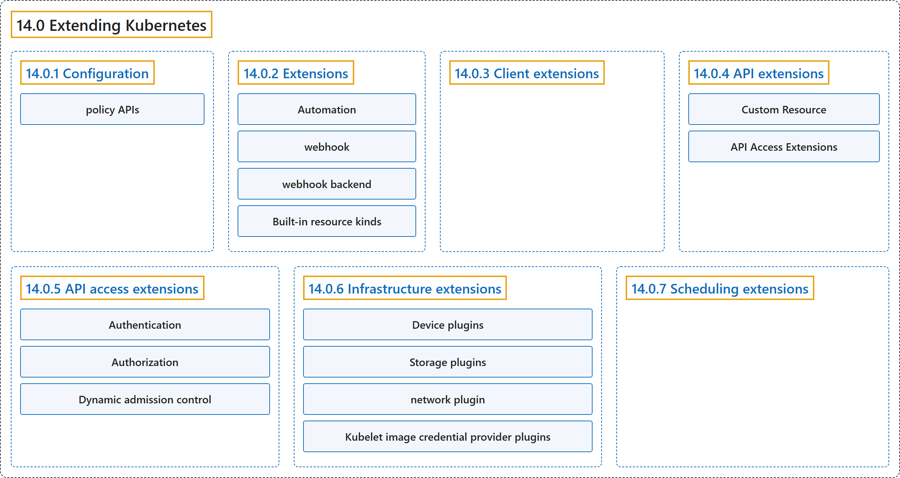

# 14.0 Extending Kubernetes

## Classification

## Glossary

| Term | Definition | 中文翻译 | Source |
|---|---|---|---|
| **14.0 Extending Kubernetes** 扩展 Kubernetes | "**Different ways** to **change the behavior of your Kubernetes cluster**." | **不同方式**，用来**改变 Kubernetes 集群的行为**。 | [The Kubernetes Authors, n.d., "Extending Kubernetes", para. 1](https://kubernetes.io/docs/concepts/extend-kubernetes/#:~:text=Different%20ways%20to%20change%20the%20behavior%20of) |
| **14.0.1 Configuration** 配置 | (context) "***Configuration files* and *command arguments*** are documented in **the Reference section of the online documentation**" | （语境）***配置文件*和*命令参数*** 记载在**在线文档的参考部分** | [The Kubernetes Authors, n.d., "Configuration", para. 1](https://kubernetes.io/docs/concepts/extend-kubernetes/#:~:text=%2AConfiguration%20files%2A%20and%20%2Acommand%20arguments%2A%20are%20documented) |
| **policy APIs** 策略 API | (context) "**Built-in *policy APIs***, such as **ResourceQuota, NetworkPolicy and Role-based Access Control**" | （语境）**内置的*策略 API***，例如 **ResourceQuota、NetworkPolicy 和基于角色的访问控制** | [The Kubernetes Authors, n.d., "Configuration", para. 8](https://kubernetes.io/docs/concepts/extend-kubernetes/#:~:text=Built-in%20%2Apolicy%20APIs%2A%2C%20such%20as%20%5BResourceQuota%5D%28https%3A%2F%2Fkubernetes.io%2Fdocs%2Fconcepts%2Fpolicy%2Fresource-quotas%2F%29%2C%20%5BNetworkPolicy%5D%28https%3A%2F%2Fkubernetes.io%2Fdocs%2Fconcepts%2Fservices-networking%2Fnetwork-policies%2F%29) |
| **14.0.2 Extensions** 扩展 | "**Extensions** are **software components** that **extend and deeply integrate with Kubernetes**." | **扩展**是一类**软件组件**，它们**扩展 Kubernetes 并与之深度集成**。 | [The Kubernetes Authors, n.d., "Extensions", para. 1](https://kubernetes.io/docs/concepts/extend-kubernetes/#:~:text=Extensions%20are%20software%20components%20that%20extend%20and) |
| **Automation** 自动化 | "***Automation*** can **run on the cluster** or **off it**." | ***自动化*** 可以**在集群内运行**，也可以**在集群外运行**。 | [The Kubernetes Authors, n.d., "Extension patterns", para. 1](https://kubernetes.io/docs/concepts/extend-kubernetes/#:~:text=%2AAutomation%2A%20can%20run%20on%20the%20cluster%20or) |
| **webhook** Webhook | "When **Kubernetes is the client** and **calls out to a remote service**, **Kubernetes calls this a *webhook***." | 当 **Kubernetes 作为客户端**并**调用远程服务**时，**Kubernetes 把这称为 *Webhook***。 | [The Kubernetes Authors, n.d., "Extension patterns", para. 3](https://kubernetes.io/docs/concepts/extend-kubernetes/#:~:text=When%20Kubernetes%20is%20the%20client%20and%20calls) |
| **webhook backend** Webhook 后端 | "**The remote service** is **called a *webhook backend***." | **该远程服务**被**称为 *Webhook 后端***。 | [The Kubernetes Authors, n.d., "Extension patterns", para. 3](https://kubernetes.io/docs/concepts/extend-kubernetes/#:~:text=The%20remote%20service%20is%20called%20a%20%2Awebhook) |
| **Built-in resource kinds** 内置资源类型 | "***Built-in resource kinds***, such as `pods`, are **defined by the Kubernetes project** and **can't be changed**." | ***内置资源类型***（例如 `pods`）**由 Kubernetes 项目定义**，**不能更改**。 | [The Kubernetes Authors, n.d., "Key to the figure", para. 3](https://kubernetes.io/docs/concepts/extend-kubernetes/#:~:text=%2ABuilt-in%20resource%20kinds%2A%2C%20such%20as%20%60pods%60%2C%20are) |
| **14.0.3 Client extensions** 客户端扩展 | "**Plugins for kubectl** are **separate binaries** that **add or replace the behavior of specific subcommands**." | **kubectl 插件**是**独立的二进制文件**，用来**添加或替换特定子命令的行为**。 | [The Kubernetes Authors, n.d., "Client extensions", para. 1](https://kubernetes.io/docs/concepts/extend-kubernetes/#:~:text=Plugins%20for%20kubectl%20are%20separate%20binaries%20that) |
| **14.0.4 API extensions** API 扩展 | (No definition) | （无定义） | [The Kubernetes Authors, n.d., "API extensions"](https://kubernetes.io/docs/concepts/extend-kubernetes/#api-extensions) |
| **Custom Resource** 自定义资源 | (context) "Consider **adding a *Custom Resource* to Kubernetes** if you want to **define new controllers, application configuration objects or other declarative APIs**" | （语境）可以考虑**向 Kubernetes 添加*自定义资源***，前提是你想**定义新的控制器、应用配置对象或其他声明式 API** | [The Kubernetes Authors, n.d., "Custom resource definitions", para. 1](https://kubernetes.io/docs/concepts/extend-kubernetes/#:~:text=Consider%20adding%20a%20%2ACustom%20Resource%2A%20to%20Kubernetes) |
| **API Access Extensions** API 访问扩展 | (context) "**Adding an API** does not directly let you affect **the behavior of existing APIs** (such as Pods), whereas ***API Access Extensions* do**." | （语境）**添加 API** 并不能直接影响**现有 API 的行为**（例如 Pod），而 ***API 访问扩展*可以**。 | [The Kubernetes Authors, n.d., "Changing built-in resources", para. 1](https://kubernetes.io/docs/concepts/extend-kubernetes/#:~:text=Adding%20an%20API%20does%20not%20directly%20let) |
| **14.0.5 API access extensions** API 访问扩展 | "When a request reaches the Kubernetes API Server, **it is first *authenticated***, then ***authorized***, and is then subject to **various types of *admission control***" | 请求到达 Kubernetes API 服务器后，**先被*认证***，再被 ***鉴权***，然后接受**各种*准入控制*** | [The Kubernetes Authors, n.d., "API access extensions", para. 1](https://kubernetes.io/docs/concepts/extend-kubernetes/#:~:text=When%20a%20request%20reaches%20the%20Kubernetes%20API) |
| **Authentication** 认证 | "Authentication **maps headers or certificates** in all requests to **a username for the client making the request**." | 认证**把每个请求中的请求头或证书映射**为**发出请求的客户端的用户名**。 | [The Kubernetes Authors, n.d., "Authentication", para. 1](https://kubernetes.io/docs/concepts/extend-kubernetes/#:~:text=%5BAuthentication%5D%28https%3A%2F%2Fkubernetes.io%2Fdocs%2Freference%2Faccess-authn-authz%2Fauthentication%2F%29%20maps%20headers%20or%20certificates%20in%20all) |
| **Authorization** 鉴权 | "Authorization **determines whether specific users** can **read, write, and do other operations on API resources**." | 鉴权**决定特定用户**能否**对 API 资源进行读、写及其他操作**。 | [The Kubernetes Authors, n.d., "Authorization", para. 1](https://kubernetes.io/docs/concepts/extend-kubernetes/#:~:text=%5BAuthorization%5D%28https%3A%2F%2Fkubernetes.io%2Fdocs%2Freference%2Faccess-authn-authz%2Fauthorization%2F%29%20determines%20whether%20specific%20users%20can%20read%2C) |
| **Dynamic admission control** 动态准入控制 | (context) "After a request is authorized, if it is **a write operation**, it also goes through **Admission Control steps**." | （语境）请求通过鉴权之后，如果是**写操作**，还要经过**准入控制步骤**。 | [The Kubernetes Authors, n.d., "Dynamic admission control", para. 1](https://kubernetes.io/docs/concepts/extend-kubernetes/#:~:text=After%20a%20request%20is%20authorized%2C%20if%20it) |
| **14.0.6 Infrastructure extensions** 基础设施扩展 | (No definition) | （无定义） | [The Kubernetes Authors, n.d., "Infrastructure extensions"](https://kubernetes.io/docs/concepts/extend-kubernetes/#infrastructure-extensions) |
| **Device plugins** 设备插件 | "*Device plugins* **allow a node to discover new Node resources** (in addition to **the builtin ones like cpu and memory**)" | *设备插件* **让节点发现新的节点资源**（除了 **cpu 和内存等内置资源**之外） | [The Kubernetes Authors, n.d., "Device plugins", para. 1](https://kubernetes.io/docs/concepts/extend-kubernetes/#:~:text=%2ADevice%20plugins%2A%20allow%20a%20node%20to%20discover) |
| **Storage plugins** 存储插件 | "**Container Storage Interface (CSI) plugins** provide a way to **extend Kubernetes with supports for new kinds of volumes**." | **容器存储接口插件**（CSI）提供一种方式来**扩展 Kubernetes 以支持新的卷类型**。 | [The Kubernetes Authors, n.d., "Storage plugins", para. 1](https://kubernetes.io/docs/concepts/extend-kubernetes/#:~:text=%5BContainer%20Storage%20Interface%5D%28https%3A%2F%2Fkubernetes.io%2Fdocs%2Fconcepts%2Fstorage%2Fvolumes%2F%23csi%29%20%28CSI%29%20plugins%20provide%20a) |
| **network plugin** 网络插件 | "Your Kubernetes cluster needs a ***network plugin*** in order to have **a working Pod network** and to support **other aspects of the Kubernetes network model**." | 你的 Kubernetes 集群需要一个 ***网络插件***，才能拥有**可用的 Pod 网络**并支持 **Kubernetes 网络模型的其他方面**。 | [The Kubernetes Authors, n.d., "Network plugins", para. 1](https://kubernetes.io/docs/concepts/extend-kubernetes/#:~:text=Your%20Kubernetes%20cluster%20needs%20a%20%2Anetwork%20plugin%2A) |
| **Kubelet image credential provider plugins** kubelet 镜像凭据提供程序插件 | "The plugins can **communicate with external services** or **use local files** to **obtain credentials**." | 这些插件可以**与外部服务通信**，或**使用本地文件**，来**获取凭据**。 | [The Kubernetes Authors, n.d., "Kubelet image credential provider plugins", para. 1](https://kubernetes.io/docs/concepts/extend-kubernetes/#:~:text=The%20plugins%20can%20communicate%20with%20external%20services) |
| **14.0.7 Scheduling extensions** 调度扩展 | "**The scheduler** is **a special type of controller** that **watches pods**, and **assigns pods to nodes**." | **调度器**是**一种特殊的控制器**，它**监视 Pod** 并**把 Pod 分配给节点**。 | [The Kubernetes Authors, n.d., "Scheduling extensions", para. 1](https://kubernetes.io/docs/concepts/extend-kubernetes/#:~:text=The%20scheduler%20is%20a%20special%20type%20of) |

## References

The Kubernetes Authors. (n.d.). *Extending Kubernetes*. Kubernetes Documentation. Retrieved October 31, 2026, from <https://kubernetes.io/docs/concepts/extend-kubernetes/>
