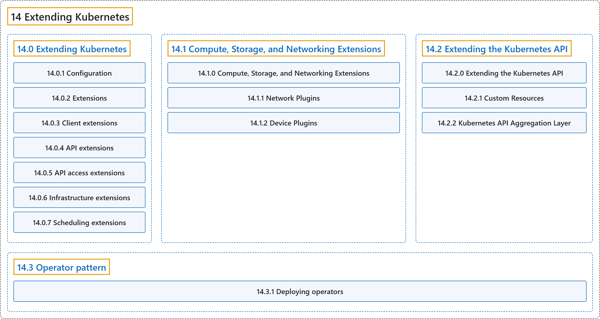

# 14 Extending Kubernetes

## Classification

## Glossary

| Term | Definition | 中文翻译 | Source |
|---|---|---|---|
| **14 Extending Kubernetes** 扩展 Kubernetes | "**Different ways to change the behavior of your Kubernetes cluster.**" | **改变 Kubernetes 集群行为的不同方式。** | [The Kubernetes Authors, n.d.-b, "Extending Kubernetes", para. 1](https://kubernetes.io/docs/concepts/extend-kubernetes/#:~:text=Different%20ways%20to%20change%20the%20behavior%20of) |
| **[14.0 Extending Kubernetes](extending-kubernetes.md)** 扩展 Kubernetes | "**Different ways to change the behavior of your Kubernetes cluster.**" | **改变 Kubernetes 集群行为的不同方式。** | [The Kubernetes Authors, n.d.-b, "Extending Kubernetes", para. 1](https://kubernetes.io/docs/concepts/extend-kubernetes/#:~:text=Different%20ways%20to%20change%20the%20behavior%20of) |
| **[14.1 Compute, Storage, and Networking Extensions](compute-storage-net/index.md)** 计算、存储与网络扩展 | "This section covers **extensions to your cluster that do not come as part as Kubernetes itself**." | 本节介绍**不属于 Kubernetes 本身的集群扩展**。 | [The Kubernetes Authors, n.d.-a, "Compute, Storage, and Networking Extensions", para. 1](https://kubernetes.io/docs/concepts/extend-kubernetes/compute-storage-net/#:~:text=This%20section%20covers%20extensions%20to%20your%20cluster) |
| **[14.2 Extending the Kubernetes API](api-extension/index.md)** 扩展 Kubernetes API | (context) "Custom resources are **extensions of the Kubernetes API**." | （语境）自定义资源是 **Kubernetes API 的扩展**。 | [The Kubernetes Authors, n.d.-c, "Extending the Kubernetes API", para. 1](https://kubernetes.io/docs/concepts/extend-kubernetes/api-extension/#:~:text=Custom%20resources%20are%20extensions%20of%20the%20Kubernetes) |
| **[14.3 Operator pattern](operator.md)** Operator 模式 | "Operators are **software extensions to Kubernetes that make use of [custom resources](https://kubernetes.io/docs/concepts/extend-kubernetes/api-extension/custom-resources/) to manage applications and their components**." | Operator 是**利用[自定义资源](https://kubernetes.io/docs/concepts/extend-kubernetes/api-extension/custom-resources/)来管理应用及其组件的 Kubernetes 软件扩展**。 | [The Kubernetes Authors, n.d.-d, "Operator pattern", para. 1](https://kubernetes.io/docs/concepts/extend-kubernetes/operator/#:~:text=Operators%20are%20software%20extensions%20to%20Kubernetes%20that) |

## References

The Kubernetes Authors. (n.d.-a). *Compute, Storage, and Networking Extensions*. Kubernetes Documentation. Retrieved October 31, 2026, from <https://kubernetes.io/docs/concepts/extend-kubernetes/compute-storage-net/>

The Kubernetes Authors. (n.d.-b). *Extending Kubernetes*. Kubernetes Documentation. Retrieved October 31, 2026, from <https://kubernetes.io/docs/concepts/extend-kubernetes/>

The Kubernetes Authors. (n.d.-c). *Extending the Kubernetes API*. Kubernetes Documentation. Retrieved October 31, 2026, from <https://kubernetes.io/docs/concepts/extend-kubernetes/api-extension/>

The Kubernetes Authors. (n.d.-d). *Operator pattern*. Kubernetes Documentation. Retrieved October 31, 2026, from <https://kubernetes.io/docs/concepts/extend-kubernetes/operator/>
