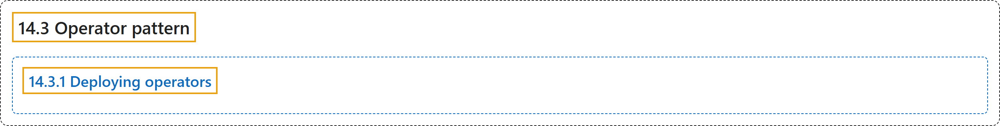

# 14.3 Operator pattern

## Classification

## Glossary

| Term | Definition | 中文翻译 | Source |
|---|---|---|---|
| **14.3 Operator pattern** Operator 模式 | "Operators are **software extensions to Kubernetes** that make use of **custom resources** to **manage applications and their components**." | Operator 是 **Kubernetes 的软件扩展**，**利用自定义资源**来**管理应用及其组件**。 | [The Kubernetes Authors, n.d., "Operator pattern", para. 1](https://kubernetes.io/docs/concepts/extend-kubernetes/operator/#:~:text=Operators%20are%20software%20extensions%20to%20Kubernetes%20that) |
| **14.3.1 Deploying operators** 部署 Operator | "The most common way to **deploy an operator** is to **add the Custom Resource Definition and its associated Controller** to **your cluster**." | **部署 Operator** 最常见的方式，是**把自定义资源定义及其关联的控制器添加**到**你的集群**中。 | [The Kubernetes Authors, n.d., "Deploying operators", para. 1](https://kubernetes.io/docs/concepts/extend-kubernetes/operator/#:~:text=The%20most%20common%20way%20to%20deploy%20an) |

## References

The Kubernetes Authors. (n.d.). *Operator pattern*. Kubernetes Documentation. Retrieved October 31, 2026, from <https://kubernetes.io/docs/concepts/extend-kubernetes/operator/>
