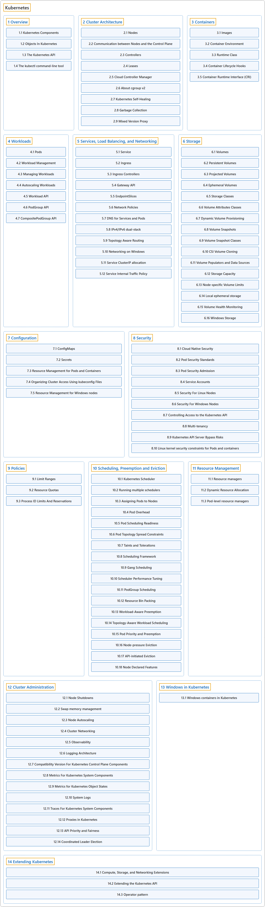

# Kubernetes

## Classification

## Glossary

| Term | Definition | 中文翻译 | Source |
|---|---|---|---|
| **Kubernetes** Kubernetes | "Kubernetes is **a portable, extensible, open source platform** for **managing containerized workloads and services** that facilitate both **declarative configuration and automation**." | Kubernetes 是**一个可移植、可扩展的开源平台**，用于**管理容器化的工作负载和服务**，可促进**声明式配置和自动化**。 | [The Kubernetes Authors, n.d.-f, "Overview", para. 1](https://kubernetes.io/docs/concepts/overview/#:~:text=Kubernetes%20is%20a%20portable%2C%20extensible%2C%20open%20source) |
| **[1 Overview](overview/index.md)** 概述 | (No definition) | （无定义） | [The Kubernetes Authors, n.d.-f, "Overview", documentation menu](https://kubernetes.io/docs/concepts/overview/) |
| **[2 Cluster Architecture](architecture/index.md)** 集群架构 | (context) "**The architectural concepts behind Kubernetes.**" | （语境）**Kubernetes 背后的架构概念。** | [The Kubernetes Authors, n.d.-b, "Cluster Architecture", para. 1](https://kubernetes.io/docs/concepts/architecture/#:~:text=The%20architectural%20concepts%20behind%20Kubernetes.) |
| **[3 Containers](containers/index.md)** 容器 | "**Technology** for **packaging an application** along with **its runtime dependencies**." | **技术**，用于**打包应用程序**及**其运行时依赖**。 | [The Kubernetes Authors, n.d.-d, "Containers", para. 1](https://kubernetes.io/docs/concepts/containers/#:~:text=Technology%20for%20packaging%20an%20application%20along%20with) |
| **[4 Workloads](workloads/index.md)** 工作负载 | "**A workload** is **an application running on Kubernetes**." | **工作负载**是**运行在 Kubernetes 上的应用程序**。 | [The Kubernetes Authors, n.d.-n, "Workloads", para. 2](https://kubernetes.io/docs/concepts/workloads/#:~:text=A%20workload%20is%20an%20application%20running%20on%20Kubernetes) |
| **[5 Services, Load Balancing, and Networking](services-networking/index.md)** 服务、负载均衡与网络 | (context) "**Concepts and resources** behind **networking in Kubernetes**." | （语境）**概念和资源**，支撑 **Kubernetes 中的网络**。 | [The Kubernetes Authors, n.d.-k, "Services, Load Balancing, and Networking", para. 1](https://kubernetes.io/docs/concepts/services-networking/#:~:text=Concepts%20and%20resources%20behind%20networking%20in%20Kubernetes.) |
| **[6 Storage](storage/index.md)** 存储 | "**Ways** to provide both **long-term and temporary storage** to **Pods in your cluster**." | **各种方式**，把**长期和临时存储**提供给**集群中的 Pod**。 | [The Kubernetes Authors, n.d.-l, "Storage", para. 1](https://kubernetes.io/docs/concepts/storage/#:~:text=Ways%20to%20provide%20both%20long-term%20and%20temporary) |
| **[7 Configuration](configuration/index.md)** 配置 | "**Configuration mechanisms within Kubernetes.**" | **Kubernetes 内部的配置机制。** | [The Kubernetes Authors, n.d.-c, "Configuration", para. 1](https://kubernetes.io/docs/concepts/configuration/#:~:text=Configuration%20mechanisms%20within%20Kubernetes.) |
| **[8 Security](security/index.md)** 安全 | (context) "**Concepts** for **keeping your cloud-native workload secure**." | （语境）**概念**，用于**保障云原生工作负载的安全**。 | [The Kubernetes Authors, n.d.-j, "Security", para. 1](https://kubernetes.io/docs/concepts/security/#:~:text=Concepts%20for%20keeping%20your%20cloud-native%20workload%20secure.) |
| **[9 Policies](policy/index.md)** 策略 | (context) "**Manage security and best-practices** with **policies**." | （语境）**管理安全和最佳实践**，手段是**策略**。 | [The Kubernetes Authors, n.d.-g, "Policies", para. 1](https://kubernetes.io/docs/concepts/policy/#:~:text=Manage%20security%20and%20best-practices%20with%20policies.) |
| **[10 Scheduling, Preemption and Eviction](scheduling-eviction/index.md)** 调度、抢占与驱逐 | (context) "In Kubernetes, **scheduling** refers to making sure that **Pods are matched to Nodes** so that **the kubelet can run them**." | （语境）在 Kubernetes 中，**调度**是指确保 **Pod 被匹配到 Node**，以便 **kubelet 能够运行它们**。 | [The Kubernetes Authors, n.d.-i, "Scheduling, Preemption and Eviction", para. 1](https://kubernetes.io/docs/concepts/scheduling-eviction/#:~:text=In%20Kubernetes%2C%20scheduling%20refers%20to%20making%20sure) |
| **[11 Resource Management](resource-management/index.md)** 资源管理 | "How **Kubernetes represents, requests, allocates, and constrains** the **resources that workloads consume**." | **Kubernetes 如何表示、请求、分配和约束**那些**工作负载所消耗的资源**。 | [The Kubernetes Authors, n.d.-h, "Resource Management", para. 1](https://kubernetes.io/docs/concepts/resource-management/#:~:text=How%20Kubernetes%20represents%2C%20requests%2C%20allocates%2C%20and%20constrains) |
| **[12 Cluster Administration](cluster-administration/index.md)** 集群管理 | "**Lower-level detail** relevant to **creating or administering a Kubernetes cluster**." | **底层细节**，与**创建或管理 Kubernetes 集群**相关。 | [The Kubernetes Authors, n.d.-a, "Cluster Administration", para. 1](https://kubernetes.io/docs/concepts/cluster-administration/#:~:text=Lower-level%20detail%20relevant%20to%20creating%20or%20administering) |
| **[13 Windows in Kubernetes](windows/index.md)** Kubernetes 中的 Windows | (context) "**Kubernetes supports nodes** that **run Microsoft Windows**." | （语境）**Kubernetes 支持节点**，这些节点**运行 Microsoft Windows**。 | [The Kubernetes Authors, n.d.-m, "Windows in Kubernetes", para. 1](https://kubernetes.io/docs/concepts/windows/#:~:text=Kubernetes%20supports%20nodes%20that%20run%20Microsoft%20Windows.) |
| **[14 Extending Kubernetes](extend-kubernetes/index.md)** 扩展 Kubernetes | "**Different ways** to **change the behavior of your Kubernetes cluster**." | **不同方式**，用来**改变 Kubernetes 集群的行为**。 | [The Kubernetes Authors, n.d.-e, "Extending Kubernetes", para. 1](https://kubernetes.io/docs/concepts/extend-kubernetes/#:~:text=Different%20ways%20to%20change%20the%20behavior%20of) |

## References

The Kubernetes Authors. (n.d.-a). *Cluster Administration*. Kubernetes Documentation. Retrieved October 31, 2026, from <https://kubernetes.io/docs/concepts/cluster-administration/>

The Kubernetes Authors. (n.d.-b). *Cluster Architecture*. Kubernetes Documentation. Retrieved October 31, 2026, from <https://kubernetes.io/docs/concepts/architecture/>

The Kubernetes Authors. (n.d.-c). *Configuration*. Kubernetes Documentation. Retrieved October 31, 2026, from <https://kubernetes.io/docs/concepts/configuration/>

The Kubernetes Authors. (n.d.-d). *Containers*. Kubernetes Documentation. Retrieved October 31, 2026, from <https://kubernetes.io/docs/concepts/containers/>

The Kubernetes Authors. (n.d.-e). *Extending Kubernetes*. Kubernetes Documentation. Retrieved October 31, 2026, from <https://kubernetes.io/docs/concepts/extend-kubernetes/>

The Kubernetes Authors. (n.d.-f). *Overview*. Kubernetes Documentation. Retrieved October 31, 2026, from <https://kubernetes.io/docs/concepts/overview/>

The Kubernetes Authors. (n.d.-g). *Policies*. Kubernetes Documentation. Retrieved October 31, 2026, from <https://kubernetes.io/docs/concepts/policy/>

The Kubernetes Authors. (n.d.-h). *Resource Management*. Kubernetes Documentation. Retrieved October 31, 2026, from <https://kubernetes.io/docs/concepts/resource-management/>

The Kubernetes Authors. (n.d.-i). *Scheduling, Preemption and Eviction*. Kubernetes Documentation. Retrieved October 31, 2026, from <https://kubernetes.io/docs/concepts/scheduling-eviction/>

The Kubernetes Authors. (n.d.-j). *Security*. Kubernetes Documentation. Retrieved October 31, 2026, from <https://kubernetes.io/docs/concepts/security/>

The Kubernetes Authors. (n.d.-k). *Services, Load Balancing, and Networking*. Kubernetes Documentation. Retrieved October 31, 2026, from <https://kubernetes.io/docs/concepts/services-networking/>

The Kubernetes Authors. (n.d.-l). *Storage*. Kubernetes Documentation. Retrieved October 31, 2026, from <https://kubernetes.io/docs/concepts/storage/>

The Kubernetes Authors. (n.d.-m). *Windows in Kubernetes*. Kubernetes Documentation. Retrieved October 31, 2026, from <https://kubernetes.io/docs/concepts/windows/>

The Kubernetes Authors. (n.d.-n). *Workloads*. Kubernetes Documentation. Retrieved October 31, 2026, from <https://kubernetes.io/docs/concepts/workloads/>
