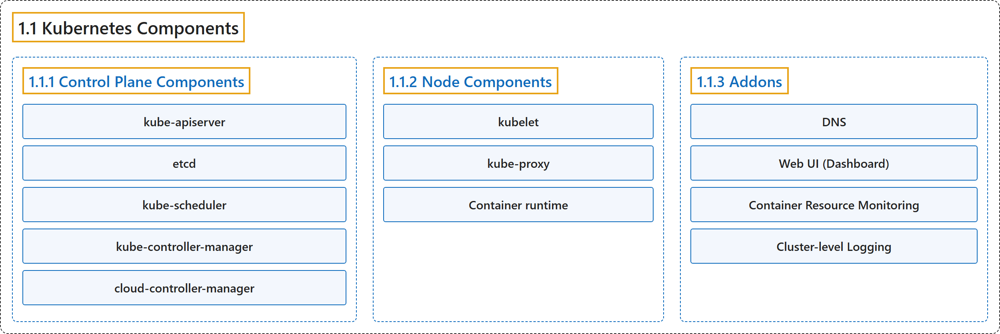

# 1.1 Kubernetes Components

## Classification

## Glossary

| Term | Definition | 中文翻译 | Source |
|---|---|---|---|
| **1.1 Kubernetes Components** Kubernetes 组件 | (context) "An overview of **the key components** that **make up a Kubernetes cluster**." | （语境）概述**关键组件**，这些组件**构成 Kubernetes 集群**。 | [The Kubernetes Authors, n.d., "Kubernetes Components", para. 1](https://kubernetes.io/docs/concepts/overview/components/#:~:text=An%20overview%20of%20the%20key%20components%20that) |
| **1.1.1 Control Plane Components** 控制平面组件 | "**Manage** the **overall state of the cluster**:" | **管理**集群的**整体状态**： | [The Kubernetes Authors, n.d., "Control Plane Components", para. 1](https://kubernetes.io/docs/concepts/overview/components/#:~:text=Manage%20the%20overall%20state%20of%20the%20cluster%3A) |
| **kube-apiserver** kube-apiserver | "**The core component server** that **exposes the Kubernetes HTTP API**." | **核心组件服务器**，**暴露 Kubernetes HTTP API**。 | [The Kubernetes Authors, n.d., "Control Plane Components", para. 3](https://kubernetes.io/docs/concepts/overview/components/#:~:text=The%20core%20component%20server%20that%20exposes%20the) |
| **etcd** etcd | "**Consistent and highly-available key value store** for **all API server data**." | **一致且高可用的键值存储**，存放**所有 API 服务器数据**。 | [The Kubernetes Authors, n.d., "Control Plane Components", para. 5](https://kubernetes.io/docs/concepts/overview/components/#:~:text=Consistent%20and%20highly-available%20key%20value%20store%20for) |
| **kube-scheduler** kube-scheduler | "**Looks for Pods not yet bound to a node**, and **assigns each Pod to a suitable node**." | **寻找尚未绑定到节点的 Pod**，并**为每个 Pod 分配合适的节点**。 | [The Kubernetes Authors, n.d., "Control Plane Components", para. 7](https://kubernetes.io/docs/concepts/overview/components/#:~:text=Looks%20for%20Pods%20not%20yet%20bound%20to) |
| **kube-controller-manager** kube-controller-manager | "**Runs controllers** to **implement Kubernetes API behavior**." | **运行**控制器来**实现 Kubernetes API 的行为**。 | [The Kubernetes Authors, n.d., "Control Plane Components", para. 9](https://kubernetes.io/docs/concepts/overview/components/#:~:text=Runs%20%5Bcontrollers%5D%28https%3A%2F%2Fkubernetes.io%2Fdocs%2Fconcepts%2Farchitecture%2Fcontroller%2F%29%20to%20implement%20Kubernetes%20API%20behavior.) |
| **cloud-controller-manager** cloud-controller-manager | "**Integrates** with **underlying cloud provider(s)**." | **集成**到**底层云服务商**。 | [The Kubernetes Authors, n.d., "Control Plane Components", para. 11](https://kubernetes.io/docs/concepts/overview/components/#:~:text=Integrates%20with%20underlying%20cloud%20provider%28s%29.) |
| **1.1.2 Node Components** 节点组件 | "**Run on every node**, **maintaining running pods** and **providing the Kubernetes runtime environment**:" | **在每个节点上运行**，**维护运行中的 Pod** 并**提供 Kubernetes 运行时环境**： | [The Kubernetes Authors, n.d., "Node Components", para. 1](https://kubernetes.io/docs/concepts/overview/components/#:~:text=Run%20on%20every%20node%2C%20maintaining%20running%20pods) |
| **kubelet** kubelet | "**Ensures that Pods are running**, **including their containers**." | **确保 Pod 正在运行**，**包括其中的容器**。 | [The Kubernetes Authors, n.d., "Node Components", para. 3](https://kubernetes.io/docs/concepts/overview/components/#:~:text=Ensures%20that%20Pods%20are%20running%2C%20including%20their) |
| **kube-proxy** kube-proxy | "**Maintains network rules on nodes** to **implement Services**." | **维护节点上的网络规则**，以**实现 Service**。 | [The Kubernetes Authors, n.d., "Node Components", para. 5](https://kubernetes.io/docs/concepts/overview/components/#:~:text=Maintains%20network%20rules%20on%20nodes%20to%20implement) |
| **Container runtime** 容器运行时 | "**Software** responsible for **running containers**." | **软件**，负责**运行容器**。 | [The Kubernetes Authors, n.d., "Node Components", para. 7](https://kubernetes.io/docs/concepts/overview/components/#:~:text=Software%20responsible%20for%20running%20containers.) |
| **1.1.3 Addons** 插件 | "**Addons** extend **the functionality of Kubernetes**." | **插件**扩展 **Kubernetes 的功能**。 | [The Kubernetes Authors, n.d., "Addons", para. 1](https://kubernetes.io/docs/concepts/overview/components/#:~:text=Addons%20extend%20the%20functionality%20of%20Kubernetes.) |
| **DNS** DNS | "**For cluster-wide DNS resolution.**" | **用于集群范围的 DNS 解析。** | [The Kubernetes Authors, n.d., "Addons", para. 3](https://kubernetes.io/docs/concepts/overview/components/#:~:text=For%20cluster-wide%20DNS%20resolution.) |
| **Web UI (Dashboard)** Web 界面（仪表板） | "For **cluster management** via **a web interface**." | 用于**集群管理**，经由 **Web 界面**。 | [The Kubernetes Authors, n.d., "Addons", para. 5](https://kubernetes.io/docs/concepts/overview/components/#:~:text=For%20cluster%20management%20via%20a%20web%20interface.) |
| **Container Resource Monitoring** 容器资源监控 | "**For collecting and storing container metrics.**" | **用于收集和存储容器指标。** | [The Kubernetes Authors, n.d., "Addons", para. 7](https://kubernetes.io/docs/concepts/overview/components/#:~:text=For%20collecting%20and%20storing%20container%20metrics.) |
| **Cluster-level Logging** 集群级日志 | "For **saving container logs** to **a central log store**." | 用于**保存容器日志**到**集中的日志存储**。 | [The Kubernetes Authors, n.d., "Addons", para. 9](https://kubernetes.io/docs/concepts/overview/components/#:~:text=For%20saving%20container%20logs%20to%20a%20central) |

## References

The Kubernetes Authors. (n.d.). *Kubernetes Components*. Kubernetes Documentation. Retrieved October 31, 2026, from <https://kubernetes.io/docs/concepts/overview/components/>
