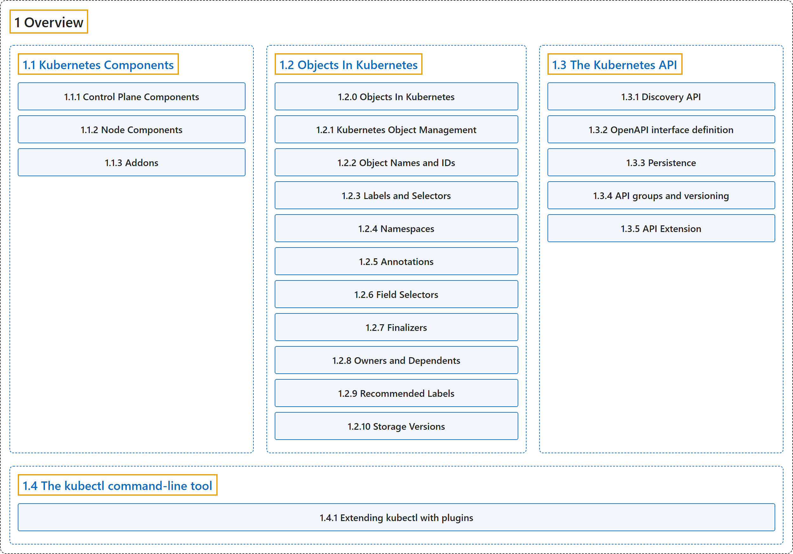

# 1 Overview

## Classification

## Glossary

| Term | Definition | 中文翻译 | Source |
|---|---|---|---|
| **1 Overview** 概述 | (No definition) | （无定义） | [The Kubernetes Authors, n.d.-c, "Overview", documentation menu](https://kubernetes.io/docs/concepts/overview/) |
| **[1.1 Kubernetes Components](components.md)** Kubernetes 组件 | (context) "An overview of **the key components** that **make up a Kubernetes cluster**." | （语境）概述**关键组件**，这些组件**构成 Kubernetes 集群**。 | [The Kubernetes Authors, n.d.-a, "Kubernetes Components", para. 1](https://kubernetes.io/docs/concepts/overview/components/#:~:text=An%20overview%20of%20the%20key%20components%20that) |
| **[1.2 Objects In Kubernetes](working-with-objects/index.md)** Kubernetes 中的对象 | "**Kubernetes objects** are **persistent entities in the Kubernetes system**." | **Kubernetes 对象**是 **Kubernetes 系统中的持久化实体**。 | [The Kubernetes Authors, n.d.-b, "Objects In Kubernetes", para. 1](https://kubernetes.io/docs/concepts/overview/working-with-objects/#:~:text=Kubernetes%20objects%20are%20persistent%20entities%20in%20the) |
| **[1.3 The Kubernetes API](kubernetes-api.md)** Kubernetes API | "**The Kubernetes API** lets you **query and manipulate the state of objects in Kubernetes**." | **Kubernetes API** 让你**查询和操作 Kubernetes 中对象的状态**。 | [The Kubernetes Authors, n.d.-e, "The Kubernetes API", para. 1](https://kubernetes.io/docs/concepts/overview/kubernetes-api/#:~:text=The%20Kubernetes%20API%20lets%20you%20query%20and) |
| **[1.4 The kubectl command-line tool](kubectl.md)** kubectl 命令行工具 | "kubectl is **the primary command-line tool** for **communicating with a Kubernetes cluster**." | kubectl 是**主要的命令行工具**，用于**与 Kubernetes 集群通信**。 | [The Kubernetes Authors, n.d.-d, "The kubectl command-line tool", para. 1](https://kubernetes.io/docs/concepts/overview/kubectl/#:~:text=kubectl%20is%20the%20primary%20command-line%20tool%20for) |

## References

The Kubernetes Authors. (n.d.-a). *Kubernetes Components*. Kubernetes Documentation. Retrieved October 31, 2026, from <https://kubernetes.io/docs/concepts/overview/components/>

The Kubernetes Authors. (n.d.-b). *Objects In Kubernetes*. Kubernetes Documentation. Retrieved October 31, 2026, from <https://kubernetes.io/docs/concepts/overview/working-with-objects/>

The Kubernetes Authors. (n.d.-c). *Overview*. Kubernetes Documentation. Retrieved October 31, 2026, from <https://kubernetes.io/docs/concepts/overview/>

The Kubernetes Authors. (n.d.-d). *The kubectl command-line tool*. Kubernetes Documentation. Retrieved October 31, 2026, from <https://kubernetes.io/docs/concepts/overview/kubectl/>

The Kubernetes Authors. (n.d.-e). *The Kubernetes API*. Kubernetes Documentation. Retrieved October 31, 2026, from <https://kubernetes.io/docs/concepts/overview/kubernetes-api/>
