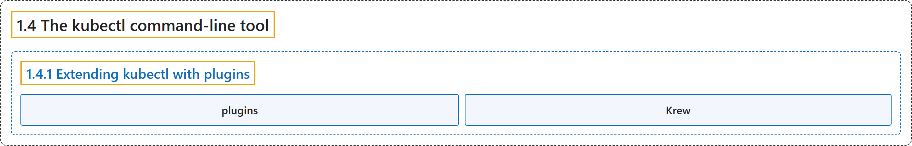

# 1.4 The kubectl command-line tool

## Classification

## Glossary

| Term | Definition | 中文翻译 | Source |
|---|---|---|---|
| **1.4 The kubectl command-line tool** kubectl 命令行工具 | "kubectl is **the primary command-line tool for communicating with a Kubernetes cluster**." | kubectl 是**与 Kubernetes 集群通信的主要命令行工具**。 | [The Kubernetes Authors, n.d., "The kubectl command-line tool", para. 1](https://kubernetes.io/docs/concepts/overview/kubectl/#:~:text=kubectl%20is%20the%20primary%20command-line%20tool%20for) |
| **1.4.1 Extending kubectl with plugins** 用插件扩展 kubectl | "You can extend `kubectl` with [plugins](https://kubernetes.io/docs/tasks/extend-kubectl/kubectl-plugins/) that **add new sub-commands**." | 你可以用[插件](https://kubernetes.io/docs/tasks/extend-kubectl/kubectl-plugins/)扩展 `kubectl`，**添加新的子命令**。 | [The Kubernetes Authors, n.d., "Extending kubectl with plugins", para. 1](https://kubernetes.io/docs/concepts/overview/kubectl/#:~:text=You%20can%20extend%20%60kubectl%60%20with%20%5Bplugins%5D%28https%3A%2F%2Fkubernetes.io%2Fdocs%2Ftasks%2Fextend-kubectl%2Fkubectl-plugins%2F%29%20that) |
| **plugins** 插件 | "Plugins are **standalone binaries that follow the `kubectl-<plugin-name>` naming convention**." | 插件是**遵循 `kubectl-<plugin-name>` 命名约定的独立二进制文件**。 | [The Kubernetes Authors, n.d., "Extending kubectl with plugins", para. 1](https://kubernetes.io/docs/concepts/overview/kubectl/#:~:text=Plugins%20are%20standalone%20binaries%20that%20follow%20the) |
| **Krew** Krew | (context) "The Kubernetes community maintains many plugins, and you can **manage them with the [Krew](https://krew.sigs.k8s.io/) plugin manager**." | （语境）Kubernetes 社区维护着许多插件，你可以**用 [Krew](https://krew.sigs.k8s.io/) 插件管理器来管理它们**。 | [The Kubernetes Authors, n.d., "Extending kubectl with plugins", para. 1](https://kubernetes.io/docs/concepts/overview/kubectl/#:~:text=The%20Kubernetes%20community%20maintains%20many%20plugins%2C%20and) |

## References

The Kubernetes Authors. (n.d.). *The kubectl command-line tool*. Kubernetes Documentation. Retrieved October 31, 2026, from <https://kubernetes.io/docs/concepts/overview/kubectl/>
