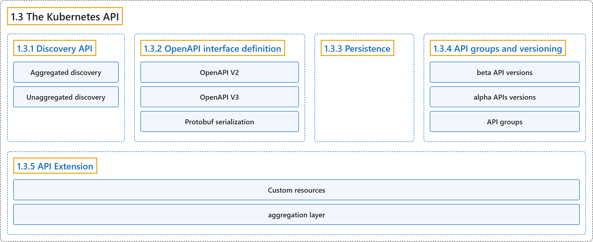

# 1.3 The Kubernetes API

## Classification

## Glossary

| Term | Definition | 中文翻译 | Source |
|---|---|---|---|
| **1.3 The Kubernetes API** Kubernetes API | "**The Kubernetes API** lets you **query and manipulate the state of objects in Kubernetes**." | **Kubernetes API** 让你**查询和操作 Kubernetes 中对象的状态**。 | [The Kubernetes Authors, n.d., "The Kubernetes API", para. 1](https://kubernetes.io/docs/concepts/overview/kubernetes-api/#:~:text=The%20Kubernetes%20API%20lets%20you%20query%20and) |
| **1.3.1 Discovery API** 发现 API | "Kubernetes **publishes a list of all group versions and resources** supported via **the Discovery API**." | Kubernetes **发布所支持的全部组版本和资源的列表**，途径是**发现 API**。 | [The Kubernetes Authors, n.d., "Discovery API", para. 1](https://kubernetes.io/docs/concepts/overview/kubernetes-api/#:~:text=Kubernetes%20publishes%20a%20list%20of%20all%20group) |
| **Aggregated discovery** 聚合发现 | "Kubernetes offers stable support for ***aggregated discovery***, publishing **all resources supported by a cluster** through **two endpoints (`/api` and `/apis`)**." | Kubernetes 稳定支持***聚合发现***，发布**集群支持的所有资源**，通过**两个端点**（`/api` 和 `/apis`）。 | [The Kubernetes Authors, n.d., "Aggregated discovery", para. 2](https://kubernetes.io/docs/concepts/overview/kubernetes-api/#:~:text=Kubernetes%20offers%20stable%20support%20for%20%2Aaggregated%20discovery%2A%2C) |
| **Unaggregated discovery** 非聚合发现 | "Without discovery aggregation, **discovery is published in levels**, with **the root endpoints** publishing **discovery information for downstream documents**." | 没有发现聚合时，**发现信息分层发布**，由**根端点**发布**下游文档的发现信息**。 | [The Kubernetes Authors, n.d., "Unaggregated discovery", para. 1](https://kubernetes.io/docs/concepts/overview/kubernetes-api/#:~:text=Without%20discovery%20aggregation%2C%20discovery%20is%20published%20in) |
| **1.3.2 OpenAPI interface definition** OpenAPI 接口定义 | (context) "**Kubernetes serves** both **OpenAPI v2.0 and OpenAPI v3.0**." | （语境）**Kubernetes 提供**两者：**OpenAPI v2.0 和 OpenAPI v3.0**。 | [The Kubernetes Authors, n.d., "OpenAPI interface definition", para. 2](https://kubernetes.io/docs/concepts/overview/kubernetes-api/#:~:text=Kubernetes%20serves%20both%20OpenAPI%20v2.0%20and%20OpenAPI) |
| **OpenAPI V2** OpenAPI V2 | "The Kubernetes API server serves **an aggregated OpenAPI v2 spec** via **the `/openapi/v2` endpoint**." | Kubernetes API 服务器提供**聚合的 OpenAPI v2 规范**，通过 **`/openapi/v2` 端点**。 | [The Kubernetes Authors, n.d., "OpenAPI V2", para. 1](https://kubernetes.io/docs/concepts/overview/kubernetes-api/#:~:text=The%20Kubernetes%20API%20server%20serves%20an%20aggregated) |
| **OpenAPI V3** OpenAPI V3 | "Kubernetes supports **publishing a description of its APIs** as **OpenAPI v3**." | Kubernetes 支持**发布其 API 的描述**，格式为 **OpenAPI v3**。 | [The Kubernetes Authors, n.d., "OpenAPI V3", para. 2](https://kubernetes.io/docs/concepts/overview/kubernetes-api/#:~:text=Kubernetes%20supports%20publishing%20a%20description%20of%20its) |
| **Protobuf serialization** Protobuf 序列化 | "Kubernetes implements **an alternative Protobuf based serialization format** that is primarily intended for **intra-cluster communication**." | Kubernetes 实现了**一种基于 Protobuf 的替代序列化格式**，主要用于**集群内部通信**。 | [The Kubernetes Authors, n.d., "Protobuf serialization", para. 1](https://kubernetes.io/docs/concepts/overview/kubernetes-api/#:~:text=Kubernetes%20implements%20an%20alternative%20Protobuf%20based%20serialization) |
| **1.3.3 Persistence** 持久化 | "Kubernetes **stores the serialized state of objects** by **writing them into etcd**." | Kubernetes **存储对象的序列化状态**，方式是**把它们写入 etcd**。 | [The Kubernetes Authors, n.d., "Persistence", para. 1](https://kubernetes.io/docs/concepts/overview/kubernetes-api/#:~:text=Kubernetes%20stores%20the%20serialized%20state%20of%20objects) |
| **1.3.4 API groups and versioning** API 组与版本 | "To make it easier to eliminate fields or restructure resource representations, Kubernetes **supports multiple API versions**, each at **a different API path**, such as `/api/v1` or `/apis/rbac.authorization.k8s.io/v1alpha1`." | 为了更容易删除字段或重构资源表示，Kubernetes **支持多个 API 版本**，每个版本位于**不同的 API 路径**，例如 `/api/v1` 或 `/apis/rbac.authorization.k8s.io/v1alpha1`。 | [The Kubernetes Authors, n.d., "API groups and versioning", para. 1](https://kubernetes.io/docs/concepts/overview/kubernetes-api/#:~:text=To%20make%20it%20easier%20to%20eliminate%20fields) |
| **beta API versions** beta API 版本 | (context) "Additionally, Kubernetes **maintains compatibility** with **data persisted via *beta* API versions** of official Kubernetes APIs" | （语境）此外，Kubernetes **保持兼容性**，对象是官方 Kubernetes API 中**通过 *beta* API 版本持久化的数据** | [The Kubernetes Authors, n.d., "API changes", para. 3](https://kubernetes.io/docs/concepts/overview/kubernetes-api/#:~:text=Additionally%2C%20Kubernetes%20maintains%20compatibility%20with%20data%20persisted) |
| **alpha APIs versions** alpha API 版本 | (context) "Although Kubernetes also aims to **maintain compatibility for *alpha* APIs versions**, in some circumstances **this is not possible**." | （语境）尽管 Kubernetes 也力求**为 *alpha* API 版本保持兼容**，但在某些情况下**做不到**。 | [The Kubernetes Authors, n.d., "Note:", para. 1](https://kubernetes.io/docs/concepts/overview/kubernetes-api/#:~:text=Although%20Kubernetes%20also%20aims%20to%20maintain%20compatibility) |
| **API groups** API 组 | (context) "To make it easier to evolve and to extend its API, Kubernetes **implements API groups** that can be **enabled or disabled**." | （语境）为了更容易演进和扩展 API，Kubernetes **实现了 API 组**，它们可以**启用或禁用**。 | [The Kubernetes Authors, n.d., "API groups and versioning", para. 3](https://kubernetes.io/docs/concepts/overview/kubernetes-api/#:~:text=To%20make%20it%20easier%20to%20evolve%20and) |
| **1.3.5 API Extension** API 扩展 | "**The Kubernetes API** can be **extended in one of two ways**:" | **Kubernetes API** 可以**用两种方式之一来扩展**： | [The Kubernetes Authors, n.d., "API Extension", para. 1](https://kubernetes.io/docs/concepts/overview/kubernetes-api/#:~:text=The%20Kubernetes%20API%20can%20be%20extended%20in) |
| **Custom resources** 自定义资源 | "**Custom resources** let you **declaratively define** how **the API server should provide your chosen resource API**." | **自定义资源**让你**声明式地定义**一件事：**API 服务器应如何提供你选择的资源 API**。 | [The Kubernetes Authors, n.d., "API Extension", para. 2](https://kubernetes.io/docs/concepts/overview/kubernetes-api/#:~:text=%5BCustom%20resources%5D%28https%3A%2F%2Fkubernetes.io%2Fdocs%2Fconcepts%2Fextend-kubernetes%2Fapi-extension%2Fcustom-resources%2F%29%20let%20you%20declaratively%20define%20how) |
| **aggregation layer** 聚合层 | (context) "You can also **extend the Kubernetes API** by **implementing an aggregation layer**." | （语境）你也可以**扩展 Kubernetes API**，方式是**实现聚合层**。 | [The Kubernetes Authors, n.d., "API Extension", para. 3](https://kubernetes.io/docs/concepts/overview/kubernetes-api/#:~:text=You%20can%20also%20extend%20the%20Kubernetes%20API) |

## References

The Kubernetes Authors. (n.d.). *The Kubernetes API*. Kubernetes Documentation. Retrieved October 31, 2026, from <https://kubernetes.io/docs/concepts/overview/kubernetes-api/>
