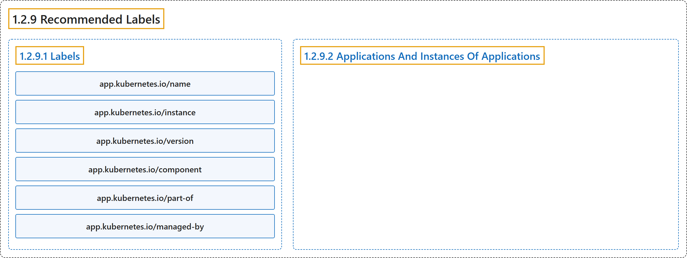

# 1.2.9 Recommended Labels

## Classification

## Glossary

| Term | Definition | 中文翻译 | Source |
|---|---|---|---|
| **1.2.9 Recommended Labels** 推荐使用的标签 | (context) "**A common set of labels** allows tools to **work interoperably**, **describing objects in a common manner** that all tools can understand." | （语境）**一组通用标签**让工具可以**互操作**，**以通用方式描述对象**，所有工具都能理解这种方式。 | [The Kubernetes Authors, n.d., "Recommended Labels", para. 1](https://kubernetes.io/docs/concepts/overview/working-with-objects/common-labels/#:~:text=A%20common%20set%20of%20labels%20allows%20tools) |
| **1.2.9.1 Labels** 标签 | (No definition) | （无定义） | [The Kubernetes Authors, n.d., "Labels"](https://kubernetes.io/docs/concepts/overview/working-with-objects/common-labels/#labels) |
| **app.kubernetes.io/name** app.kubernetes.io/name | "**The name of the application**" | **应用程序的名称** | [The Kubernetes Authors, n.d., "Labels", para. 4](https://kubernetes.io/docs/concepts/overview/working-with-objects/common-labels/#:~:text=The%20name%20of%20the%20application) |
| **app.kubernetes.io/instance** app.kubernetes.io/instance | "**A unique name** identifying **the instance of an application**" | **唯一名称**，标识**应用程序的实例** | [The Kubernetes Authors, n.d., "Labels", para. 5](https://kubernetes.io/docs/concepts/overview/working-with-objects/common-labels/#:~:text=A%20unique%20name%20identifying%20the%20instance%20of) |
| **app.kubernetes.io/version** app.kubernetes.io/version | "**The current version of the application** (e.g., **a SemVer 1.0 , revision hash**, etc.)" | **应用程序的当前版本**（例如 **SemVer 1.0、修订哈希**等） | [The Kubernetes Authors, n.d., "Labels", para. 6](https://kubernetes.io/docs/concepts/overview/working-with-objects/common-labels/#:~:text=The%20current%20version%20of%20the%20application%20%28e.g.%2C) |
| **app.kubernetes.io/component** app.kubernetes.io/component | "**The component within the architecture**" | **架构中的组件** | [The Kubernetes Authors, n.d., "Labels", para. 7](https://kubernetes.io/docs/concepts/overview/working-with-objects/common-labels/#:~:text=The%20component%20within%20the%20architecture) |
| **app.kubernetes.io/part-of** app.kubernetes.io/part-of | "**The name of a higher level application** this one is **part of**" | **更高层应用的名称**，此应用是其**一部分** | [The Kubernetes Authors, n.d., "Labels", para. 8](https://kubernetes.io/docs/concepts/overview/working-with-objects/common-labels/#:~:text=The%20name%20of%20a%20higher%20level%20application) |
| **app.kubernetes.io/managed-by** app.kubernetes.io/managed-by | "**The tool** being used to **manage the operation of an application**" | **工具**，用来**管理应用程序的运行** | [The Kubernetes Authors, n.d., "Labels", para. 9](https://kubernetes.io/docs/concepts/overview/working-with-objects/common-labels/#:~:text=The%20tool%20being%20used%20to%20manage%20the) |
| **1.2.9.2 Applications And Instances Of Applications** 应用与应用实例 | "**An application** can be **installed one or more times** into a Kubernetes cluster and, in some cases, **the same namespace**." | **一个应用**可以**安装一次或多次**到 Kubernetes 集群中，有时甚至安装在**同一个命名空间**中。 | [The Kubernetes Authors, n.d., "Applications And Instances Of Applications", para. 1](https://kubernetes.io/docs/concepts/overview/working-with-objects/common-labels/#:~:text=An%20application%20can%20be%20installed%20one%20or) |

## References

The Kubernetes Authors. (n.d.). *Recommended Labels*. Kubernetes Documentation. Retrieved October 31, 2026, from <https://kubernetes.io/docs/concepts/overview/working-with-objects/common-labels/>
