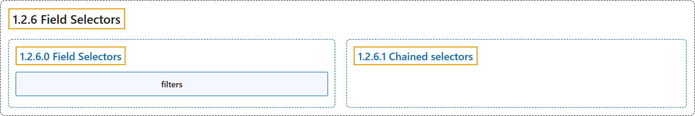

# 1.2.6 Field Selectors

## Classification

## Glossary

| Term | Definition | 中文翻译 | Source |
|---|---|---|---|
| **1.2.6 Field Selectors** 字段选择器 | "***Field selectors*** let you **select Kubernetes objects** based on **the value of one or more resource fields**." | ***字段选择器***让你**选择 Kubernetes 对象**，依据是**一个或多个资源字段的值**。 | [The Kubernetes Authors, n.d., "Field Selectors", para. 1](https://kubernetes.io/docs/concepts/overview/working-with-objects/field-selectors/#:~:text=%2AField%20selectors%2A%20let%20you%20select%20Kubernetes%20%5Bobjects%5D%28https%3A%2F%2Fkubernetes.io%2Fdocs%2Fconcepts%2Foverview%2Fworking-with-objects%2F%23kubernetes-objects%29) |
| **1.2.6.0 Field Selectors** 字段选择器 | (No definition) | （无定义） | [The Kubernetes Authors, n.d., "Field Selectors"](https://kubernetes.io/docs/concepts/overview/working-with-objects/field-selectors/#field-selectors) |
| **filters** 过滤器 | "**Field selectors** are essentially **resource *filters***." | **字段选择器**本质上是**资源*过滤器***。 | [The Kubernetes Authors, n.d., "Note:", para. 1](https://kubernetes.io/docs/concepts/overview/working-with-objects/field-selectors/#:~:text=Field%20selectors%20are%20essentially%20resource%20%2Afilters%2A.) |
| **1.2.6.1 Chained selectors** 链式选择器 | "As with label and other selectors, **field selectors** can be **chained together** as **a comma-separated list**." | 与标签及其他选择器一样，**字段选择器**可以**串联起来**，形成**逗号分隔的列表**。 | [The Kubernetes Authors, n.d., "Chained selectors", para. 1](https://kubernetes.io/docs/concepts/overview/working-with-objects/field-selectors/#:~:text=As%20with%20%5Blabel%5D%28https%3A%2F%2Fkubernetes.io%2Fdocs%2Fconcepts%2Foverview%2Fworking-with-objects%2Flabels%2F%29%20and%20other%20selectors%2C%20field) |

## References

The Kubernetes Authors. (n.d.). *Field Selectors*. Kubernetes Documentation. Retrieved October 31, 2026, from <https://kubernetes.io/docs/concepts/overview/working-with-objects/field-selectors/>
