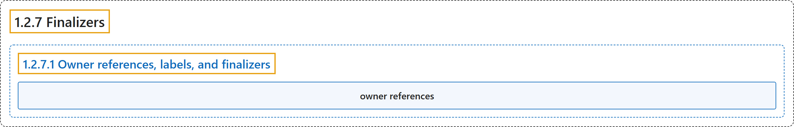

# 1.2.7 Finalizers

## Classification

## Glossary

| Term | Definition | 中文翻译 | Source |
|---|---|---|---|
| **1.2.7 Finalizers** Finalizer | "Finalizers are **namespaced keys** that tell Kubernetes to **wait until specific conditions are met** before it **fully deletes resources that are marked for deletion**." | Finalizer 是**带命名空间的键**，告诉 Kubernetes **等待特定条件满足**，然后才**彻底删除被标记为删除的资源**。 | [The Kubernetes Authors, n.d., "Finalizers", para. 1](https://kubernetes.io/docs/concepts/overview/working-with-objects/finalizers/#:~:text=Finalizers%20are%20namespaced%20keys%20that%20tell%20Kubernetes) |
| **1.2.7.1 Owner references, labels, and finalizers** 属主引用、标签与 Finalizer | (No definition) | （无定义） | [The Kubernetes Authors, n.d., "Owner references, labels, and finalizers"](https://kubernetes.io/docs/concepts/overview/working-with-objects/finalizers/#owner-references-labels-and-finalizers) |
| **owner references** 属主引用 | (context) "The Job controller also adds ***owner references*** to those Pods, **pointing at the Job that created the Pods**." | （语境）Job 控制器还会为这些 Pod 添加***属主引用***，**指向创建这些 Pod 的 Job**。 | [The Kubernetes Authors, n.d., "Owner references, labels, and finalizers", para. 2](https://kubernetes.io/docs/concepts/overview/working-with-objects/finalizers/#:~:text=The%20Job%20controller%20also%20adds%20%2Aowner%20references%2A) |

## References

The Kubernetes Authors. (n.d.). *Finalizers*. Kubernetes Documentation. Retrieved October 31, 2026, from <https://kubernetes.io/docs/concepts/overview/working-with-objects/finalizers/>
