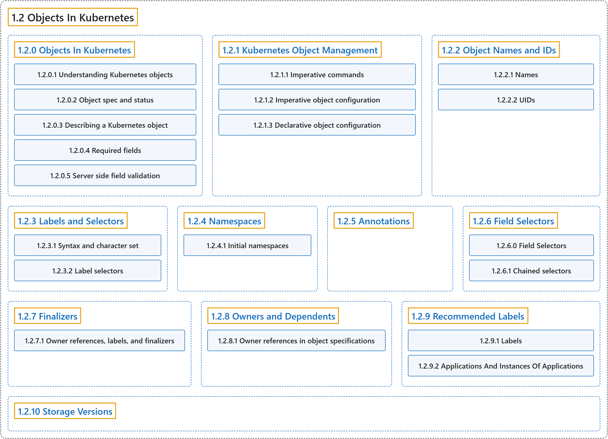

# 1.2 Objects In Kubernetes

## Classification

## Glossary

| Term | Definition | 中文翻译 | Source |
|---|---|---|---|
| **1.2 Objects In Kubernetes** Kubernetes 中的对象 | "Kubernetes objects are **persistent entities in the Kubernetes system**." | Kubernetes 对象是 **Kubernetes 系统中的持久化实体**。 | [The Kubernetes Authors, n.d.-h, "Objects In Kubernetes", para. 1](https://kubernetes.io/docs/concepts/overview/working-with-objects/#:~:text=Kubernetes%20objects%20are%20persistent%20entities%20in%20the) |
| **[1.2.0 Objects In Kubernetes](objects-in-kubernetes.md)** Kubernetes 中的对象 | "Kubernetes objects are **persistent entities in the Kubernetes system**." | Kubernetes 对象是 **Kubernetes 系统中的持久化实体**。 | [The Kubernetes Authors, n.d.-h, "Objects In Kubernetes", para. 1](https://kubernetes.io/docs/concepts/overview/working-with-objects/#:~:text=Kubernetes%20objects%20are%20persistent%20entities%20in%20the) |
| **[1.2.1 Kubernetes Object Management](object-management.md)** Kubernetes 对象管理 | (context) "The `kubectl` command-line tool **supports several different ways to create and manage Kubernetes [objects](https://kubernetes.io/docs/concepts/overview/working-with-objects/#kubernetes-objects)**." | （语境）`kubectl` 命令行工具**支持多种不同方式来创建和管理 Kubernetes [对象](https://kubernetes.io/docs/concepts/overview/working-with-objects/#kubernetes-objects)**。 | [The Kubernetes Authors, n.d.-d, "Kubernetes Object Management", para. 1](https://kubernetes.io/docs/concepts/overview/working-with-objects/object-management/#:~:text=The%20%60kubectl%60%20command-line%20tool%20supports%20several%20different) |
| **[1.2.2 Object Names and IDs](names.md)** 对象名称与 ID | (context) "Each [object](https://kubernetes.io/docs/concepts/overview/working-with-objects/#kubernetes-objects) in your cluster has **a [Name](#names) that is unique for that type of resource**." | （语境）集群中的每个[对象](https://kubernetes.io/docs/concepts/overview/working-with-objects/#kubernetes-objects)都有**一个在该类资源中唯一的[名称](#names)**。 | [The Kubernetes Authors, n.d.-g, "Object Names and IDs", para. 1](https://kubernetes.io/docs/concepts/overview/working-with-objects/names/#:~:text=Each%20%5Bobject%5D%28https%3A%2F%2Fkubernetes.io%2Fdocs%2Fconcepts%2Foverview%2Fworking-with-objects%2F%23kubernetes-objects%29%20in%20your%20cluster%20has%20a) |
| **[1.2.3 Labels and Selectors](labels.md)** 标签与选择算符 | "*Labels* are **key/value pairs that are attached to [objects](https://kubernetes.io/docs/concepts/overview/working-with-objects/#kubernetes-objects) such as Pods**." | *标签*是**附加在 Pod 等[对象](https://kubernetes.io/docs/concepts/overview/working-with-objects/#kubernetes-objects)上的键值对**。 | [The Kubernetes Authors, n.d.-e, "Labels and Selectors", para. 1](https://kubernetes.io/docs/concepts/overview/working-with-objects/labels/#:~:text=%2ALabels%2A%20are%20key%2Fvalue%20pairs%20that%20are%20attached) |
| **[1.2.4 Namespaces](namespaces.md)** 命名空间 | "In Kubernetes, *namespaces* provide **a mechanism for isolating groups of resources within a single cluster**." | 在 Kubernetes 中，*命名空间*提供**一种在单个集群中隔离资源组的机制**。 | [The Kubernetes Authors, n.d.-f, "Namespaces", para. 1](https://kubernetes.io/docs/concepts/overview/working-with-objects/namespaces/#:~:text=In%20Kubernetes%2C%20%2Anamespaces%2A%20provide%20a%20mechanism%20for) |
| **[1.2.5 Annotations](annotations.md)** 注解 | "You can use Kubernetes annotations to **attach arbitrary non-identifying metadata to [objects](https://kubernetes.io/docs/concepts/overview/working-with-objects/#kubernetes-objects)**." | 你可以使用 Kubernetes 注解来**为[对象](https://kubernetes.io/docs/concepts/overview/working-with-objects/#kubernetes-objects)附加任意的非标识性元数据**。 | [The Kubernetes Authors, n.d.-a, "Annotations", para. 1](https://kubernetes.io/docs/concepts/overview/working-with-objects/annotations/#:~:text=You%20can%20use%20Kubernetes%20annotations%20to%20attach) |
| **[1.2.6 Field Selectors](field-selectors.md)** 字段选择器 | "*Field selectors* let you **select Kubernetes [objects](https://kubernetes.io/docs/concepts/overview/working-with-objects/#kubernetes-objects) based on the value of one or more resource fields**." | *字段选择器*让你**根据一个或多个资源字段的值选择 Kubernetes [对象](https://kubernetes.io/docs/concepts/overview/working-with-objects/#kubernetes-objects)**。 | [The Kubernetes Authors, n.d.-b, "Field Selectors", para. 1](https://kubernetes.io/docs/concepts/overview/working-with-objects/field-selectors/#:~:text=%2AField%20selectors%2A%20let%20you%20select%20Kubernetes%20%5Bobjects%5D%28https%3A%2F%2Fkubernetes.io%2Fdocs%2Fconcepts%2Foverview%2Fworking-with-objects%2F%23kubernetes-objects%29) |
| **[1.2.7 Finalizers](finalizers.md)** Finalizer | "Finalizers are **namespaced keys that tell Kubernetes to wait until specific conditions are met before it fully deletes [resources](https://kubernetes.io/docs/reference/using-api/api-concepts/#standard-api-terminology) that are marked for deletion**." | Finalizer 是**带命名空间的键，告诉 Kubernetes 在彻底删除被标记为删除的[资源](https://kubernetes.io/docs/reference/using-api/api-concepts/#standard-api-terminology)之前，先等待特定条件满足**。 | [The Kubernetes Authors, n.d.-c, "Finalizers", para. 1](https://kubernetes.io/docs/concepts/overview/working-with-objects/finalizers/#:~:text=Finalizers%20are%20namespaced%20keys%20that%20tell%20Kubernetes) |
| **[1.2.8 Owners and Dependents](owners-dependents.md)** 属主与附属 | "In Kubernetes, some [objects](https://kubernetes.io/docs/concepts/overview/working-with-objects/#kubernetes-objects) are ***owners* of other objects**." | 在 Kubernetes 中，有些[对象](https://kubernetes.io/docs/concepts/overview/working-with-objects/#kubernetes-objects)是**其他对象的*属主***。 | [The Kubernetes Authors, n.d.-i, "Owners and Dependents", para. 1](https://kubernetes.io/docs/concepts/overview/working-with-objects/owners-dependents/#:~:text=In%20Kubernetes%2C%20some%20%5Bobjects%5D%28https%3A%2F%2Fkubernetes.io%2Fdocs%2Fconcepts%2Foverview%2Fworking-with-objects%2F%23kubernetes-objects%29%20are%20%2Aowners%2A%20of) |
| **[1.2.9 Recommended Labels](common-labels.md)** 推荐使用的标签 | (context) "A common set of labels **allows tools to work interoperably, describing objects in a common manner that all tools can understand**." | （语境）一组通用标签**让工具之间可以互操作，以所有工具都能理解的通用方式描述对象**。 | [The Kubernetes Authors, n.d.-j, "Recommended Labels", para. 1](https://kubernetes.io/docs/concepts/overview/working-with-objects/common-labels/#:~:text=A%20common%20set%20of%20labels%20allows%20tools) |
| **[1.2.10 Storage Versions](storage-version.md)** 存储版本 | "Kubernetes uses the term *storage version* to **describe how an object is stored in your cluster**." | Kubernetes 用*存储版本*这个术语来**描述对象在集群中的存储方式**。 | [The Kubernetes Authors, n.d.-k, "Storage Versions", para. 1](https://kubernetes.io/docs/concepts/overview/working-with-objects/storage-version/#:~:text=Kubernetes%20uses%20the%20term%20%2Astorage%20version%2A%20to) |

## References

The Kubernetes Authors. (n.d.-a). *Annotations*. Kubernetes Documentation. Retrieved October 31, 2026, from <https://kubernetes.io/docs/concepts/overview/working-with-objects/annotations/>

The Kubernetes Authors. (n.d.-b). *Field Selectors*. Kubernetes Documentation. Retrieved October 31, 2026, from <https://kubernetes.io/docs/concepts/overview/working-with-objects/field-selectors/>

The Kubernetes Authors. (n.d.-c). *Finalizers*. Kubernetes Documentation. Retrieved October 31, 2026, from <https://kubernetes.io/docs/concepts/overview/working-with-objects/finalizers/>

The Kubernetes Authors. (n.d.-d). *Kubernetes Object Management*. Kubernetes Documentation. Retrieved October 31, 2026, from <https://kubernetes.io/docs/concepts/overview/working-with-objects/object-management/>

The Kubernetes Authors. (n.d.-e). *Labels and Selectors*. Kubernetes Documentation. Retrieved October 31, 2026, from <https://kubernetes.io/docs/concepts/overview/working-with-objects/labels/>

The Kubernetes Authors. (n.d.-f). *Namespaces*. Kubernetes Documentation. Retrieved October 31, 2026, from <https://kubernetes.io/docs/concepts/overview/working-with-objects/namespaces/>

The Kubernetes Authors. (n.d.-g). *Object Names and IDs*. Kubernetes Documentation. Retrieved October 31, 2026, from <https://kubernetes.io/docs/concepts/overview/working-with-objects/names/>

The Kubernetes Authors. (n.d.-h). *Objects In Kubernetes*. Kubernetes Documentation. Retrieved October 31, 2026, from <https://kubernetes.io/docs/concepts/overview/working-with-objects/>

The Kubernetes Authors. (n.d.-i). *Owners and Dependents*. Kubernetes Documentation. Retrieved October 31, 2026, from <https://kubernetes.io/docs/concepts/overview/working-with-objects/owners-dependents/>

The Kubernetes Authors. (n.d.-j). *Recommended Labels*. Kubernetes Documentation. Retrieved October 31, 2026, from <https://kubernetes.io/docs/concepts/overview/working-with-objects/common-labels/>

The Kubernetes Authors. (n.d.-k). *Storage Versions*. Kubernetes Documentation. Retrieved October 31, 2026, from <https://kubernetes.io/docs/concepts/overview/working-with-objects/storage-version/>
