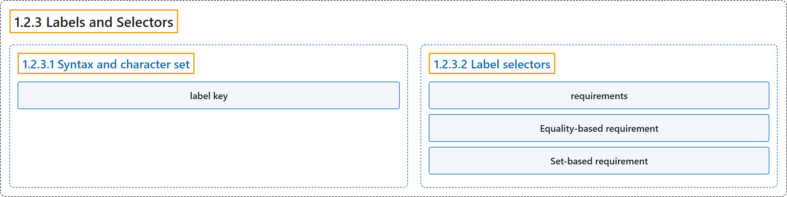

# 1.2.3 Labels and Selectors

## Classification

## Glossary

| Term | Definition | 中文翻译 | Source |
|---|---|---|---|
| **1.2.3 Labels and Selectors** 标签与选择算符 | "*Labels* are **key/value pairs that are attached to [objects](https://kubernetes.io/docs/concepts/overview/working-with-objects/#kubernetes-objects) such as Pods**." | *标签*是**附加在 Pod 等[对象](https://kubernetes.io/docs/concepts/overview/working-with-objects/#kubernetes-objects)上的键值对**。 | [The Kubernetes Authors, n.d., "Labels and Selectors", para. 1](https://kubernetes.io/docs/concepts/overview/working-with-objects/labels/#:~:text=%2ALabels%2A%20are%20key%2Fvalue%20pairs%20that%20are%20attached) |
| **1.2.3.1 Syntax and character set** 语法与字符集 | (No definition) | （无定义） | [The Kubernetes Authors, n.d., "Syntax and character set"](https://kubernetes.io/docs/concepts/overview/working-with-objects/labels/#syntax-and-character-set) |
| **label key** 标签键 | "Valid label keys have **two segments: an optional prefix and name, separated by a slash (`/`)**." | 有效的标签键有**两段：可选的前缀和名称，用斜杠（`/`）分隔**。 | [The Kubernetes Authors, n.d., "Syntax and character set", para. 1](https://kubernetes.io/docs/concepts/overview/working-with-objects/labels/#:~:text=Valid%20label%20keys%20have%20two%20segments%3A%20an) |
| **1.2.3.2 Label selectors** 标签选择算符 | "Via a *label selector*, **the client/user can identify a set of objects**." | 通过*标签选择算符*，**客户端或用户可以识别一组对象**。 | [The Kubernetes Authors, n.d., "Label selectors", para. 2](https://kubernetes.io/docs/concepts/overview/working-with-objects/labels/#:~:text=Via%20a%20%2Alabel%20selector%2A%2C%20the%20client%2Fuser%20can) |
| **requirements** 需求 | "A label selector can be made of **multiple *requirements* which are comma-separated**." | 一个标签选择算符可以由**多个用逗号分隔的*需求***组成。 | [The Kubernetes Authors, n.d., "Label selectors", para. 3](https://kubernetes.io/docs/concepts/overview/working-with-objects/labels/#:~:text=A%20label%20selector%20can%20be%20made%20of) |
| **Equality-based requirement** 基于等值的需求 | "*Equality-* or *inequality-based* requirements **allow filtering by label keys and values**." | *基于等值*或*不等值*的需求**允许按标签键和值过滤**。 | [The Kubernetes Authors, n.d., "Equality-based requirement", para. 1](https://kubernetes.io/docs/concepts/overview/working-with-objects/labels/#:~:text=%2AEquality-%2A%20or%20%2Ainequality-based%2A%20requirements%20allow%20filtering%20by) |
| **Set-based requirement** 基于集合的需求 | "*Set-based* label requirements **allow filtering keys according to a set of values**." | *基于集合*的标签需求**允许按一组值过滤键**。 | [The Kubernetes Authors, n.d., "Set-based requirement", para. 1](https://kubernetes.io/docs/concepts/overview/working-with-objects/labels/#:~:text=%2ASet-based%2A%20label%20requirements%20allow%20filtering%20keys%20according) |

## References

The Kubernetes Authors. (n.d.). *Labels and Selectors*. Kubernetes Documentation. Retrieved October 31, 2026, from <https://kubernetes.io/docs/concepts/overview/working-with-objects/labels/>
