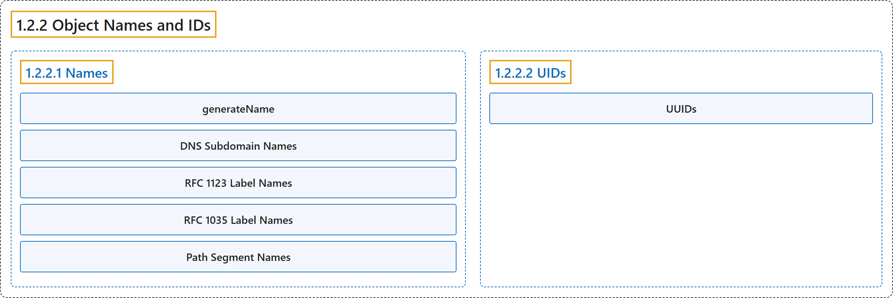

# 1.2.2 Object Names and IDs

## Classification

## Glossary

| Term | Definition | 中文翻译 | Source |
|---|---|---|---|
| **1.2.2 Object Names and IDs** 对象名称与 ID | (context) "Each [object](https://kubernetes.io/docs/concepts/overview/working-with-objects/#kubernetes-objects) in your cluster has **a [Name](#names) that is unique for that type of resource**." | （语境）集群中的每个[对象](https://kubernetes.io/docs/concepts/overview/working-with-objects/#kubernetes-objects)都有**一个在该类资源中唯一的[名称](#names)**。 | [The Kubernetes Authors, n.d., "Object Names and IDs", para. 1](https://kubernetes.io/docs/concepts/overview/working-with-objects/names/#:~:text=Each%20%5Bobject%5D%28https%3A%2F%2Fkubernetes.io%2Fdocs%2Fconcepts%2Foverview%2Fworking-with-objects%2F%23kubernetes-objects%29%20in%20your%20cluster%20has%20a) |
| **1.2.2.1 Names** 名称 | "**A client-provided string that refers to an object in a [resource](https://kubernetes.io/docs/reference/using-api/api-concepts/#standard-api-terminology) URL**, such as `/api/v1/pods/some-name`." | **一个由客户端提供、在[资源](https://kubernetes.io/docs/reference/using-api/api-concepts/#standard-api-terminology) URL 中引用对象的字符串**，例如 `/api/v1/pods/some-name`。 | [The Kubernetes Authors, n.d., "Names", para. 1](https://kubernetes.io/docs/concepts/overview/working-with-objects/names/#:~:text=A%20client-provided%20string%20that%20refers%20to%20an) |
| **generateName** generateName | (context) "The server may **generate a name when `generateName` is provided instead of `name`** in a resource create request." | （语境）在资源创建请求中提供 `generateName` 而非 `name` 时，**服务器可能会生成一个名称**。 | [The Kubernetes Authors, n.d., "Note:", para. 2](https://kubernetes.io/docs/concepts/overview/working-with-objects/names/#:~:text=The%20server%20may%20generate%20a%20name%20when) |
| **DNS Subdomain Names** DNS 子域名 | (context) "Most resource types require **a name that can be used as a DNS subdomain name as defined in [RFC 1123](https://tools.ietf.org/html/rfc1123)**." | （语境）大多数资源类型要求**名称可以用作 [RFC 1123](https://tools.ietf.org/html/rfc1123) 所定义的 DNS 子域名**。 | [The Kubernetes Authors, n.d., "DNS Subdomain Names", para. 1](https://kubernetes.io/docs/concepts/overview/working-with-objects/names/#:~:text=Most%20resource%20types%20require%20a%20name%20that) |
| **RFC 1123 Label Names** RFC 1123 标签名 | (context) "Some resource types require their names to **follow the DNS label standard as defined in [RFC 1123](https://tools.ietf.org/html/rfc1123)**." | （语境）某些资源类型要求名称**遵循 [RFC 1123](https://tools.ietf.org/html/rfc1123) 所定义的 DNS 标签标准**。 | [The Kubernetes Authors, n.d., "RFC 1123 Label Names", para. 1](https://kubernetes.io/docs/concepts/overview/working-with-objects/names/#:~:text=Some%20resource%20types%20require%20their%20names%20to) |
| **RFC 1035 Label Names** RFC 1035 标签名 | (context) "Some resource types require their names to **follow the DNS label standard as defined in [RFC 1035](https://tools.ietf.org/html/rfc1035)**." | （语境）某些资源类型要求名称**遵循 [RFC 1035](https://tools.ietf.org/html/rfc1035) 所定义的 DNS 标签标准**。 | [The Kubernetes Authors, n.d., "RFC 1035 Label Names", para. 1](https://kubernetes.io/docs/concepts/overview/working-with-objects/names/#:~:text=Some%20resource%20types%20require%20their%20names%20to) |
| **Path Segment Names** 路径段名称 | (context) "Some resource types require their names to **be able to be safely encoded as a path segment**." | （语境）某些资源类型要求名称**能够被安全地编码为路径段**。 | [The Kubernetes Authors, n.d., "Path Segment Names", para. 1](https://kubernetes.io/docs/concepts/overview/working-with-objects/names/#:~:text=Some%20resource%20types%20require%20their%20names%20to) |
| **1.2.2.2 UIDs** UID | "**A Kubernetes systems-generated string to uniquely identify objects.**" | **一个由 Kubernetes 系统生成、用来唯一标识对象的字符串。** | [The Kubernetes Authors, n.d., "UIDs", para. 1](https://kubernetes.io/docs/concepts/overview/working-with-objects/names/#:~:text=A%20Kubernetes%20systems-generated%20string%20to%20uniquely%20identify) |
| **UUIDs** UUID | "Kubernetes UIDs are **universally unique identifiers (also known as UUIDs)**." | Kubernetes 的 UID 是**通用唯一标识符（也称为 UUID）**。 | [The Kubernetes Authors, n.d., "UIDs", para. 3](https://kubernetes.io/docs/concepts/overview/working-with-objects/names/#:~:text=Kubernetes%20UIDs%20are%20universally%20unique%20identifiers%20%28also) |

## References

The Kubernetes Authors. (n.d.). *Object Names and IDs*. Kubernetes Documentation. Retrieved October 31, 2026, from <https://kubernetes.io/docs/concepts/overview/working-with-objects/names/>
