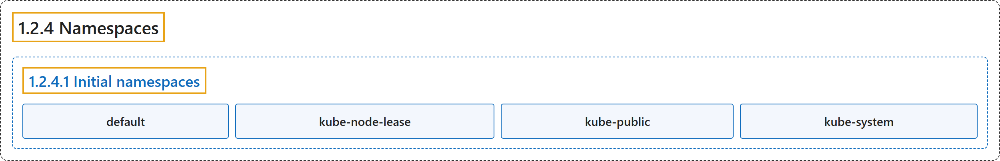

# 1.2.4 Namespaces

## Classification

## Glossary

| Term | Definition | 中文翻译 | Source |
|---|---|---|---|
| **1.2.4 Namespaces** 命名空间 | "In Kubernetes, *namespaces* provide **a mechanism for isolating groups of resources within a single cluster**." | 在 Kubernetes 中，*命名空间*提供**一种在单个集群中隔离资源组的机制**。 | [The Kubernetes Authors, n.d., "Namespaces", para. 1](https://kubernetes.io/docs/concepts/overview/working-with-objects/namespaces/#:~:text=In%20Kubernetes%2C%20%2Anamespaces%2A%20provide%20a%20mechanism%20for) |
| **1.2.4.1 Initial namespaces** 初始命名空间 | "Kubernetes starts with **four initial namespaces**:" | Kubernetes 启动时有**四个初始命名空间**： | [The Kubernetes Authors, n.d., "Initial namespaces", para. 1](https://kubernetes.io/docs/concepts/overview/working-with-objects/namespaces/#:~:text=Kubernetes%20starts%20with%20four%20initial%20namespaces%3A) |
| **default** default | "Kubernetes includes this namespace so that **you can start using your new cluster without first creating a namespace**." | Kubernetes 包含这个命名空间，让**你无需先创建命名空间就能开始使用新集群**。 | [The Kubernetes Authors, n.d., "Initial namespaces", para. 3](https://kubernetes.io/docs/concepts/overview/working-with-objects/namespaces/#:~:text=Kubernetes%20includes%20this%20namespace%20so%20that%20you) |
| **kube-node-lease** kube-node-lease | "This namespace **holds [Lease](https://kubernetes.io/docs/concepts/architecture/leases/) objects associated with each node**." | 这个命名空间**保存与每个节点关联的 [Lease](https://kubernetes.io/docs/concepts/architecture/leases/) 对象**。 | [The Kubernetes Authors, n.d., "Initial namespaces", para. 5](https://kubernetes.io/docs/concepts/overview/working-with-objects/namespaces/#:~:text=This%20namespace%20holds%20%5BLease%5D%28https%3A%2F%2Fkubernetes.io%2Fdocs%2Fconcepts%2Farchitecture%2Fleases%2F%29%20objects%20associated%20with) |
| **kube-public** kube-public | "This namespace is **readable by *all* clients (including those not authenticated)**." | 这个命名空间**可被*所有*客户端读取（包括未经认证的客户端）**。 | [The Kubernetes Authors, n.d., "Initial namespaces", para. 7](https://kubernetes.io/docs/concepts/overview/working-with-objects/namespaces/#:~:text=This%20namespace%20is%20readable%20by%20%2Aall%2A%20clients) |
| **kube-system** kube-system | "**The namespace for objects created by the Kubernetes system.**" | **存放 Kubernetes 系统所创建对象的命名空间。** | [The Kubernetes Authors, n.d., "Initial namespaces", para. 9](https://kubernetes.io/docs/concepts/overview/working-with-objects/namespaces/#:~:text=The%20namespace%20for%20objects%20created%20by%20the) |

## References

The Kubernetes Authors. (n.d.). *Namespaces*. Kubernetes Documentation. Retrieved October 31, 2026, from <https://kubernetes.io/docs/concepts/overview/working-with-objects/namespaces/>
