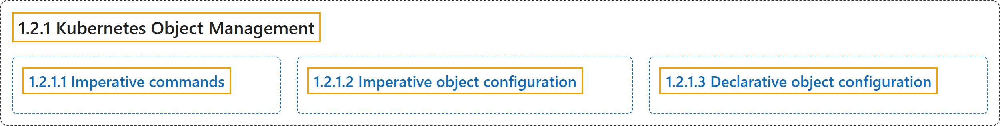

# 1.2.1 Kubernetes Object Management

## Classification

## Glossary

| Term | Definition | 中文翻译 | Source |
|---|---|---|---|
| **1.2.1 Kubernetes Object Management** Kubernetes 对象管理 | (context) "**The `kubectl` command-line tool** supports **several different ways** to **create and manage Kubernetes objects**." | （语境）**`kubectl` 命令行工具**支持**多种不同方式**来**创建和管理 Kubernetes 对象**。 | [The Kubernetes Authors, n.d., "Kubernetes Object Management", para. 1](https://kubernetes.io/docs/concepts/overview/working-with-objects/object-management/#:~:text=The%20%60kubectl%60%20command-line%20tool%20supports%20several%20different) |
| **1.2.1.1 Imperative commands** 指令式命令 | "When using **imperative commands**, a user **operates directly** on **live objects in a cluster**." | 使用**指令式命令**时，用户**直接操作**的是**集群中的活动对象**。 | [The Kubernetes Authors, n.d., "Imperative commands", para. 1](https://kubernetes.io/docs/concepts/overview/working-with-objects/object-management/#:~:text=When%20using%20imperative%20commands%2C%20a%20user%20operates) |
| **1.2.1.2 Imperative object configuration** 指令式对象配置 | "In **imperative object configuration**, the kubectl command specifies **the operation (create, replace, etc.)**, optional flags and **at least one file name**." | 在**指令式对象配置**中，kubectl 命令指定**操作**（create、replace 等）、可选标志以及**至少一个文件名**。 | [The Kubernetes Authors, n.d., "Imperative object configuration", para. 1](https://kubernetes.io/docs/concepts/overview/working-with-objects/object-management/#:~:text=In%20imperative%20object%20configuration%2C%20the%20kubectl%20command) |
| **1.2.1.3 Declarative object configuration** 声明式对象配置 | "When using **declarative object configuration**, a user operates on **object configuration files stored locally**, however the user **does not define the operations** to be taken on the files." | 使用**声明式对象配置**时，用户操作**存储在本地的对象配置文件**，但**不定义要执行的操作**。 | [The Kubernetes Authors, n.d., "Declarative object configuration", para. 1](https://kubernetes.io/docs/concepts/overview/working-with-objects/object-management/#:~:text=When%20using%20declarative%20object%20configuration%2C%20a%20user) |

## References

The Kubernetes Authors. (n.d.). *Kubernetes Object Management*. Kubernetes Documentation. Retrieved October 31, 2026, from <https://kubernetes.io/docs/concepts/overview/working-with-objects/object-management/>
