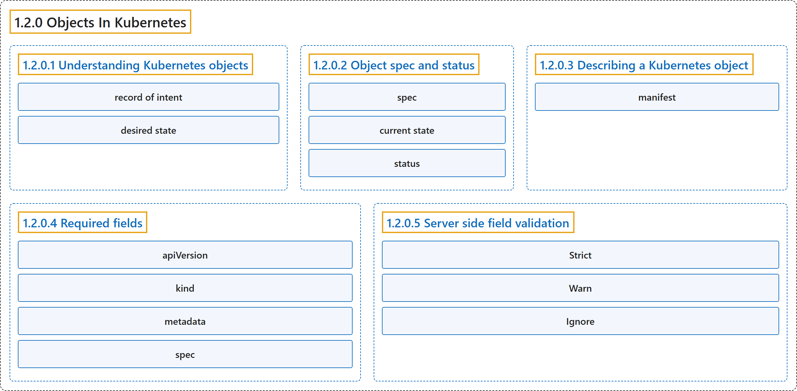

# 1.2.0 Objects In Kubernetes

## Classification

## Glossary

| Term | Definition | 中文翻译 | Source |
|---|---|---|---|
| **1.2.0 Objects In Kubernetes** Kubernetes 中的对象 | "Kubernetes objects are **persistent entities in the Kubernetes system**." | Kubernetes 对象是 **Kubernetes 系统中的持久化实体**。 | [The Kubernetes Authors, n.d., "Objects In Kubernetes", para. 1](https://kubernetes.io/docs/concepts/overview/working-with-objects/#:~:text=Kubernetes%20objects%20are%20persistent%20entities%20in%20the) |
| **1.2.0.1 Understanding Kubernetes objects** 理解 Kubernetes 对象 | (context) "Kubernetes uses these entities to **represent the state of your cluster**." | （语境）Kubernetes 用这些实体来**表示集群的状态**。 | [The Kubernetes Authors, n.d., "Objects In Kubernetes", para. 1](https://kubernetes.io/docs/concepts/overview/working-with-objects/#:~:text=Kubernetes%20uses%20these%20entities%20to%20represent%20the) |
| **record of intent** 意图记录 | "A Kubernetes object is a **"record of intent"--once you create the object, the Kubernetes system will constantly work to ensure that the object exists**." | Kubernetes 对象是一份**“意图记录”：一旦你创建了对象，Kubernetes 系统就会持续工作，确保该对象存在**。 | [The Kubernetes Authors, n.d., "Understanding Kubernetes objects", para. 5](https://kubernetes.io/docs/concepts/overview/working-with-objects/#:~:text=A%20Kubernetes%20object%20is%20a%20%22record%20of) |
| **desired state** 期望状态 | "By creating an object, you're effectively telling the Kubernetes system **what you want your cluster's workload to look like**; this is your cluster's *desired state*." | 通过创建对象，你实际上是在告诉 Kubernetes 系统**你希望集群的工作负载是什么样子**；这就是集群的*期望状态*。 | [The Kubernetes Authors, n.d., "Understanding Kubernetes objects", para. 5](https://kubernetes.io/docs/concepts/overview/working-with-objects/#:~:text=By%20creating%20an%20object%2C%20you%27re%20effectively%20telling) |
| **1.2.0.2 Object spec and status** 对象的规约与状态 | "Almost every Kubernetes object includes **two nested object fields that govern the object's configuration**: the object *`spec`* and the object *`status`*." | 几乎每个 Kubernetes 对象都包含**两个控制对象配置的嵌套对象字段**：对象 *`spec`* 和对象 *`status`*。 | [The Kubernetes Authors, n.d., "Object spec and status", para. 1](https://kubernetes.io/docs/concepts/overview/working-with-objects/#:~:text=Almost%20every%20Kubernetes%20object%20includes%20two%20nested) |
| **spec** 规约 | "For objects that have a `spec`, you have to set this when you create the object, **providing a description of the characteristics you want the resource to have: its *desired state***." | 对于有 `spec` 的对象，你必须在创建对象时设置它，**描述你希望资源具备的特征，也就是它的*期望状态***。 | [The Kubernetes Authors, n.d., "Object spec and status", para. 1](https://kubernetes.io/docs/concepts/overview/working-with-objects/#:~:text=For%20objects%20that%20have%20a%20%60spec%60%2C%20you) |
| **current state** 当前状态 | "The `status` describes **the *current state* of the object**, supplied and updated by the Kubernetes system and its components." | `status` 描述**对象的*当前状态***，由 Kubernetes 系统及其组件提供和更新。 | [The Kubernetes Authors, n.d., "Object spec and status", para. 2](https://kubernetes.io/docs/concepts/overview/working-with-objects/#:~:text=The%20%60status%60%20describes%20the%20%2Acurrent%20state%2A%20of) |
| **status** 状态 | "The `status` describes **the *current state* of the object, supplied and updated by the Kubernetes system and its components**." | `status` 描述**对象的*当前状态*，由 Kubernetes 系统及其组件提供和更新**。 | [The Kubernetes Authors, n.d., "Object spec and status", para. 2](https://kubernetes.io/docs/concepts/overview/working-with-objects/#:~:text=The%20%60status%60%20describes%20the%20%2Acurrent%20state%2A%20of) |
| **1.2.0.3 Describing a Kubernetes object** 描述 Kubernetes 对象 | (context) "When you create an object in Kubernetes, you must provide **the object spec that describes its desired state, as well as some basic information about the object** (such as a name)." | （语境）在 Kubernetes 中创建对象时，你必须提供**描述其期望状态的对象规约，以及对象的一些基本信息**（例如名称）。 | [The Kubernetes Authors, n.d., "Describing a Kubernetes object", para. 1](https://kubernetes.io/docs/concepts/overview/working-with-objects/#:~:text=When%20you%20create%20an%20object%20in%20Kubernetes%2C) |
| **manifest** 清单 | (context) "Most often, you provide the information to `kubectl` in **a file known as a *manifest***." | （语境）最常见的做法是，你在**一个称为*清单*的文件**中把这些信息提供给 `kubectl`。 | [The Kubernetes Authors, n.d., "Describing a Kubernetes object", para. 1](https://kubernetes.io/docs/concepts/overview/working-with-objects/#:~:text=Most%20often%2C%20you%20provide%20the%20information%20to) |
| **1.2.0.4 Required fields** 必需字段 | (context) "In the manifest (YAML or JSON file) for the Kubernetes object you want to create, **you'll need to set values for the following fields**:" | （语境）在你要创建的 Kubernetes 对象的清单（YAML 或 JSON 文件）中，**你需要为以下字段设置值**： | [The Kubernetes Authors, n.d., "Required fields", para. 1](https://kubernetes.io/docs/concepts/overview/working-with-objects/#:~:text=In%20the%20manifest%20%28YAML%20or%20JSON%20file%29) |
| **apiVersion** apiVersion | "`apiVersion` - **Which version of the Kubernetes API you're using to create this object**" | `apiVersion`：**你用来创建此对象的 Kubernetes API 版本** | [The Kubernetes Authors, n.d., "Required fields", para. 2](https://kubernetes.io/docs/concepts/overview/working-with-objects/#:~:text=%60apiVersion%60%20-%20Which%20version%20of%20the%20Kubernetes) |
| **kind** kind | "`kind` - **What kind of object you want to create**" | `kind`：**你想创建的对象类型** | [The Kubernetes Authors, n.d., "Required fields", para. 3](https://kubernetes.io/docs/concepts/overview/working-with-objects/#:~:text=%60kind%60%20-%20What%20kind%20of%20object%20you) |
| **metadata** metadata | "`metadata` - **Data that helps uniquely identify the object**, including a `name` string, `UID`, and optional `namespace`" | `metadata`：**帮助唯一标识对象的数据**，包括 `name` 字符串、`UID` 和可选的 `namespace` | [The Kubernetes Authors, n.d., "Required fields", para. 4](https://kubernetes.io/docs/concepts/overview/working-with-objects/#:~:text=%60metadata%60%20-%20Data%20that%20helps%20uniquely%20identify) |
| **spec** spec | "`spec` - **What state you desire for the object**" | `spec`：**你期望对象处于的状态** | [The Kubernetes Authors, n.d., "Required fields", para. 5](https://kubernetes.io/docs/concepts/overview/working-with-objects/#:~:text=%60spec%60%20-%20What%20state%20you%20desire%20for) |
| **1.2.0.5 Server side field validation** 服务器端字段校验 | "Starting with Kubernetes v1.25, the API server offers server side [field validation](https://kubernetes.io/docs/reference/using-api/api-concepts/#field-validation) that **detects unrecognized or duplicate fields in an object**." | 从 Kubernetes v1.25 开始，API 服务器提供服务器端[字段校验](https://kubernetes.io/docs/reference/using-api/api-concepts/#field-validation)，**检测对象中无法识别或重复的字段**。 | [The Kubernetes Authors, n.d., "Server side field validation", para. 1](https://kubernetes.io/docs/concepts/overview/working-with-objects/#:~:text=Starting%20with%20Kubernetes%20v1.25%2C%20the%20API%20server) |
| **Strict** Strict | "**Strict field validation, errors on validation failure**" | **严格的字段校验，校验失败时报错** | [The Kubernetes Authors, n.d., "Server side field validation", para. 4](https://kubernetes.io/docs/concepts/overview/working-with-objects/#:~:text=Strict%20field%20validation%2C%20errors%20on%20validation%20failure) |
| **Warn** Warn | "**Field validation is performed, but errors are exposed as warnings rather than failing the request**" | **执行字段校验，但错误以警告形式暴露，而不会让请求失败** | [The Kubernetes Authors, n.d., "Server side field validation", para. 6](https://kubernetes.io/docs/concepts/overview/working-with-objects/#:~:text=Field%20validation%20is%20performed%2C%20but%20errors%20are) |
| **Ignore** Ignore | "**No server side field validation is performed**" | **不执行服务器端字段校验** | [The Kubernetes Authors, n.d., "Server side field validation", para. 8](https://kubernetes.io/docs/concepts/overview/working-with-objects/#:~:text=No%20server%20side%20field%20validation%20is%20performed) |

## References

The Kubernetes Authors. (n.d.). *Objects In Kubernetes*. Kubernetes Documentation. Retrieved October 31, 2026, from <https://kubernetes.io/docs/concepts/overview/working-with-objects/>
