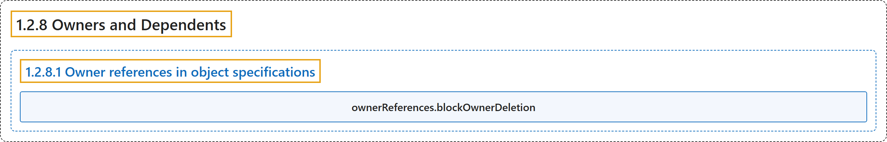

# 1.2.8 Owners and Dependents

## Classification

## Glossary

| Term | Definition | 中文翻译 | Source |
|---|---|---|---|
| **1.2.8 Owners and Dependents** 属主与附属 | "In Kubernetes, some [objects](https://kubernetes.io/docs/concepts/overview/working-with-objects/#kubernetes-objects) are ***owners* of other objects**." | 在 Kubernetes 中，有些[对象](https://kubernetes.io/docs/concepts/overview/working-with-objects/#kubernetes-objects)是**其他对象的*属主***。 | [The Kubernetes Authors, n.d., "Owners and Dependents", para. 1](https://kubernetes.io/docs/concepts/overview/working-with-objects/owners-dependents/#:~:text=In%20Kubernetes%2C%20some%20%5Bobjects%5D%28https%3A%2F%2Fkubernetes.io%2Fdocs%2Fconcepts%2Foverview%2Fworking-with-objects%2F%23kubernetes-objects%29%20are%20%2Aowners%2A%20of) |
| **1.2.8.1 Owner references in object specifications** 对象规约中的属主引用 | "Dependent objects have **a `metadata.ownerReferences` field that references their owner object**." | 附属对象有**一个引用其属主对象的 `metadata.ownerReferences` 字段**。 | [The Kubernetes Authors, n.d., "Owner references in object specifications", para. 1](https://kubernetes.io/docs/concepts/overview/working-with-objects/owners-dependents/#:~:text=Dependent%20objects%20have%20a%20%60metadata.ownerReferences%60%20field%20that) |
| **ownerReferences.blockOwnerDeletion** ownerReferences.blockOwnerDeletion | "Dependent objects also have an `ownerReferences.blockOwnerDeletion` field that **takes a boolean value and controls whether specific dependents can block garbage collection from deleting their owner object**." | 附属对象还有一个 `ownerReferences.blockOwnerDeletion` 字段，**取布尔值，控制特定附属对象能否阻止垃圾回收删除其属主对象**。 | [The Kubernetes Authors, n.d., "Owner references in object specifications", para. 2](https://kubernetes.io/docs/concepts/overview/working-with-objects/owners-dependents/#:~:text=Dependent%20objects%20also%20have%20an%20%60ownerReferences.blockOwnerDeletion%60%20field) |

## References

The Kubernetes Authors. (n.d.). *Owners and Dependents*. Kubernetes Documentation. Retrieved October 31, 2026, from <https://kubernetes.io/docs/concepts/overview/working-with-objects/owners-dependents/>
