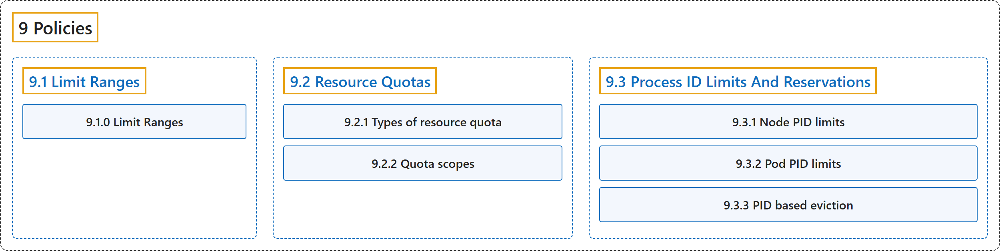

# 9 Policies

## Classification

## Glossary

| Term | Definition | 中文翻译 | Source |
|---|---|---|---|
| **9 Policies** 策略 | (context) "**Manage security and best-practices** with **policies**." | （语境）**管理安全和最佳实践**，靠的是**策略**。 | [The Kubernetes Authors, n.d.-b, "Policies", para. 1](https://kubernetes.io/docs/concepts/policy/#:~:text=Manage%20security%20and%20best-practices%20with%20policies.) |
| **[9.1 Limit Ranges](limit-range.md)** 限制范围 | "A LimitRange is **a policy to constrain the resource allocations (limits and requests)** that you can specify for **each applicable object kind** (such as Pod or PersistentVolumeClaim) in a namespace." | LimitRange 是**一种策略，用来约束资源分配（限制和请求）**，这些分配是你可以为**每种适用对象类型**指定的（例如命名空间中的 Pod 或 PersistentVolumeClaim）。 | [The Kubernetes Authors, n.d.-a, "Limit Ranges", para. 2](https://kubernetes.io/docs/concepts/policy/limit-range/#:~:text=A%20LimitRange%20is%20a%20policy%20to%20constrain) |
| **[9.2 Resource Quotas](resource-quotas.md)** 资源配额 | (context) "*Resource quotas* are **a tool for administrators** to **address this concern**." | （语境）*资源配额*是**管理员的一种工具**，用来**解决这一问题**。 | [The Kubernetes Authors, n.d.-d, "Resource Quotas", para. 2](https://kubernetes.io/docs/concepts/policy/resource-quotas/#:~:text=%2AResource%20quotas%2A%20are%20a%20tool%20for%20administrators) |
| **[9.3 Process ID Limits And Reservations](pid-limiting.md)** 进程 ID 限制与预留 | (context) "Kubernetes allow you to **limit the number of process IDs (PIDs)** that **a Pod can use**." | （语境）Kubernetes 允许你**限制进程 ID（PID）的数量**，即**一个 Pod 可使用的数量**。 | [The Kubernetes Authors, n.d.-c, "Process ID Limits And Reservations", para. 1](https://kubernetes.io/docs/concepts/policy/pid-limiting/#:~:text=Kubernetes%20allow%20you%20to%20limit%20the%20number) |

## References

The Kubernetes Authors. (n.d.-a). *Limit Ranges*. Kubernetes Documentation. Retrieved October 31, 2026, from <https://kubernetes.io/docs/concepts/policy/limit-range/>

The Kubernetes Authors. (n.d.-b). *Policies*. Kubernetes Documentation. Retrieved October 31, 2026, from <https://kubernetes.io/docs/concepts/policy/>

The Kubernetes Authors. (n.d.-c). *Process ID Limits And Reservations*. Kubernetes Documentation. Retrieved October 31, 2026, from <https://kubernetes.io/docs/concepts/policy/pid-limiting/>

The Kubernetes Authors. (n.d.-d). *Resource Quotas*. Kubernetes Documentation. Retrieved October 31, 2026, from <https://kubernetes.io/docs/concepts/policy/resource-quotas/>
