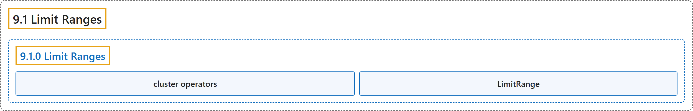

# 9.1 Limit Ranges

## Classification

## Glossary

| Term | Definition | 中文翻译 | Source |
|---|---|---|---|
| **9.1 Limit Ranges** 限制范围 | "A LimitRange is **a policy to constrain the resource allocations (limits and requests)** that you can specify for **each applicable object kind** (such as Pod or PersistentVolumeClaim) in a namespace." | LimitRange 是**一种策略，用来约束资源分配（限制和请求）**，这些分配是你可以为**每种适用对象类型**指定的（例如命名空间中的 Pod 或 PersistentVolumeClaim）。 | [The Kubernetes Authors, n.d., "Limit Ranges", para. 2](https://kubernetes.io/docs/concepts/policy/limit-range/#:~:text=A%20LimitRange%20is%20a%20policy%20to%20constrain) |
| **9.1.0 Limit Ranges** 限制范围 | (No definition) | （无定义） | [The Kubernetes Authors, n.d., "Limit Ranges"](https://kubernetes.io/docs/concepts/policy/limit-range/#limit-ranges) |
| **cluster operators** 集群运维人员 | (context) "Using Kubernetes resource quotas, **administrators** (also termed *cluster operators*) can **restrict consumption and creation of cluster resources**" | （语境）借助 Kubernetes 资源配额，**管理员**（也称*集群运维人员*）可以**限制集群资源的消耗和创建** | [The Kubernetes Authors, n.d., "Limit Ranges", para. 1](https://kubernetes.io/docs/concepts/policy/limit-range/#:~:text=Using%20Kubernetes%20%5Bresource%20quotas%5D%28https%3A%2F%2Fkubernetes.io%2Fdocs%2Fconcepts%2Fpolicy%2Fresource-quotas%2F%29%2C%20administrators%20%28also%20termed) |
| **LimitRange** LimitRange | (context) "A *LimitRange* **provides constraints** that can:" | （语境）*LimitRange* **提供的约束**可以： | [The Kubernetes Authors, n.d., "Limit Ranges", para. 3](https://kubernetes.io/docs/concepts/policy/limit-range/#:~:text=A%20%2ALimitRange%2A%20provides%20constraints%20that%20can%3A) |

## References

The Kubernetes Authors. (n.d.). *Limit Ranges*. Kubernetes Documentation. Retrieved October 31, 2026, from <https://kubernetes.io/docs/concepts/policy/limit-range/>
